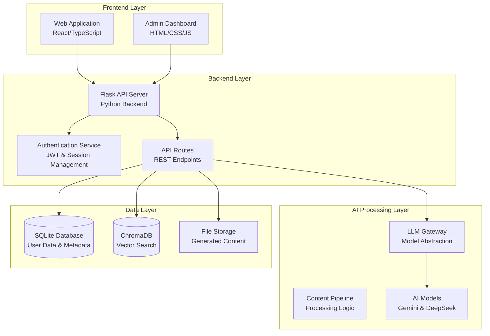
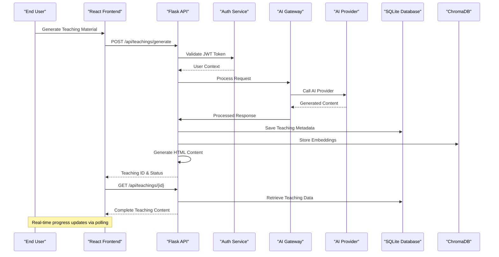
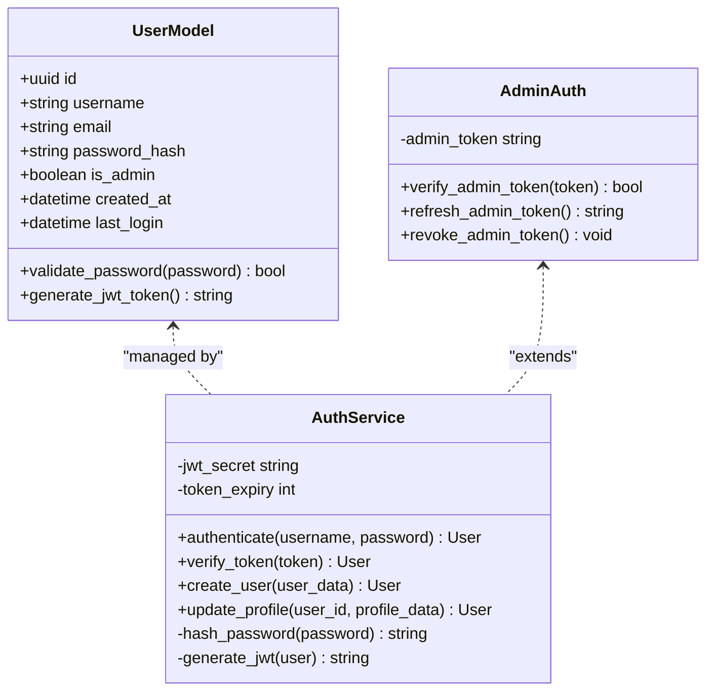
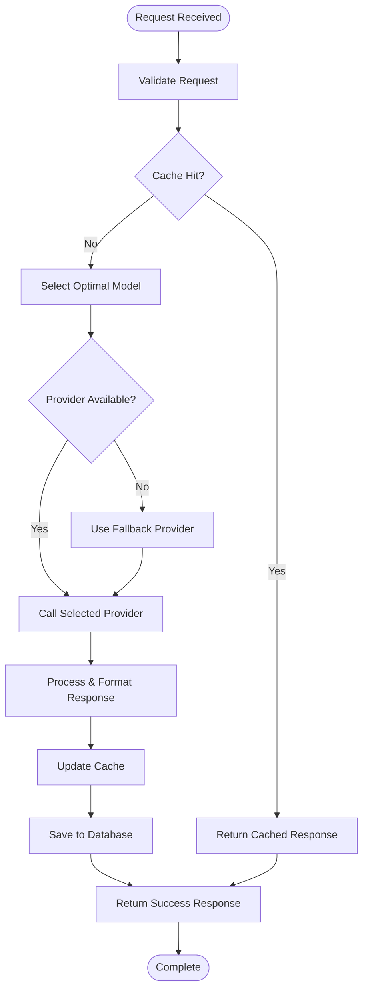
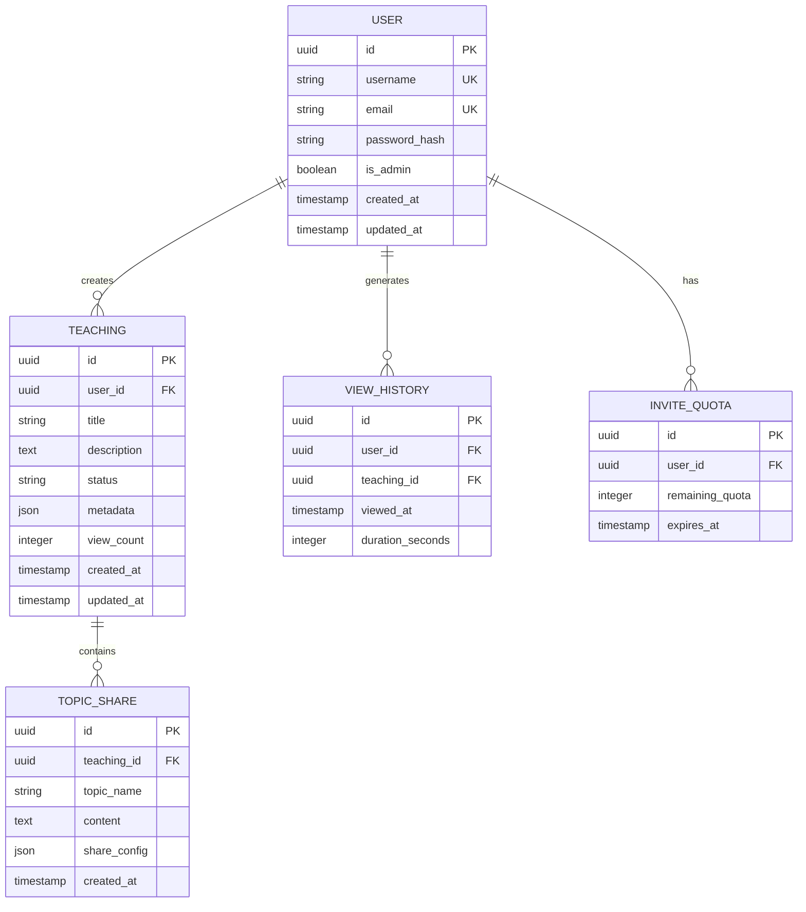
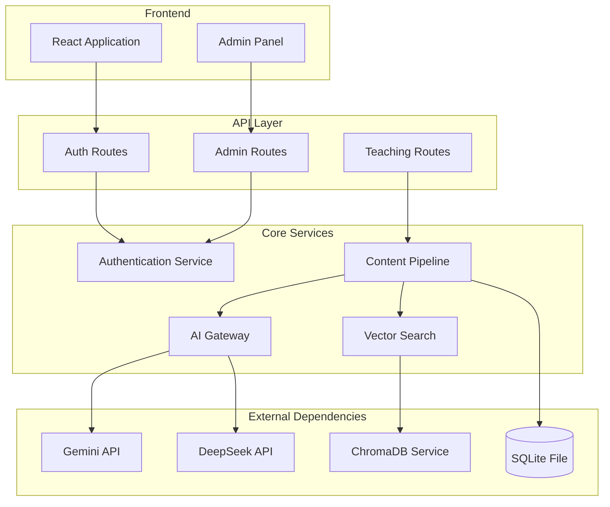
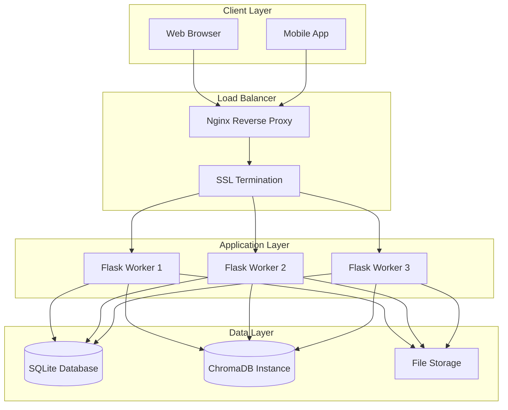

# Overall System Design

<cite>
**Referenced Files in This Document**
- [backend/app.py](file://backend/app.py)
- [backend/config.py](file://backend/config.py)
- [backend/gateway_llm.py](file://backend/gateway_llm.py)
- [backend/database/models.py](file://backend/database/models.py)
- [backend/pipeline.py](file://backend/pipeline.py)
- [backend/auth.py](file://backend/auth.py)
- [backend/ai_teacher_route.py](file://backend/ai_teacher_route.py)
- [web/src/App.tsx](file://web/src/App.tsx)
- [web/src/lib/api.ts](file://web/src/lib/api.ts)
- [web/package.json](file://web/package.json)
- [deploy/nginx.conf](file://deploy/nginx.conf)
- [deploy/deploy.sh](file://deploy/deploy.sh)
</cite>

## Table of Contents
1. [Introduction](#introduction)
2. [Project Structure](#project-structure)
3. [Core Components](#core-components)
4. [Architecture Overview](#architecture-overview)
5. [Detailed Component Analysis](#detailed-component-analysis)
6. [Dependency Analysis](#dependency-analysis)
7. [Performance Considerations](#performance-considerations)
8. [Deployment Topology](#deployment-topology)
9. [Scalability Considerations](#scalability-considerations)
10. [Troubleshooting Guide](#troubleshooting-guide)
11. [Conclusion](#conclusion)

## Introduction

The XSYY Edu platform is a comprehensive AI-powered educational content generation system that combines modern web technologies with advanced artificial intelligence capabilities. The platform enables users to generate interactive teaching materials through natural language prompts, leveraging multiple AI model providers including Gemini and DeepSeek for content creation and analysis.

The system follows a microservices-inspired architecture with clear separation between the React frontend application, Flask backend services, and AI processing pipeline. It incorporates vector search capabilities through ChromaDB for intelligent content retrieval and maintains data persistence using SQLite database with structured schema management.

## Project Structure

The XSYY Edu platform is organized into three primary layers:

**Diagram sources**
- [backend/app.py](file://backend/app.py)
- [web/src/App.tsx](file://web/src/App.tsx)
- [backend/gateway_llm.py](file://backend/gateway_llm.py)

**Section sources**
- [backend/app.py](file://backend/app.py)
- [web/src/App.tsx](file://web/src/App.tsx)

## Core Components

### Backend Architecture

The Flask-based backend serves as the central orchestration layer, managing API endpoints, authentication, business logic, and integration with external AI services. Key components include:

- **Application Factory**: Centralized Flask app initialization and configuration management
- **Authentication Module**: JWT-based user authentication and session management
- **AI Gateway**: Unified interface for multiple LLM providers (Gemini, DeepSeek)
- **Database Layer**: SQLAlchemy ORM with SQLite backend and migration management
- **Vector Search**: ChromaDB integration for semantic content retrieval
- **Content Pipeline**: Processing workflow for AI-generated educational content

### Frontend Architecture

The React-based frontend provides both user-facing interfaces and administrative dashboards:

- **Main Application**: Interactive teaching material generation interface
- **Admin Dashboard**: Content management and system monitoring
- **State Management**: Local storage and API state synchronization
- **Component Library**: Reusable UI components for consistent user experience

### AI Processing Pipeline

The AI processing layer abstracts multiple model providers behind a unified gateway:

- **Model Abstraction**: Consistent interface across different AI providers
- **Prompt Engineering**: Structured prompt templates for educational content
- **Response Processing**: Content validation and formatting
- **Cost Optimization**: Intelligent model selection based on task complexity

**Section sources**
- [backend/app.py](file://backend/app.py)
- [backend/config.py](file://backend/config.py)
- [backend/gateway_llm.py](file://backend/gateway_llm.py)
- [backend/database/models.py](file://backend/database/models.py)

## Architecture Overview

The XSYY Edu platform implements a layered architecture with clear separation of concerns:

**Diagram sources**
- [backend/ai_teacher_route.py](file://backend/ai_teacher_route.py)
- [backend/gateway_llm.py](file://backend/gateway_llm.py)
- [web/src/lib/api.ts](file://web/src/lib/api.ts)

### Technology Stack

| Component | Technology | Purpose |
|-----------|------------|---------|
| **Frontend Framework** | React 18 + TypeScript | Modern UI development with type safety |
| **Build Tool** | Vite | Fast development and optimized builds |
| **Styling** | Tailwind CSS | Utility-first CSS framework |
| **Backend Framework** | Flask | Lightweight Python web framework |
| **Database** | SQLite | Embedded relational database |
| **Vector Database** | ChromaDB | Semantic search and similarity matching |
| **AI Providers** | Gemini API, DeepSeek API | Multi-provider AI content generation |
| **Authentication** | JWT Tokens | Stateless user authentication |
| **Deployment** | Nginx + systemd | Production server configuration |

**Section sources**
- [web/package.json](file://web/package.json)
- [backend/requirements.txt](file://backend/requirements.txt)

## Detailed Component Analysis

### Authentication System

The authentication system implements JWT-based stateless authentication with role-based access control:

**Diagram sources**
- [backend/auth.py](file://backend/auth.py)
- [backend/admin_auth.py](file://backend/admin_auth.py)

### AI Gateway Architecture

The AI gateway provides abstraction over multiple AI providers with intelligent routing and fallback mechanisms:

**Diagram sources**
- [backend/gateway_llm.py](file://backend/gateway_llm.py)
- [backend/cost_optimization_demo/main_service.py](file://backend/cost_optimization_demo/main_service.py)

### Database Schema Design

The database schema supports comprehensive educational content management:

**Diagram sources**
- [backend/database/models.py](file://backend/database/models.py)
- [backend/database/schema.sql](file://backend/database/schema.sql)

**Section sources**
- [backend/auth.py](file://backend/auth.py)
- [backend/gateway_llm.py](file://backend/gateway_llm.py)
- [backend/database/models.py](file://backend/database/models.py)

## Dependency Analysis

The system exhibits well-defined dependency patterns with clear separation between layers:

**Diagram sources**
- [backend/app.py](file://backend/app.py)
- [backend/gateway_llm.py](file://backend/gateway_llm.py)
- [web/src/lib/api.ts](file://web/src/lib/api.ts)

### External Service Integration

| Service | Type | Integration Method | Fallback Strategy |
|---------|------|-------------------|-------------------|
| **Gemini API** | AI Provider | HTTP REST API | DeepSeek API |
| **DeepSeek API** | AI Provider | HTTP REST API | Gemini API |
| **ChromaDB** | Vector Database | Python Client | In-memory cache |
| **SQLite** | Relational Database | SQLAlchemy ORM | Local file backup |

**Section sources**
- [backend/gateway_llm.py](file://backend/gateway_llm.py)
- [backend/utils/vector_db.py](file://backend/utils/vector_db.py)

## Performance Considerations

### Caching Strategy

The system implements multi-level caching to optimize performance:

- **Response Cache**: Redis-backed caching for frequently accessed teachings
- **Vector Cache**: ChromaDB for semantic similarity searches
- **Template Cache**: Compiled HTML templates for rapid rendering
- **Session Cache**: JWT token validation results

### Database Optimization

- **Indexing Strategy**: Strategic indexes on frequently queried fields
- **Connection Pooling**: Efficient database connection management
- **Query Optimization**: Parameterized queries and batch operations
- **Migration Management**: Version-controlled schema evolution

### AI Processing Optimization

- **Model Selection**: Intelligent routing based on task complexity
- **Batch Processing**: Grouped requests for improved throughput
- **Streaming Responses**: Real-time progress updates for long-running tasks
- **Error Handling**: Graceful degradation when providers are unavailable

## Deployment Topology

The production deployment utilizes a containerized architecture with reverse proxy configuration:

**Diagram sources**
- [deploy/nginx.conf](file://deploy/nginx.conf)
- [deploy/deploy.sh](file://deploy/deploy.sh)

### Infrastructure Requirements

| Component | Minimum Specs | Recommended Specs | Purpose |
|-----------|---------------|-------------------|---------|
| **Application Server** | 2 CPU, 4GB RAM | 4 CPU, 8GB RAM | Flask application workers |
| **Database Server** | 1 CPU, 2GB RAM | 2 CPU, 4GB RAM | SQLite file storage |
| **Vector Database** | 1 CPU, 2GB RAM | 2 CPU, 4GB RAM | ChromaDB instance |
| **Storage** | 10GB SSD | 50GB SSD | Generated content files |
| **Network** | 100Mbps | 1Gbps | API response delivery |

**Section sources**
- [deploy/nginx.conf](file://deploy/nginx.conf)
- [deploy/deploy.sh](file://deploy/deploy.sh)

## Scalability Considerations

### Horizontal Scaling

The Flask application supports horizontal scaling through:

- **Stateless Design**: No local session storage, all state in database
- **Worker Processes**: Multiple Gunicorn workers per application instance
- **Load Balancing**: Nginx distributes requests across worker instances
- **Database Sharding**: Potential for future read replicas

### Vertical Scaling

For increased capacity within single instances:

- **Memory Optimization**: Efficient memory usage patterns
- **Connection Pooling**: Optimized database and API connections
- **Caching Layers**: Multi-level caching to reduce external dependencies
- **Async Processing**: Background job queue for heavy operations

### Cloud Deployment Patterns

- **Container Orchestration**: Docker containers with Kubernetes support
- **Auto-scaling**: Dynamic scaling based on request volume
- **Service Discovery**: Automatic service registration and discovery
- **Health Monitoring**: Comprehensive health checks and metrics

## Troubleshooting Guide

### Common Issues and Solutions

| Issue | Symptoms | Solution |
|-------|----------|----------|
| **AI Provider Timeout** | Slow responses, error messages | Implement retry logic, check API quotas |
| **Database Lock Errors** | Concurrent write failures | Use WAL mode, implement connection pooling |
| **Memory Leaks** | Increasing memory usage | Monitor process memory, restart workers periodically |
| **Vector Search Failures** | Similarity search errors | Check ChromaDB connectivity, rebuild indexes |

### Monitoring and Logging

- **Application Metrics**: Request latency, error rates, throughput
- **AI Provider Health**: API availability, response times, cost tracking
- **Database Performance**: Query execution times, connection pool utilization
- **System Resources**: CPU, memory, disk I/O monitoring

### Debug Tools

- **API Testing Suite**: Comprehensive endpoint testing
- **Performance Profiling**: Bottleneck identification
- **Error Tracking**: Centralized error logging and alerting
- **Health Checks**: Automated service availability monitoring

**Section sources**
- [backend/monitoring.py](file://backend/monitoring.py)
- [backend/tests/integration/test_api_health.py](file://backend/tests/integration/test_api_health.py)

## Conclusion

The XSYY Edu platform demonstrates a well-architected approach to AI-powered educational content generation. The clear separation between frontend, backend, and AI processing layers enables independent scaling and maintenance. The multi-provider AI gateway ensures resilience and cost optimization, while the comprehensive caching strategy delivers responsive user experiences.

The system's modular design facilitates future enhancements, including additional AI provider integration, advanced analytics capabilities, and expanded content types. The deployment topology supports both small-scale deployments and enterprise-grade scalability requirements.

Key strengths include the robust authentication system, intelligent model routing, efficient vector search capabilities, and comprehensive monitoring infrastructure. The platform successfully balances performance, reliability, and maintainability while providing a solid foundation for educational content generation at scale.