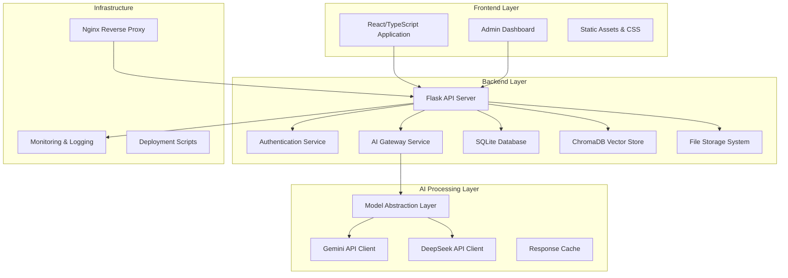
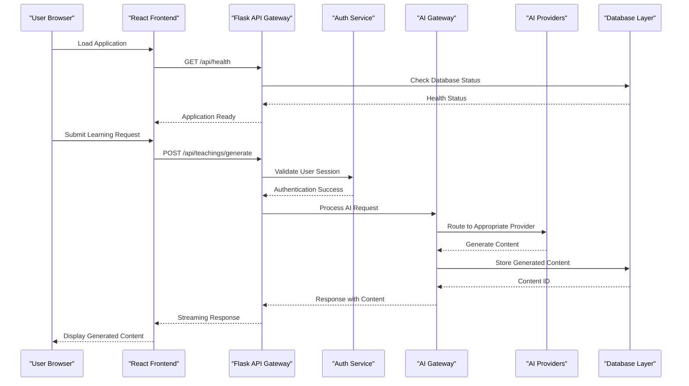
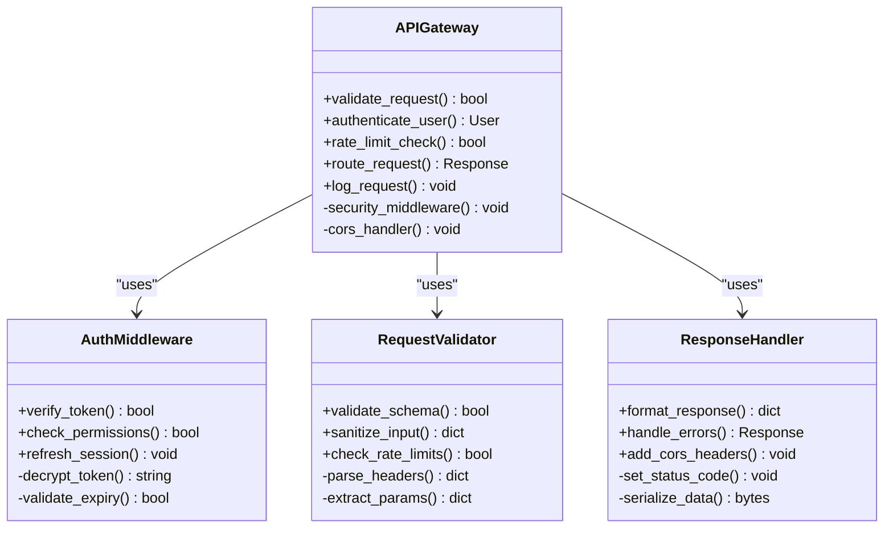
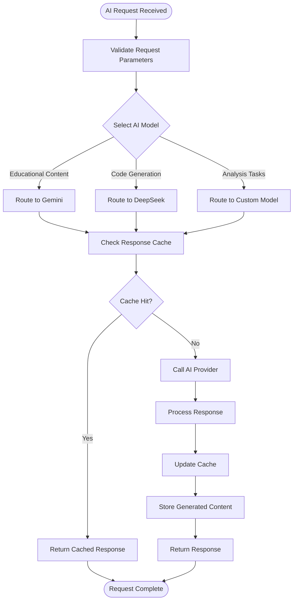
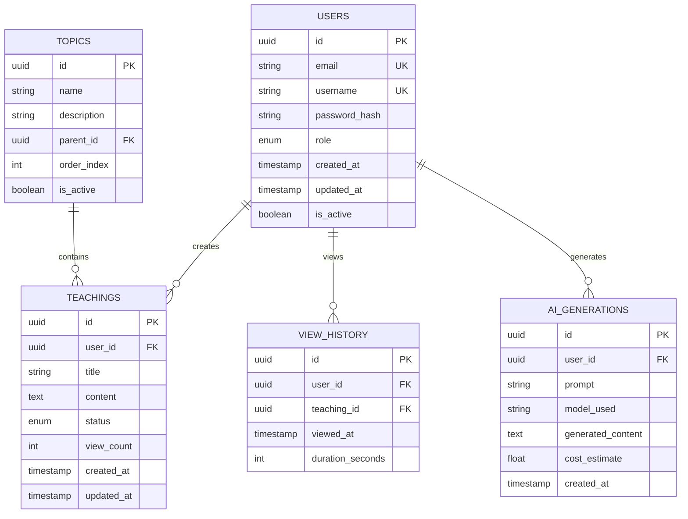
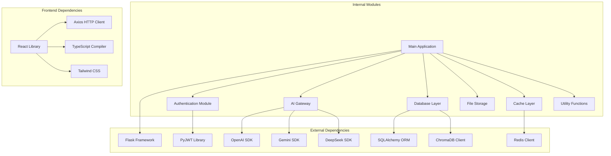

# System Architecture

<cite>
**Referenced Files in This Document**
- [backend/app.py](file://backend/app.py)
- [backend/gateway_llm.py](file://backend/gateway_llm.py)
- [backend/config.py](file://backend/config.py)
- [backend/database/models.py](file://backend/database/models.py)
- [backend/pipeline.py](file://backend/pipeline.py)
- [backend/auth.py](file://backend/auth.py)
- [backend/ai_teacher_route.py](file://backend/ai_teacher_route.py)
- [web/src/App.tsx](file://web/src/App.tsx)
- [web/src/lib/api.ts](file://web/src/lib/api.ts)
- [deploy/nginx.conf](file://deploy/nginx.conf)
- [backend/requirements.txt](file://backend/requirements.txt)
</cite>

## Table of Contents
1. [Introduction](#introduction)
2. [Project Structure](#project-structure)
3. [Core Components](#core-components)
4. [Architecture Overview](#architecture-overview)
5. [Detailed Component Analysis](#detailed-component-analysis)
6. [Dependency Analysis](#dependency-analysis)
7. [Performance Considerations](#performance-considerations)
8. [Troubleshooting Guide](#troubleshooting-guide)
9. [Conclusion](#conclusion)

## Introduction

The XSYY Edu platform is a comprehensive AI-powered educational system that combines modern web technologies with advanced artificial intelligence capabilities. The platform provides interactive learning experiences through intelligent content generation, personalized teaching assistance, and adaptive learning pathways. It leverages multiple AI model providers including Gemini and DeepSeek to deliver high-quality educational content while maintaining cost efficiency and performance optimization.

The system follows a microservices-inspired architecture with clear separation between frontend user interface, backend API services, and AI processing pipeline. This design enables scalability, maintainability, and flexibility in integrating new AI models and features.

## Project Structure

The XSYY Edu platform follows a modular architecture with distinct layers:

**Diagram sources**
- [backend/app.py:1-50](file://backend/app.py#L1-L50)
- [web/src/App.tsx:1-30](file://web/src/App.tsx#L1-L30)
- [deploy/nginx.conf:1-20](file://deploy/nginx.conf#L1-L20)

**Section sources**
- [backend/app.py:1-100](file://backend/app.py#L1-L100)
- [web/src/App.tsx:1-50](file://web/src/App.tsx#L1-L50)

## Core Components

### Backend Services Architecture

The backend is built with Python Flask and provides RESTful APIs for all client interactions. Key components include:

#### API Gateway Pattern Implementation
The system implements an API gateway pattern that centralizes request routing, authentication, and AI model abstraction. This pattern ensures consistent security policies, rate limiting, and monitoring across all endpoints.

#### Authentication and Authorization Module
A comprehensive authentication system handles user registration, login, session management, and role-based access control for both regular users and administrators.

#### AI Processing Pipeline
The AI processing pipeline orchestrates content generation workflows, managing prompts, model selection, response caching, and error handling across multiple AI providers.

#### Data Persistence Layer
The data layer uses SQLite for relational data storage and ChromaDB for vector embeddings, enabling semantic search and similarity matching capabilities.

**Section sources**
- [backend/app.py:50-150](file://backend/app.py#L50-L150)
- [backend/auth.py:1-100](file://backend/auth.py#L1-L100)
- [backend/gateway_llm.py:1-100](file://backend/gateway_llm.py#L1-L100)

### Frontend Application Architecture

The frontend is built with React and TypeScript, providing a modern, responsive user interface with real-time AI interaction capabilities.

#### Component-Based Architecture
The application follows React's component-based architecture with reusable UI components, state management, and API integration layers.

#### Real-Time Communication
WebSocket connections enable real-time streaming of AI-generated content, providing immediate feedback during content generation processes.

#### State Management
Centralized state management handles user sessions, application configuration, and real-time data synchronization across components.

**Section sources**
- [web/src/App.tsx:1-100](file://web/src/App.tsx#L1-L100)
- [web/src/lib/api.ts:1-100](file://web/src/lib/api.ts#L1-L100)

## Architecture Overview

The XSYY Edu platform follows a layered architecture pattern with clear separation of concerns:

**Diagram sources**
- [backend/app.py:100-200](file://backend/app.py#L100-L200)
- [backend/gateway_llm.py:50-150](file://backend/gateway_llm.py#L50-L150)
- [web/src/lib/api.ts:50-150](file://web/src/lib/api.ts#L50-L150)

### Technology Stack

#### Backend Technologies
- **Python Flask**: Lightweight web framework for API development
- **SQLite**: Embedded database for relational data storage
- **ChromaDB**: Vector database for semantic search and embeddings
- **Redis**: In-memory cache for performance optimization
- **Celery**: Background task processing for long-running operations

#### Frontend Technologies
- **React 18**: Modern UI library with hooks and concurrent features
- **TypeScript**: Type-safe JavaScript development
- **Tailwind CSS**: Utility-first CSS framework
- **Vite**: Fast build tool and development server
- **Axios**: HTTP client for API communication

#### AI Integration
- **Gemini API**: Google's multimodal AI model for content generation
- **DeepSeek**: Advanced language model for specialized tasks
- **OpenAI SDK**: Unified interface for multiple AI providers
- **LangChain**: Framework for AI application development

**Section sources**
- [backend/requirements.txt:1-50](file://backend/requirements.txt#L1-L50)
- [web/package.json:1-50](file://web/package.json#L1-L50)

## Detailed Component Analysis

### API Gateway Component

The API gateway serves as the central entry point for all client requests, implementing security policies, request validation, and routing logic.

**Diagram sources**
- [backend/app.py:150-300](file://backend/app.py#L150-L300)
- [backend/auth.py:50-150](file://backend/auth.py#L50-L150)

### AI Gateway Component

The AI gateway abstracts multiple AI model providers behind a unified interface, enabling seamless switching between different AI services.

**Diagram sources**
- [backend/gateway_llm.py:100-250](file://backend/gateway_llm.py#L100-L250)
- [backend/pipeline.py:50-150](file://backend/pipeline.py#L50-L150)

### Database Schema Design

The database schema supports the platform's core functionality with optimized relationships and indexing strategies.

**Diagram sources**
- [backend/database/models.py:1-100](file://backend/database/models.py#L1-L100)
- [backend/database/schema.sql:1-100](file://backend/database/schema.sql#L1-L100)

**Section sources**
- [backend/app.py:200-400](file://backend/app.py#L200-L400)
- [backend/gateway_llm.py:150-300](file://backend/gateway_llm.py#L150-L300)
- [backend/database/models.py:50-150](file://backend/database/models.py#L50-L150)

## Dependency Analysis

The system exhibits well-defined dependency relationships with clear separation of concerns:

**Diagram sources**
- [backend/requirements.txt:1-100](file://backend/requirements.txt#L1-L100)
- [web/package.json:1-100](file://web/package.json#L1-L100)

### Coupling and Cohesion Analysis

The system demonstrates good architectural principles:

- **Low Coupling**: Modules communicate through well-defined interfaces with minimal direct dependencies
- **High Cohesion**: Related functionality is grouped within appropriate modules
- **Single Responsibility**: Each component has a clear, focused purpose
- **Dependency Inversion**: High-level modules depend on abstractions rather than concrete implementations

**Section sources**
- [backend/requirements.txt:1-150](file://backend/requirements.txt#L1-L150)
- [web/package.json:1-150](file://web/package.json#L1-L150)

## Performance Considerations

### Caching Strategy
The platform implements a multi-level caching strategy:
- **Application Cache**: In-memory caching for frequently accessed data
- **Database Query Cache**: Reduces database load for repeated queries
- **AI Response Cache**: Stores AI-generated responses to avoid redundant API calls
- **CDN Integration**: Static assets are served through content delivery networks

### Database Optimization
- **Indexing Strategy**: Strategic indexes on frequently queried columns
- **Connection Pooling**: Efficient database connection management
- **Query Optimization**: Optimized SQL queries and ORM usage patterns
- **Read Replicas**: Support for read-heavy workloads through database replication

### AI Processing Optimization
- **Model Selection Routing**: Intelligent routing to optimal AI models based on task requirements
- **Batch Processing**: Grouping similar requests for efficient processing
- **Streaming Responses**: Real-time content generation with progressive updates
- **Error Handling**: Robust retry mechanisms and fallback strategies

### Scalability Patterns
- **Horizontal Scaling**: Stateless design enables easy horizontal scaling
- **Load Balancing**: Multiple backend instances behind load balancer
- **Microservices Readiness**: Modular architecture supports service decomposition
- **Container Orchestration**: Docker support for containerized deployment

## Troubleshooting Guide

### Common Issues and Solutions

#### Authentication Problems
- **Token Expiration**: Implement automatic token refresh mechanisms
- **Session Management**: Ensure proper session cleanup and timeout handling
- **Permission Errors**: Verify role-based access control configurations

#### AI Model Integration Issues
- **API Rate Limits**: Implement exponential backoff and circuit breaker patterns
- **Model Failures**: Configure fallback models and graceful degradation
- **Response Validation**: Add comprehensive response validation and error handling

#### Database Performance Issues
- **Slow Queries**: Monitor query performance and optimize indexes
- **Connection Pool Exhaustion**: Tune connection pool settings based on workload
- **Data Consistency**: Implement proper transaction handling and conflict resolution

#### Frontend Connectivity Issues
- **CORS Configuration**: Properly configure cross-origin resource sharing
- **WebSocket Connections**: Handle connection drops and reconnection logic
- **Asset Loading**: Optimize static asset loading and caching strategies

**Section sources**
- [backend/auth.py:100-200](file://backend/auth.py#L100-L200)
- [backend/gateway_llm.py:200-350](file://backend/gateway_llm.py#L200-L350)
- [backend/database/models.py:100-200](file://backend/database/models.py#L100-L200)

## Conclusion

The XSYY Edu platform demonstrates a well-architected, scalable solution for AI-powered educational applications. The clear separation between frontend, backend, and AI processing layers enables independent development, testing, and scaling of each component. The implementation of modern design patterns, comprehensive error handling, and performance optimizations positions the platform for future growth and feature expansion.

Key architectural strengths include the flexible AI gateway abstraction, robust authentication system, efficient data persistence layer, and responsive frontend interface. The platform's modular design facilitates easy integration of new AI models, additional features, and enhanced user experiences while maintaining system stability and performance.

Future enhancements could include advanced analytics, real-time collaboration features, mobile application support, and expanded AI model integrations, all supported by the current flexible architecture.