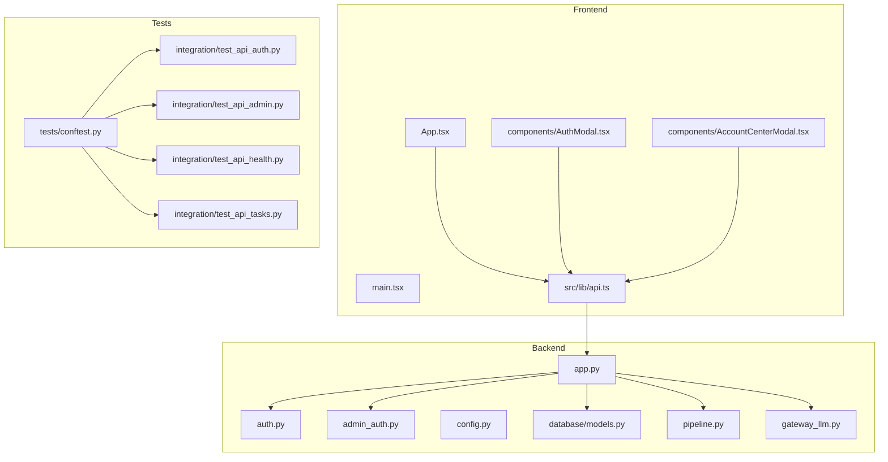
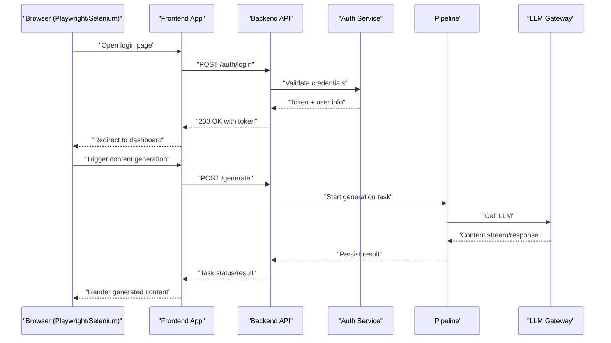
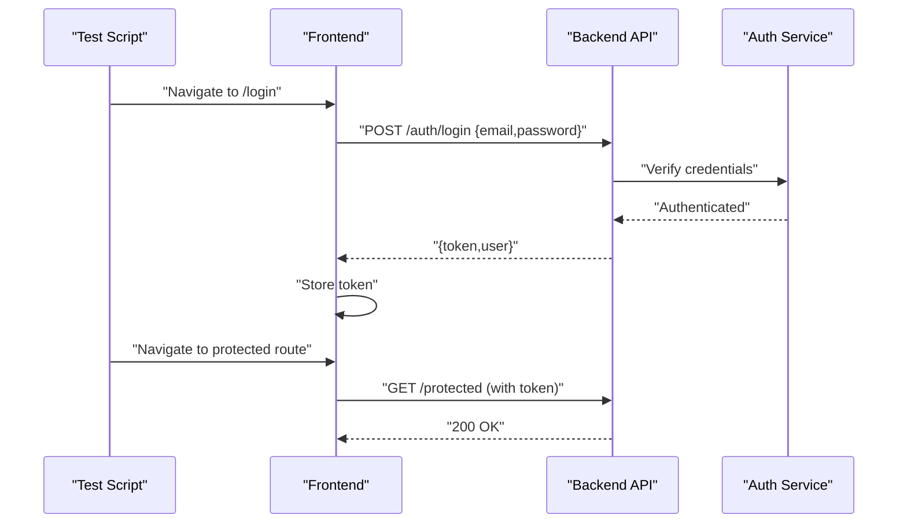
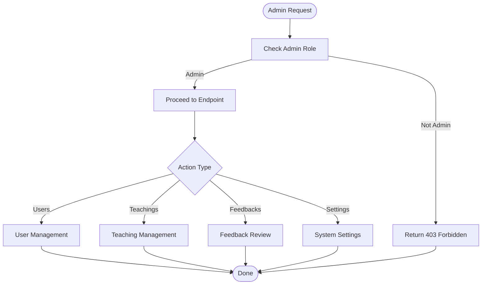
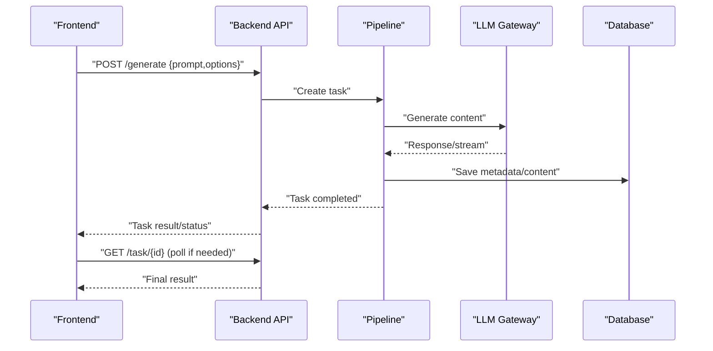
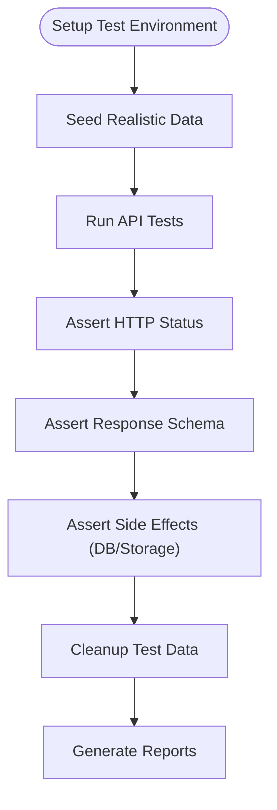
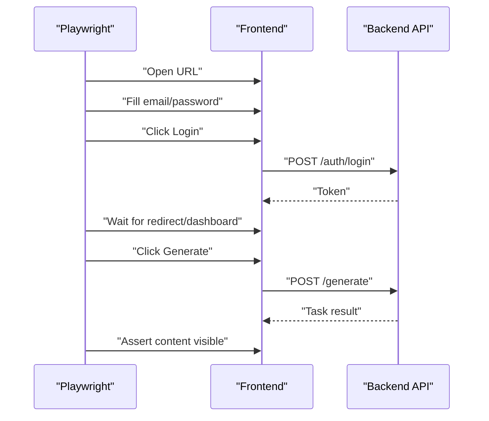
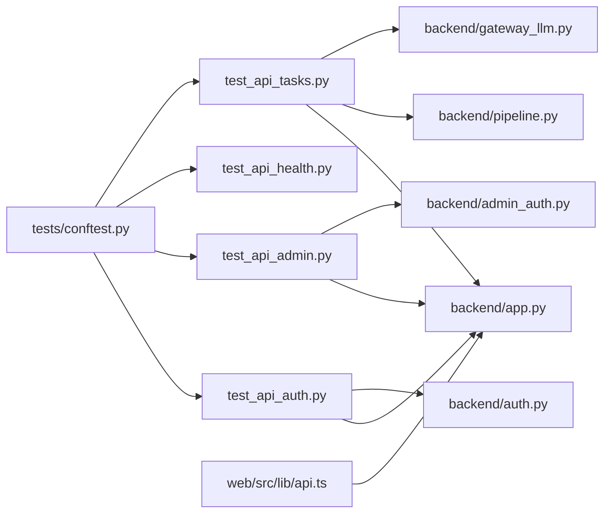

# End-to-End Testing

<cite>
**Referenced Files in This Document**
- [backend/tests/README.md](file://backend/tests/README.md)
- [backend/tests/conftest.py](file://backend/tests/conftest.py)
- [backend/tests/run_tests.sh](file://backend/tests/run_tests.sh)
- [backend/tests/run_tests.bat](file://backend/tests/run_tests.bat)
- [backend/tests/integration/test_api_auth.py](file://backend/tests/integration/test_api_auth.py)
- [backend/tests/integration/test_api_admin.py](file://backend/tests/integration/test_api_admin.py)
- [backend/tests/integration/test_api_health.py](file://backend/tests/integration/test_api_health.py)
- [backend/tests/integration/test_api_tasks.py](file://backend/tests/integration/test_api_tasks.py)
- [backend/app.py](file://backend/app.py)
- [backend/auth.py](file://backend/auth.py)
- [backend/admin_auth.py](file://backend/admin_auth.py)
- [backend/config.py](file://backend/config.py)
- [backend/database/models.py](file://backend/database/models.py)
- [backend/pipeline.py](file://backend/pipeline.py)
- [backend/gateway_llm.py](file://backend/gateway_llm.py)
- [web/package.json](file://web/package.json)
- [web/src/lib/api.ts](file://web/src/lib/api.ts)
- [web/src/components/AuthModal.tsx](file://web/src/components/AuthModal.tsx)
- [web/src/components/AccountCenterModal.tsx](file://web/src/components/AccountCenterModal.tsx)
- [web/src/App.tsx](file://web/src/App.tsx)
- [web/src/main.tsx](file://web/src/main.tsx)
- [web/vite.config.js](file://web/vite.config.js)
- [deploy/deploy-dev.sh](file://deploy/deploy-dev.sh)
- [deploy/deploy-prod.sh](file://deploy/deploy-prod.sh)
- [.github/workflows/deploy.yml](file://.github/workflows/deploy.yml)
</cite>

## Table of Contents
1. [Introduction](#introduction)
2. [Project Structure](#project-structure)
3. [Core Components](#core-components)
4. [Architecture Overview](#architecture-overview)
5. [Detailed Component Analysis](#detailed-component-analysis)
6. [Dependency Analysis](#dependency-analysis)
7. [Performance Considerations](#performance-considerations)
8. [Troubleshooting Guide](#troubleshooting-guide)
9. [Conclusion](#conclusion)
10. [Appendices](#appendices)

## Introduction
This document provides end-to-end testing guidance for the application, covering browser automation (Selenium or Playwright), API testing from a client perspective, cross-browser compatibility, environment setup, session management, realistic data scenarios, critical user journeys (content generation, registration, admin operations), mobile responsiveness, accessibility validation, performance benchmarking, continuous integration, flaky test identification, and debugging techniques for distributed environments. It maps these practices to the existing backend and frontend codebase to ensure tests validate real user workflows.

## Project Structure
The repository contains:
- Backend Python service with authentication, admin authorization, database models, LLM gateway, and pipeline orchestration.
- Frontend web app built with TypeScript/React and Vite, including auth components and API utilities.
- Tests under backend/tests with integration tests for APIs and shared configuration fixtures.
- Deployment scripts and GitHub Actions workflow for deployment.

**Diagram sources**
- [web/src/App.tsx](file://web/src/App.tsx)
- [web/src/main.tsx](file://web/src/main.tsx)
- [web/src/lib/api.ts](file://web/src/lib/api.ts)
- [web/src/components/AuthModal.tsx](file://web/src/components/AuthModal.tsx)
- [web/src/components/AccountCenterModal.tsx](file://web/src/components/AccountCenterModal.tsx)
- [backend/app.py](file://backend/app.py)
- [backend/auth.py](file://backend/auth.py)
- [backend/admin_auth.py](file://backend/admin_auth.py)
- [backend/config.py](file://backend/config.py)
- [backend/database/models.py](file://backend/database/models.py)
- [backend/pipeline.py](file://backend/pipeline.py)
- [backend/gateway_llm.py](file://backend/gateway_llm.py)
- [backend/tests/conftest.py](file://backend/tests/conftest.py)
- [backend/tests/integration/test_api_auth.py](file://backend/tests/integration/test_api_auth.py)
- [backend/tests/integration/test_api_admin.py](file://backend/tests/integration/test_api_admin.py)
- [backend/tests/integration/test_api_health.py](file://backend/tests/integration/test_api_health.py)
- [backend/tests/integration/test_api_tasks.py](file://backend/tests/integration/test_api_tasks.py)

**Section sources**
- [backend/tests/README.md](file://backend/tests/README.md)
- [backend/tests/conftest.py](file://backend/tests/conftest.py)
- [backend/app.py](file://backend/app.py)
- [web/src/lib/api.ts](file://web/src/lib/api.ts)
- [web/src/components/AuthModal.tsx](file://web/src/components/AuthModal.tsx)
- [web/src/components/AccountCenterModal.tsx](file://web/src/components/AccountCenterModal.tsx)

## Core Components
- Authentication flow: User login, token handling, and session persistence across frontend and backend.
- Admin operations: Authorization checks and protected endpoints for administrative tasks.
- Content generation: Pipeline orchestration that integrates with an LLM gateway to produce teaching content.
- API layer: REST endpoints exposed by the backend consumed by the frontend and tests.

Key implementation references:
- Backend entry and routing: [backend/app.py](file://backend/app.py)
- Auth middleware and helpers: [backend/auth.py](file://backend/auth.py)
- Admin authorization: [backend/admin_auth.py](file://backend/admin_auth.py)
- Configuration: [backend/config.py](file://backend/config.py)
- Data models: [backend/database/models.py](file://backend/database/models.py)
- Generation pipeline: [backend/pipeline.py](file://backend/pipeline.py)
- LLM gateway: [backend/gateway_llm.py](file://backend/gateway_llm.py)
- Frontend API client: [web/src/lib/api.ts](file://web/src/lib/api.ts)
- Auth UI components: [web/src/components/AuthModal.tsx](file://web/src/components/AuthModal.tsx), [web/src/components/AccountCenterModal.tsx](file://web/src/components/AccountCenterModal.tsx)

**Section sources**
- [backend/app.py](file://backend/app.py)
- [backend/auth.py](file://backend/auth.py)
- [backend/admin_auth.py](file://backend/admin_auth.py)
- [backend/config.py](file://backend/config.py)
- [backend/database/models.py](file://backend/database/models.py)
- [backend/pipeline.py](file://backend/pipeline.py)
- [backend/gateway_llm.py](file://backend/gateway_llm.py)
- [web/src/lib/api.ts](file://web/src/lib/api.ts)
- [web/src/components/AuthModal.tsx](file://web/src/components/AuthModal.tsx)
- [web/src/components/AccountCenterModal.tsx](file://web/src/components/AccountCenterModal.tsx)

## Architecture Overview
The E2E system validates full user journeys through the frontend and backend:
- Browser automation drives the React/Vite frontend to simulate user actions.
- API tests call backend endpoints directly to assert business logic and data integrity.
- Session and token flows are validated end-to-end across both layers.
- Admin operations are tested with privileged credentials.
- Content generation is exercised via pipeline and LLM gateway interactions.

**Diagram sources**
- [web/src/lib/api.ts](file://web/src/lib/api.ts)
- [backend/app.py](file://backend/app.py)
- [backend/auth.py](file://backend/auth.py)
- [backend/pipeline.py](file://backend/pipeline.py)
- [backend/gateway_llm.py](file://backend/gateway_llm.py)

## Detailed Component Analysis

### Authentication and Session Management
- Login sequence: The frontend calls the auth endpoint; backend validates credentials and returns tokens.
- Session handling: Tokens stored in frontend state/local storage; included in subsequent requests via headers.
- Protected routes: Middleware enforces authentication and admin roles.

**Diagram sources**
- [web/src/components/AuthModal.tsx](file://web/src/components/AuthModal.tsx)
- [web/src/lib/api.ts](file://web/src/lib/api.ts)
- [backend/auth.py](file://backend/auth.py)
- [backend/app.py](file://backend/app.py)

**Section sources**
- [backend/auth.py](file://backend/auth.py)
- [backend/app.py](file://backend/app.py)
- [web/src/components/AuthModal.tsx](file://web/src/components/AuthModal.tsx)
- [web/src/lib/api.ts](file://web/src/lib/api.ts)

### Admin Operations
- Admin authorization: Separate middleware ensures only admin users can access administrative endpoints.
- Typical admin flows: Manage users, view feedbacks, manage teachings, settings.

**Diagram sources**
- [backend/admin_auth.py](file://backend/admin_auth.py)
- [backend/app.py](file://backend/app.py)

**Section sources**
- [backend/admin_auth.py](file://backend/admin_auth.py)
- [backend/app.py](file://backend/app.py)

### Content Generation Workflow
- Trigger: Frontend initiates generation request.
- Pipeline: Orchestrates steps, interacts with LLM gateway, persists results.
- Status polling: Client polls or subscribes to task status updates.

**Diagram sources**
- [web/src/lib/api.ts](file://web/src/lib/api.ts)
- [backend/pipeline.py](file://backend/pipeline.py)
- [backend/gateway_llm.py](file://backend/gateway_llm.py)
- [backend/app.py](file://backend/app.py)

**Section sources**
- [backend/pipeline.py](file://backend/pipeline.py)
- [backend/gateway_llm.py](file://backend/gateway_llm.py)
- [backend/app.py](file://backend/app.py)
- [web/src/lib/api.ts](file://web/src/lib/api.ts)

### API Testing Strategy
- Use the existing integration tests as templates for new endpoints.
- Validate HTTP status codes, response schemas, and side effects (e.g., DB changes).
- Mock external dependencies where appropriate (e.g., LLM gateway) for deterministic tests.

**Section sources**
- [backend/tests/integration/test_api_auth.py](file://backend/tests/integration/test_api_auth.py)
- [backend/tests/integration/test_api_admin.py](file://backend/tests/integration/test_api_admin.py)
- [backend/tests/integration/test_api_health.py](file://backend/tests/integration/test_api_health.py)
- [backend/tests/integration/test_api_tasks.py](file://backend/tests/integration/test_api_tasks.py)
- [backend/tests/conftest.py](file://backend/tests/conftest.py)

### Browser Automation Testing (Playwright/Selenium)
- Recommended tool: Playwright for robust selectors, auto-waiting, and multi-browser support.
- Key scenarios:
  - Registration and login flows.
  - Navigating to protected pages after authentication.
  - Triggering content generation and verifying rendered output.
  - Admin operations with privileged accounts.
- Cross-browser matrix: Chrome, Firefox, Safari (where applicable), Edge.

[No sources needed since this diagram shows conceptual workflow, not actual code structure]

### Mobile Responsiveness and Accessibility Validation
- Responsive checks: Resize viewport to common mobile breakpoints; verify layout and interactions.
- Accessibility: Ensure semantic HTML, ARIA attributes, keyboard navigation, and color contrast.
- Tools: Playwright’s accessibility assertions, axe-core integration, manual audits.

[No sources needed since this section provides general guidance]

### Performance Benchmarking
- Measure key metrics: Time to first byte, time to interactive, API latency, generation duration.
- Load testing: Simulate concurrent users triggering generation and reading results.
- Baselines: Establish acceptable thresholds and track regressions.

[No sources needed since this section provides general guidance]

## Dependency Analysis
The E2E tests depend on:
- Backend services: app, auth, admin_auth, config, models, pipeline, gateway_llm.
- Frontend assets: built via Vite; tests may interact with dev server or static build.
- Shared test configuration: conftest.py sets up fixtures and environment.

**Diagram sources**
- [backend/tests/conftest.py](file://backend/tests/conftest.py)
- [backend/tests/integration/test_api_auth.py](file://backend/tests/integration/test_api_auth.py)
- [backend/tests/integration/test_api_admin.py](file://backend/tests/integration/test_api_admin.py)
- [backend/tests/integration/test_api_health.py](file://backend/tests/integration/test_api_health.py)
- [backend/tests/integration/test_api_tasks.py](file://backend/tests/integration/test_api_tasks.py)
- [backend/app.py](file://backend/app.py)
- [backend/auth.py](file://backend/auth.py)
- [backend/admin_auth.py](file://backend/admin_auth.py)
- [backend/pipeline.py](file://backend/pipeline.py)
- [backend/gateway_llm.py](file://backend/gateway_llm.py)
- [web/src/lib/api.ts](file://web/src/lib/api.ts)

**Section sources**
- [backend/tests/conftest.py](file://backend/tests/conftest.py)
- [backend/app.py](file://backend/app.py)
- [web/src/lib/api.ts](file://web/src/lib/api.ts)

## Performance Considerations
- Isolate slow tests: Mark long-running generation tests and run them separately in CI.
- Cache warm-up: Pre-seed frequently accessed data to reduce cold-start variance.
- Parallelization: Run independent tests concurrently; avoid shared mutable state.
- Resource limits: Configure timeouts and retries for external LLM calls during tests.

[No sources needed since this section provides general guidance]

## Troubleshooting Guide
Common issues and resolutions:
- Flaky tests: Identify intermittent failures by adding logs, screenshots, and videos; isolate network-dependent steps.
- Distributed debugging: Use centralized logging and correlation IDs to trace requests across services.
- Environment mismatches: Ensure consistent configs between local and CI; pin versions for browsers and drivers.
- Database state: Reset seeds before each test suite run; use transactions or isolated databases per run.

Practical references:
- Test runner scripts: [backend/tests/run_tests.sh](file://backend/tests/run_tests.sh), [backend/tests/run_tests.bat](file://backend/tests/run_tests.bat)
- Shared fixtures: [backend/tests/conftest.py](file://backend/tests/conftest.py)
- Integration tests: [backend/tests/integration/test_api_auth.py](file://backend/tests/integration/test_api_auth.py), [backend/tests/integration/test_api_admin.py](file://backend/tests/integration/test_api_admin.py), [backend/tests/integration/test_api_health.py](file://backend/tests/integration/test_api_health.py), [backend/tests/integration/test_api_tasks.py](file://backend/tests/integration/test_api_tasks.py)

**Section sources**
- [backend/tests/run_tests.sh](file://backend/tests/run_tests.sh)
- [backend/tests/run_tests.bat](file://backend/tests/run_tests.bat)
- [backend/tests/conftest.py](file://backend/tests/conftest.py)
- [backend/tests/integration/test_api_auth.py](file://backend/tests/integration/test_api_auth.py)
- [backend/tests/integration/test_api_admin.py](file://backend/tests/integration/test_api_admin.py)
- [backend/tests/integration/test_api_health.py](file://backend/tests/integration/test_api_health.py)
- [backend/tests/integration/test_api_tasks.py](file://backend/tests/integration/test_api_tasks.py)

## Conclusion
This E2E testing strategy combines browser automation and API testing to validate complete user workflows, ensuring reliability across authentication, content generation, and admin operations. By following the outlined setup, scenarios, and best practices, teams can maintain high confidence in application behavior, detect regressions early, and deliver robust experiences across devices and browsers.

[No sources needed since this section summarizes without analyzing specific files]

## Appendices

### Test Environment Setup
- Backend: Install dependencies, configure environment variables, initialize database, start services.
- Frontend: Install dependencies, build assets, serve dev server.
- Test runners: Use provided scripts to execute integration tests locally.

References:
- Test README: [backend/tests/README.md](file://backend/tests/README.md)
- Runner scripts: [backend/tests/run_tests.sh](file://backend/tests/run_tests.sh), [backend/tests/run_tests.bat](file://backend/tests/run_tests.bat)
- Config: [backend/config.py](file://backend/config.py)

**Section sources**
- [backend/tests/README.md](file://backend/tests/README.md)
- [backend/tests/run_tests.sh](file://backend/tests/run_tests.sh)
- [backend/tests/run_tests.bat](file://backend/tests/run_tests.bat)
- [backend/config.py](file://backend/config.py)

### Continuous Integration Setup
- Deploy workflow: GitHub Actions job triggers deployments; extend to include E2E test execution.
- Matrix runs: Execute tests across multiple Node and Python versions, browsers, and OSes.
- Artifacts: Upload test reports, screenshots, and videos for failed runs.

References:
- GitHub Actions: [.github/workflows/deploy.yml](file://.github/workflows/deploy.yml)
- Deployment scripts: [deploy/deploy-dev.sh](file://deploy/deploy-dev.sh), [deploy/deploy-prod.sh](file://deploy/deploy-prod.sh)
- Frontend build: [web/vite.config.js](file://web/vite.config.js), [web/package.json](file://web/package.json)

**Section sources**
- [.github/workflows/deploy.yml](file://.github/workflows/deploy.yml)
- [deploy/deploy-dev.sh](file://deploy/deploy-dev.sh)
- [deploy/deploy-prod.sh](file://deploy/deploy-prod.sh)
- [web/vite.config.js](file://web/vite.config.js)
- [web/package.json](file://web/package.json)

### Critical User Journeys Checklist
- Registration and login: Verify account creation, email verification (if applicable), token issuance, and protected route access.
- Content generation: Submit prompts, handle async tasks, poll status, render results, and persist metadata.
- Admin operations: Authenticate as admin, perform CRUD on users/teachings/feedbacks/settings, enforce role checks.

References:
- Auth components: [web/src/components/AuthModal.tsx](file://web/src/components/AuthModal.tsx), [web/src/components/AccountCenterModal.tsx](file://web/src/components/AccountCenterModal.tsx)
- API client: [web/src/lib/api.ts](file://web/src/lib/api.ts)
- Backend endpoints: [backend/app.py](file://backend/app.py), [backend/auth.py](file://backend/auth.py), [backend/admin_auth.py](file://backend/admin_auth.py)
- Pipeline and gateway: [backend/pipeline.py](file://backend/pipeline.py), [backend/gateway_llm.py](file://backend/gateway_llm.py)

**Section sources**
- [web/src/components/AuthModal.tsx](file://web/src/components/AuthModal.tsx)
- [web/src/components/AccountCenterModal.tsx](file://web/src/components/AccountCenterModal.tsx)
- [web/src/lib/api.ts](file://web/src/lib/api.ts)
- [backend/app.py](file://backend/app.py)
- [backend/auth.py](file://backend/auth.py)
- [backend/admin_auth.py](file://backend/admin_auth.py)
- [backend/pipeline.py](file://backend/pipeline.py)
- [backend/gateway_llm.py](file://backend/gateway_llm.py)