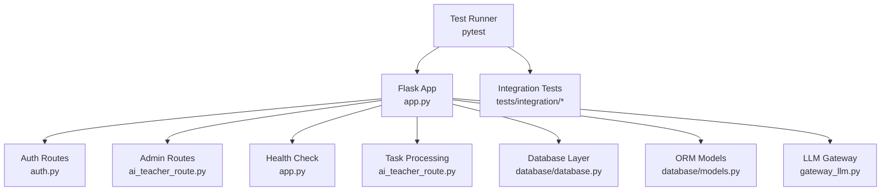
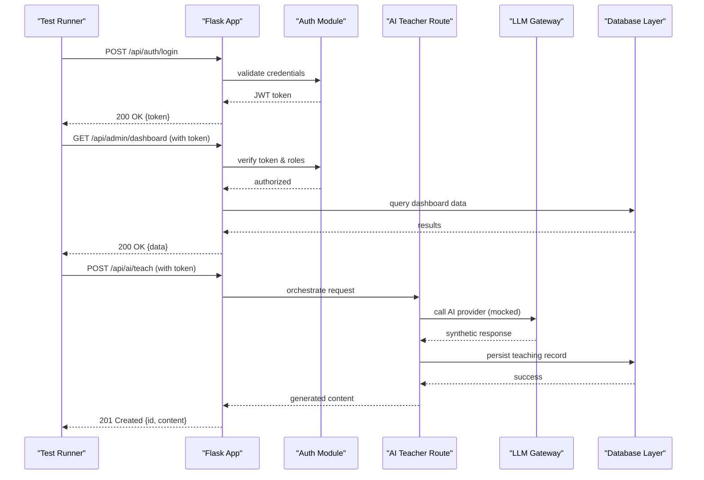
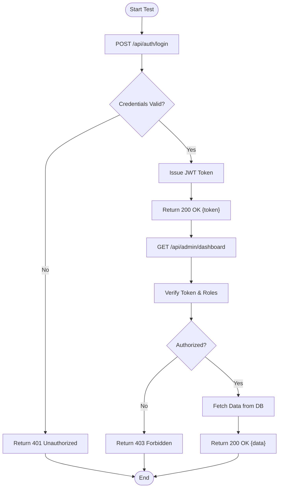
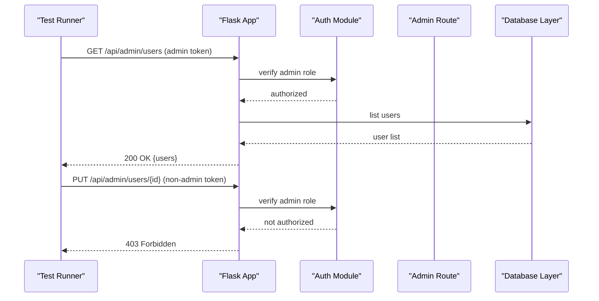
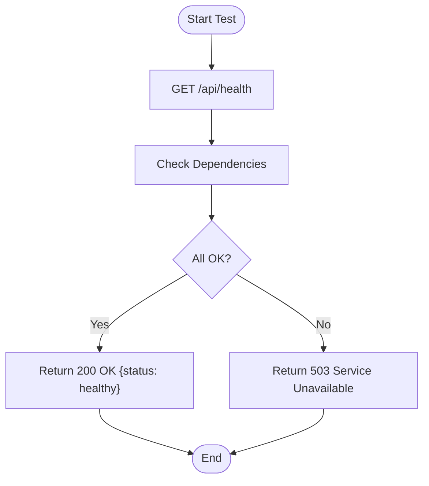
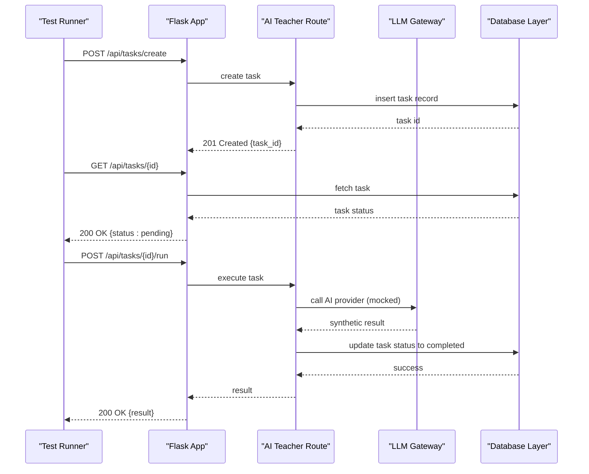
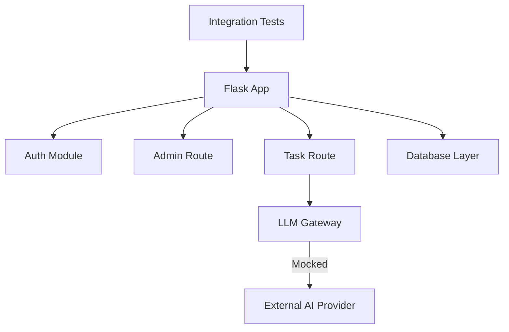

# Integration Testing

<cite>
**Referenced Files in This Document**
- [app.py](file://backend/app.py)
- [auth.py](file://backend/auth.py)
- [ai_teacher_route.py](file://backend/ai_teacher_route.py)
- [gateway_llm.py](file://backend/gateway_llm.py)
- [config.py](file://backend/config.py)
- [database/database.py](file://backend/database/database.py)
- [database/models.py](file://backend/database/models.py)
- [tests/conftest.py](file://backend/tests/conftest.py)
- [tests/integration/test_api_auth.py](file://backend/tests/integration/test_api_auth.py)
- [tests/integration/test_api_admin.py](file://backend/tests/integration/test_api_admin.py)
- [tests/integration/test_api_health.py](file://backend/tests/integration/test_api_health.py)
- [tests/integration/test_api_tasks.py](file://backend/tests/integration/test_api_tasks.py)
- [tests/README.md](file://backend/tests/README.md)
</cite>

## Table of Contents
1. [Introduction](#introduction)
2. [Project Structure](#project-structure)
3. [Core Components](#core-components)
4. [Architecture Overview](#architecture-overview)
5. [Detailed Component Analysis](#detailed-component-analysis)
6. [Dependency Analysis](#dependency-analysis)
7. [Performance Considerations](#performance-considerations)
8. [Troubleshooting Guide](#troubleshooting-guide)
9. [Conclusion](#conclusion)

## Introduction
This document provides comprehensive integration testing guidance for the backend API and service interactions. It covers RESTful endpoint validation, authentication and authorization flows, database integration with test databases and transaction rollback strategies, external service mocking for AI provider integrations, complex multi-service workflows, error scenarios, concurrency considerations, isolation strategies, cleanup procedures, and performance considerations. The content is tailored to the project’s structure and existing test suite.

## Project Structure
The backend exposes a Flask application with multiple routes including authentication, admin operations, health checks, task processing, and AI teacher services. Tests are organized under backend/tests with subfolders for unit, integration, e2e, and performance tests. The integration tests exercise real HTTP endpoints against an in-memory or temporary database and mock external dependencies where appropriate.

**Diagram sources**
- [app.py:1-200](file://backend/app.py#L1-L200)
- [auth.py:1-200](file://backend/auth.py#L1-L200)
- [ai_teacher_route.py:1-200](file://backend/ai_teacher_route.py#L1-L200)
- [gateway_llm.py:1-200](file://backend/gateway_llm.py#L1-L200)
- [database/database.py:1-200](file://backend/database/database.py#L1-L200)
- [database/models.py:1-200](file://backend/database/models.py#L1-L200)

**Section sources**
- [tests/README.md:1-100](file://backend/tests/README.md#L1-L100)

## Core Components
- Flask Application Entry Point: Centralizes route registration and middleware setup.
- Authentication Module: Handles login, token issuance, and protected route decorators.
- AI Teacher Route: Orchestrates AI-driven teaching generation and integrates with LLM gateway.
- Database Layer: Provides connection management, migrations, and ORM model definitions.
- Test Configuration: Shared fixtures and utilities for test isolation, database setup, and mocks.

Key responsibilities:
- Request/response validation at the API layer.
- Token-based authentication and role-based authorization.
- Database transactions with rollback for deterministic tests.
- External service mocking for AI providers to ensure stable tests.

**Section sources**
- [app.py:1-200](file://backend/app.py#L1-L200)
- [auth.py:1-200](file://backend/auth.py#L1-L200)
- [ai_teacher_route.py:1-200](file://backend/ai_teacher_route.py#L1-L200)
- [database/database.py:1-200](file://backend/database/database.py#L1-L200)
- [database/models.py:1-200](file://backend/database/models.py#L1-L200)
- [tests/conftest.py:1-200](file://backend/tests/conftest.py#L1-L200)

## Architecture Overview
The integration test flow exercises the full stack from HTTP requests through routing, authentication, business logic, database operations, and optional external calls. Mocking is applied to external AI providers to avoid flakiness and cost.

**Diagram sources**
- [app.py:1-200](file://backend/app.py#L1-L200)
- [auth.py:1-200](file://backend/auth.py#L1-L200)
- [ai_teacher_route.py:1-200](file://backend/ai_teacher_route.py#L1-L200)
- [gateway_llm.py:1-200](file://backend/gateway_llm.py#L1-L200)
- [database/database.py:1-200](file://backend/database/database.py#L1-L200)

## Detailed Component Analysis

### Authentication Flow Integration Tests
Focus areas:
- Login endpoint validates credentials and returns tokens.
- Protected endpoints enforce token presence and role checks.
- Error scenarios include invalid credentials, expired tokens, and unauthorized access.

**Diagram sources**
- [auth.py:1-200](file://backend/auth.py#L1-L200)
- [app.py:1-200](file://backend/app.py#L1-L200)

**Section sources**
- [tests/integration/test_api_auth.py:1-200](file://backend/tests/integration/test_api_auth.py#L1-L200)

### Admin Operations Integration Tests
Focus areas:
- Admin endpoints require elevated roles.
- CRUD operations on admin resources are validated end-to-end.
- Authorization failures are tested explicitly.

**Diagram sources**
- [ai_teacher_route.py:1-200](file://backend/ai_teacher_route.py#L1-L200)
- [auth.py:1-200](file://backend/auth.py#L1-200)
- [database/database.py:1-200](file://backend/database/database.py#L1-200)

**Section sources**
- [tests/integration/test_api_admin.py:1-200](file://backend/tests/integration/test_api_admin.py#L1-L200)

### Health Check Integration Tests
Focus areas:
- Health endpoints return status and dependency checks.
- Tests assert correct JSON structure and status codes.
- Optional dependency failure scenarios are simulated via configuration.

**Diagram sources**
- [app.py:1-200](file://backend/app.py#L1-L200)

**Section sources**
- [tests/integration/test_api_health.py:1-200](file://backend/tests/integration/test_api_health.py#L1-L200)

### Task Processing Integration Tests
Focus areas:
- Task creation, status updates, and completion workflows.
- Concurrency handling when multiple tasks run simultaneously.
- Error scenarios like invalid payloads and provider timeouts.

**Diagram sources**
- [ai_teacher_route.py:1-200](file://backend/ai_teacher_route.py#L1-200)
- [gateway_llm.py:1-200](file://backend/gateway_llm.py#L1-200)
- [database/database.py:1-200](file://backend/database/database.py#L1-200)

**Section sources**
- [tests/integration/test_api_tasks.py:1-200](file://backend/tests/integration/test_api_tasks.py#L1-L200)

### Database Integration Testing Strategy
- Use a dedicated test database instance isolated from development and production.
- Employ transactional rollback per test to ensure clean state.
- Seed minimal required data for each test scenario.
- Validate schema migrations and constraints during tests.

Best practices:
- Wrap each test in a transaction and rollback after assertions.
- Use fixtures to create and destroy test databases.
- Avoid long-running DDL operations inside tests; pre-seed static data.

**Section sources**
- [database/database.py:1-200](file://backend/database/database.py#L1-200)
- [database/models.py:1-200](file://backend/database/models.py#L1-200)
- [tests/conftest.py:1-200](file://backend/tests/conftest.py#L1-L200)

### External Service Mocking for AI Providers
- Mock HTTP calls to AI providers using libraries such as responses or httpretty.
- Provide deterministic synthetic responses for various scenarios (success, rate limit, timeout).
- Ensure network calls do not occur during tests to maintain speed and reliability.

Implementation tips:
- Patch the LLM gateway client to return predefined payloads.
- Assert that the mocked calls were made with expected parameters.
- Cover error paths by raising exceptions or returning error statuses from mocks.

**Section sources**
- [gateway_llm.py:1-200](file://backend/gateway_llm.py#L1-200)
- [ai_teacher_route.py:1-200](file://backend/ai_teacher_route.py#L1-200)

### Complex Workflow Testing
- Combine authentication, authorization, database operations, and external service calls in a single test case.
- Validate end-to-end state transitions and side effects.
- Use fixtures to prepare shared context across steps.

Example workflow:
- Login to obtain token.
- Create a resource requiring admin privileges.
- Trigger AI generation which calls external provider.
- Verify persisted state and returned payload.

**Section sources**
- [tests/integration/test_api_admin.py:1-200](file://backend/tests/integration/test_api_admin.py#L1-L200)
- [tests/integration/test_api_tasks.py:1-200](file://backend/tests/integration/test_api_tasks.py#L1-L200)

### Error Scenarios and Edge Cases
- Invalid input payloads: assert 400 Bad Request with descriptive messages.
- Authentication failures: assert 401 Unauthorized for missing or invalid tokens.
- Authorization failures: assert 403 Forbidden for insufficient roles.
- External service errors: assert 500 Internal Server Error or specific provider error codes.
- Database errors: assert proper error propagation and rollback behavior.

**Section sources**
- [auth.py:1-200](file://backend/auth.py#L1-200)
- [ai_teacher_route.py:1-200](file://backend/ai_teacher_route.py#L1-200)
- [database/database.py:1-200](file://backend/database/database.py#L1-200)

### Concurrent Operations Testing
- Simulate concurrent task executions to verify thread safety and race conditions.
- Use background threads or async clients to trigger parallel requests.
- Assert consistent final states and absence of deadlocks.

Recommendations:
- Limit concurrency levels to avoid overwhelming the test database.
- Use unique identifiers per concurrent operation to isolate results.
- Monitor resource usage and adjust timeouts accordingly.

**Section sources**
- [ai_teacher_route.py:1-200](file://backend/ai_teacher_route.py#L1-200)
- [database/database.py:1-200](file://backend/database/database.py#L1-200)

### Test Isolation and Cleanup Procedures
- Each test should be independent and not rely on prior test state.
- Use pytest fixtures to set up and tear down resources.
- Clear any temporary files or storage artifacts after tests.
- Reset configuration values to defaults between tests if needed.

Cleanup checklist:
- Rollback database transactions.
- Delete created records if not using transactions.
- Remove uploaded files or cache entries.
- Restore environment variables to original values.

**Section sources**
- [tests/conftest.py:1-200](file://backend/tests/conftest.py#L1-L200)

## Dependency Analysis
The integration tests depend on the Flask app, authentication module, AI teacher route, database layer, and LLM gateway. Proper mocking ensures external dependencies do not affect test stability.

**Diagram sources**
- [app.py:1-200](file://backend/app.py#L1-L200)
- [auth.py:1-200](file://backend/auth.py#L1-200)
- [ai_teacher_route.py:1-200](file://backend/ai_teacher_route.py#L1-200)
- [gateway_llm.py:1-200](file://backend/gateway_llm.py#L1-200)
- [database/database.py:1-200](file://backend/database/database.py#L1-200)

**Section sources**
- [tests/integration/test_api_auth.py:1-200](file://backend/tests/integration/test_api_auth.py#L1-L200)
- [tests/integration/test_api_admin.py:1-200](file://backend/tests/integration/test_api_admin.py#L1-L200)
- [tests/integration/test_api_tasks.py:1-200](file://backend/tests/integration/test_api_tasks.py#L1-L200)

## Performance Considerations
- Keep tests fast by avoiding heavy I/O and network calls.
- Use in-memory databases where possible for speed.
- Mock external services to eliminate latency and variability.
- Parallelize independent tests to reduce total execution time.
- Monitor memory usage and database connections during concurrent tests.

Optimization tips:
- Pre-seed common data once per test session.
- Reuse database connections within a test process.
- Avoid unnecessary logging during tests to reduce overhead.

[No sources needed since this section provides general guidance]

## Troubleshooting Guide
Common issues and resolutions:
- Authentication failures: Ensure test tokens are valid and roles are correctly assigned.
- Database connectivity: Verify test database credentials and migration status.
- External service errors: Confirm mocks are properly configured and return expected responses.
- Flaky tests: Increase isolation, reduce shared state, and stabilize timing-sensitive operations.

Debugging steps:
- Enable verbose logging during test runs.
- Inspect request/response payloads in failing tests.
- Use breakpoints or print statements to trace execution flow.
- Validate database state before and after operations.

**Section sources**
- [tests/conftest.py:1-200](file://backend/tests/conftest.py#L1-L200)
- [auth.py:1-200](file://backend/auth.py#L1-200)
- [database/database.py:1-200](file://backend/database/database.py#L1-200)

## Conclusion
This integration testing documentation outlines strategies for validating API endpoints, authentication and authorization flows, database interactions, and external service integrations. By leveraging test isolation, transaction rollbacks, and robust mocking techniques, the test suite ensures reliable, fast, and maintainable coverage of critical system behaviors. Following these guidelines will help maintain high-quality software through comprehensive end-to-end validation.

[No sources needed since this section summarizes without analyzing specific files]