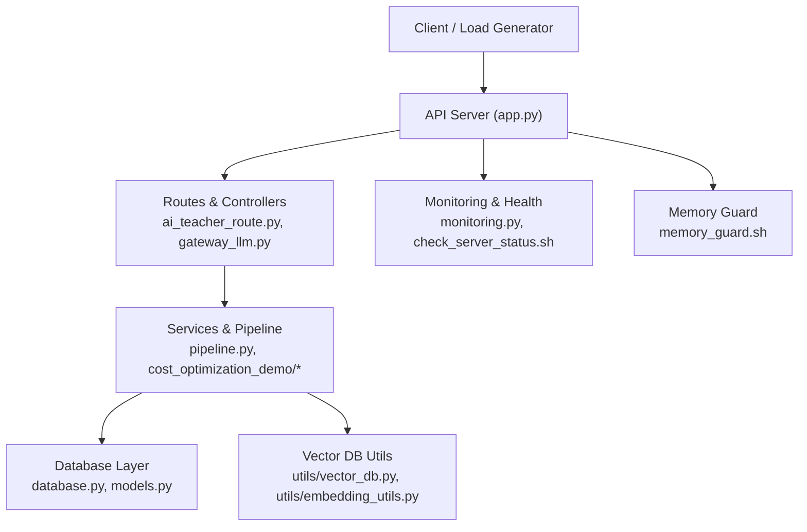
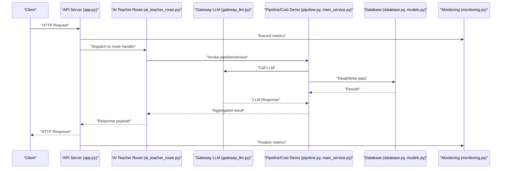
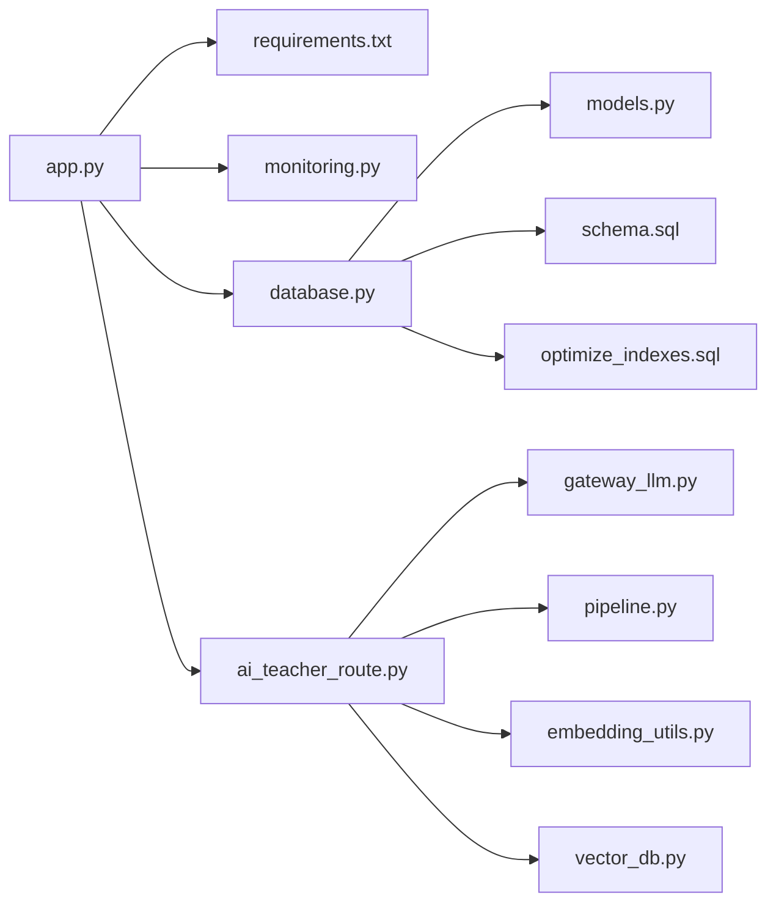

# Performance Testing

<cite>
**Referenced Files in This Document**
- [PERFORMANCE_OPTIMIZATION.md](file://backend/PERFORMANCE_OPTIMIZATION.md)
- [monitoring.py](file://backend/monitoring.py)
- [memory_guard.sh](file://backend/memory_guard.sh)
- [start_with_monitor.sh](file://backend/start_with_monitor.sh)
- [check_server_status.sh](file://backend/check_server_status.sh)
- [requirements.txt](file://backend/requirements.txt)
- [app.py](file://backend/app.py)
- [config.py](file://backend/config.py)
- [database.py](file://backend/database/database.py)
- [models.py](file://backend/database/models.py)
- [optimize_indexes.sql](file://backend/database/optimize_indexes.sql)
- [schema.sql](file://backend/database/schema.sql)
- [test_api.sh](file://backend/test_api.sh)
- [test_api.ps1](file://backend/test_api.ps1)
- [cost_optimization_demo/main_service.py](file://backend/cost_optimization_demo/main_service.py)
- [cost_optimization_demo/regression_test.py](file://backend/cost_optimization_demo/regression_test.py)
- [cost_optimization_demo/cache_service.py](file://backend/cost_optimization_demo/cache_service.py)
- [gateway_llm.py](file://backend/gateway_llm.py)
- [ai_teacher_route.py](file://backend/ai_teacher_route.py)
- [pipeline.py](file://backend/pipeline.py)
- [embedding_utils.py](file://backend/utils/embedding_utils.py)
- [vector_db.py](file://backend/utils/vector_db.py)
</cite>

## Table of Contents
1. Introduction
2. Project Structure
3. Core Components
4. Architecture Overview
5. Detailed Component Analysis
6. Dependency Analysis
7. Performance Considerations
8. Troubleshooting Guide
9. Conclusion
10. Appendices

## Introduction
This document provides a comprehensive performance testing guide for the project, covering load testing, stress testing, and memory profiling. It explains how to measure API response times, database query performance, and AI model processing efficiency. It also documents strategies using tools like Locust or JMeter, memory leak detection, CPU utilization monitoring, performance regression testing, benchmark establishment, capacity planning, high-concurrency scenarios, large file uploads, batch processing, monitoring integration, alerting thresholds, and optimization recommendations based on test results.

## Project Structure
The backend is a Python application with:
- HTTP server and routes for API endpoints
- Database layer with models and SQL schema/indexes
- AI gateway and teacher route handling LLM calls
- Monitoring utilities and shell scripts for health checks and memory guard
- Cost optimization demo including cache service and regression tests
- Utilities for embeddings and vector DB operations

**Diagram sources**
- [app.py](file://backend/app.py)
- [ai_teacher_route.py](file://backend/ai_teacher_route.py)
- [gateway_llm.py](file://backend/gateway_llm.py)
- [pipeline.py](file://backend/pipeline.py)
- [database.py](file://backend/database/database.py)
- [models.py](file://backend/database/models.py)
- [vector_db.py](file://backend/utils/vector_db.py)
- [embedding_utils.py](file://backend/utils/embedding_utils.py)
- [monitoring.py](file://backend/monitoring.py)
- [memory_guard.sh](file://backend/memory_guard.sh)

**Section sources**
- [PERFORMANCE_OPTIMIZATION.md](file://backend/PERFORMANCE_OPTIMIZATION.md)
- [monitoring.py](file://backend/monitoring.py)
- [memory_guard.sh](file://backend/memory_guard.sh)
- [start_with_monitor.sh](file://backend/start_with_monitor.sh)
- [check_server_status.sh](file://backend/check_server_status.sh)
- [requirements.txt](file://backend/requirements.txt)

## Core Components
- API Server and Routing: Entry points for requests, request validation, and dispatch to services.
- AI Gateway and Teacher Route: Orchestrate LLM calls, streaming responses, and caching.
- Database Layer: ORM models, connection management, and optimized indexes.
- Monitoring and Health Checks: Metrics collection, status endpoints, and external health probes.
- Memory Guard and Startup Scripts: Process supervision and automatic restarts under memory pressure.
- Cost Optimization Demo: Cache service and regression tests to validate performance improvements.

Key files:
- API server and configuration: [app.py](file://backend/app.py), [config.py](file://backend/config.py)
- AI orchestration: [ai_teacher_route.py](file://backend/ai_teacher_route.py), [gateway_llm.py](file://backend/gateway_llm.py), [pipeline.py](file://backend/pipeline.py)
- Database: [database.py](file://backend/database/database.py), [models.py](file://backend/database/models.py), [schema.sql](file://backend/database/schema.sql), [optimize_indexes.sql](file://backend/database/optimize_indexes.sql)
- Monitoring and health: [monitoring.py](file://backend/monitoring.py), [check_server_status.sh](file://backend/check_server_status.sh)
- Memory guard and startup: [memory_guard.sh](file://backend/memory_guard.sh), [start_with_monitor.sh](file://backend/start_with_monitor.sh)
- Cost optimization demo: [main_service.py](file://backend/cost_optimization_demo/main_service.py), [cache_service.py](file://backend/cost_optimization_demo/cache_service.py), [regression_test.py](file://backend/cost_optimization_demo/regression_test.py)
- Utilities: [embedding_utils.py](file://backend/utils/embedding_utils.py), [vector_db.py](file://backend/utils/vector_db.py)

**Section sources**
- [app.py](file://backend/app.py)
- [config.py](file://backend/config.py)
- [ai_teacher_route.py](file://backend/ai_teacher_route.py)
- [gateway_llm.py](file://backend/gateway_llm.py)
- [pipeline.py](file://backend/pipeline.py)
- [database.py](file://backend/database/database.py)
- [models.py](file://backend/database/models.py)
- [schema.sql](file://backend/database/schema.sql)
- [optimize_indexes.sql](file://backend/database/optimize_indexes.sql)
- [monitoring.py](file://backend/monitoring.py)
- [check_server_status.sh](file://backend/check_server_status.sh)
- [memory_guard.sh](file://backend/memory_guard.sh)
- [start_with_monitor.sh](file://backend/start_with_monitor.sh)
- [main_service.py](file://backend/cost_optimization_demo/main_service.py)
- [cache_service.py](file://backend/cost_optimization_demo/cache_service.py)
- [regression_test.py](file://backend/cost_optimization_demo/regression_test.py)
- [embedding_utils.py](file://backend/utils/embedding_utils.py)
- [vector_db.py](file://backend/utils/vector_db.py)

## Architecture Overview
The system processes API requests through an HTTP server that delegates to AI-related services and database operations. Monitoring hooks capture metrics and expose health endpoints. A memory guard script monitors process memory and restarts when needed.

**Diagram sources**
- [app.py](file://backend/app.py)
- [ai_teacher_route.py](file://backend/ai_teacher_route.py)
- [gateway_llm.py](file://backend/gateway_llm.py)
- [pipeline.py](file://backend/pipeline.py)
- [main_service.py](file://backend/cost_optimization_demo/main_service.py)
- [database.py](file://backend/database/database.py)
- [models.py](file://backend/database/models.py)
- [monitoring.py](file://backend/monitoring.py)

## Detailed Component Analysis

### API Server and Configuration
- Responsibilities: Initialize app, register routes, configure middleware, set timeouts, and integrate monitoring.
- Performance considerations: Connection pooling, request size limits, concurrency settings, and graceful shutdown.
- Key files: [app.py](file://backend/app.py), [config.py](file://backend/config.py)

**Section sources**
- [app.py](file://backend/app.py)
- [config.py](file://backend/config.py)

### AI Gateway and Teacher Route
- Responsibilities: Orchestrate LLM calls, handle streaming, implement caching, and manage error retries/backoff.
- Performance considerations: Rate limiting, token usage tracking, cache hit ratios, and timeout tuning.
- Key files: [ai_teacher_route.py](file://backend/ai_teacher_route.py), [gateway_llm.py](file://backend/gateway_llm.py), [pipeline.py](file://backend/pipeline.py)

**Section sources**
- [ai_teacher_route.py](file://backend/ai_teacher_route.py)
- [gateway_llm.py](file://backend/gateway_llm.py)
- [pipeline.py](file://backend/pipeline.py)

### Database Layer and Indexing
- Responsibilities: Model definitions, connection management, migrations, and index optimization.
- Performance considerations: Query plans, index coverage, connection pool sizing, and read replicas if applicable.
- Key files: [database.py](file://backend/database/database.py), [models.py](file://backend/database/models.py), [schema.sql](file://backend/database/schema.sql), [optimize_indexes.sql](file://backend/database/optimize_indexes.sql)

**Section sources**
- [database.py](file://backend/database/database.py)
- [models.py](file://backend/database/models.py)
- [schema.sql](file://backend/database/schema.sql)
- [optimize_indexes.sql](file://backend/database/optimize_indexes.sql)

### Monitoring and Health Checks
- Responsibilities: Expose metrics, health endpoints, and integrate with external monitoring systems.
- Performance considerations: Sampling rates, metric cardinality, and non-blocking instrumentation.
- Key files: [monitoring.py](file://backend/monitoring.py), [check_server_status.sh](file://backend/check_server_status.sh)

**Section sources**
- [monitoring.py](file://backend/monitoring.py)
- [check_server_status.sh](file://backend/check_server_status.sh)

### Memory Guard and Startup Scripts
- Responsibilities: Monitor process memory, trigger restarts under pressure, and ensure stable operation.
- Performance considerations: Threshold tuning, restart cooldowns, and log retention.
- Key files: [memory_guard.sh](file://backend/memory_guard.sh), [start_with_monitor.sh](file://backend/start_with_monitor.sh)

**Section sources**
- [memory_guard.sh](file://backend/memory_guard.sh)
- [start_with_monitor.sh](file://backend/start_with_monitor.sh)

### Cost Optimization Demo and Regression Tests
- Responsibilities: Demonstrate caching strategies, track costs, and run regression tests to validate performance gains.
- Performance considerations: Cache invalidation policies, TTLs, and test reproducibility.
- Key files: [main_service.py](file://backend/cost_optimization_demo/main_service.py), [cache_service.py](file://backend/cost_optimization_demo/cache_service.py), [regression_test.py](file://backend/cost_optimization_demo/regression_test.py)

**Section sources**
- [main_service.py](file://backend/cost_optimization_demo/main_service.py)
- [cache_service.py](file://backend/cost_optimization_demo/cache_service.py)
- [regression_test.py](file://backend/cost_optimization_demo/regression_test.py)

### Embeddings and Vector DB Utilities
- Responsibilities: Generate embeddings and interact with vector databases for similarity search.
- Performance considerations: Batch sizes, dimensionality, indexing strategies, and memory footprint.
- Key files: [embedding_utils.py](file://backend/utils/embedding_utils.py), [vector_db.py](file://backend/utils/vector_db.py)

**Section sources**
- [embedding_utils.py](file://backend/utils/embedding_utils.py)
- [vector_db.py](file://backend/utils/vector_db.py)

## Dependency Analysis
External dependencies relevant to performance include HTTP clients, database drivers, and optional monitoring libraries. Ensure versions are pinned and compatible.

**Diagram sources**
- [app.py](file://backend/app.py)
- [requirements.txt](file://backend/requirements.txt)
- [monitoring.py](file://backend/monitoring.py)
- [database.py](file://backend/database/database.py)
- [models.py](file://backend/database/models.py)
- [schema.sql](file://backend/database/schema.sql)
- [optimize_indexes.sql](file://backend/database/optimize_indexes.sql)
- [ai_teacher_route.py](file://backend/ai_teacher_route.py)
- [gateway_llm.py](file://backend/gateway_llm.py)
- [pipeline.py](file://backend/pipeline.py)
- [embedding_utils.py](file://backend/utils/embedding_utils.py)
- [vector_db.py](file://backend/utils/vector_db.py)

**Section sources**
- [requirements.txt](file://backend/requirements.txt)

## Performance Considerations
- Load and Stress Testing
  - Use Locust or JMeter to simulate concurrent users and ramp up load gradually.
  - Define realistic user journeys: login, AI generation, file upload, and batch jobs.
  - Measure p50, p95, p99 latencies and error rates; track throughput (RPS).
- API Response Time Measurement
  - Instrument endpoints with timing and categorize by route and operation.
  - Separate cold start time from steady-state latency.
- Database Query Performance
  - Analyze slow queries, verify index usage, and avoid N+1 patterns.
  - Tune connection pools and transaction isolation levels.
- AI Model Processing Efficiency
  - Track token usage, cache hits, and retry/backoff behavior.
  - Stream responses where possible to reduce perceived latency.
- Memory Leak Detection
  - Use memory profiling tools (e.g., tracemalloc, py-spy) during tests.
  - Monitor RSS and GC pauses; set alerts for sustained growth.
- CPU Utilization Monitoring
  - Profile hot paths with cProfile or perf; identify bottlenecks.
  - Scale horizontally if CPU-bound tasks dominate.
- Performance Regression Testing
  - Establish baselines via regression tests; fail builds on regressions.
  - Compare key metrics across branches before merging.
- Capacity Planning
  - Map current RPS and latency to resource usage; plan scaling thresholds.
  - Plan for peak loads and burst traffic with auto-scaling policies.
- High-Concurrency Scenarios
  - Test with many simultaneous connections and long-running streams.
  - Validate backpressure handling and queue saturation.
- Large File Uploads
  - Chunked uploads, resumable transfers, and progress callbacks.
  - Enforce size limits and rate-limit per user/IP.
- Batch Processing Operations
  - Use worker queues, idempotency keys, and retry policies.
  - Monitor job queue depth and processing time distributions.
- Monitoring Integration and Alerting
  - Integrate metrics into centralized observability platforms.
  - Set alert thresholds for latency, error rate, memory, and CPU.
- Optimization Recommendations
  - Add caching layers, optimize queries, and tune concurrency.
  - Offload heavy tasks to background workers and use async I/O.

[No sources needed since this section provides general guidance]

## Troubleshooting Guide
- Health Checks
  - Use health endpoints and shell scripts to verify service readiness.
  - Investigate failed checks and correlate with logs and metrics.
- Memory Guard Behavior
  - Review thresholds and restart logs; adjust limits to prevent thrashing.
- Common Errors
  - Timeouts from LLM providers: increase timeouts or enable retries.
  - Database deadlocks: review transactions and lock ordering.
  - OOM kills: reduce batch sizes and enable memory profiling.
- Debugging Tools
  - Enable verbose logging in staging environments.
  - Use sampling traces to pinpoint hotspots without overhead.

**Section sources**
- [check_server_status.sh](file://backend/check_server_status.sh)
- [memory_guard.sh](file://backend/memory_guard.sh)
- [monitoring.py](file://backend/monitoring.py)

## Conclusion
Adopt a structured approach to performance testing: define clear SLOs, establish benchmarks, and continuously validate with automated regression tests. Combine load/stress testing with memory and CPU profiling to uncover bottlenecks. Integrate monitoring and alerting to maintain reliability under varying loads. Iterate on optimizations—caching, indexing, concurrency, and offloading—to achieve scalable and responsive performance.

[No sources needed since this section summarizes without analyzing specific files]

## Appendices

### Appendix A: Load Testing Strategies with Locust and JMeter
- Locust
  - Write Python-based scenarios mimicking real user flows.
  - Configure spawn rate, hatch rate, and host URL.
  - Collect CSV reports and analyze percentiles.
- JMeter
  - Build thread groups and HTTP samplers.
  - Use listeners for graphs and summary statistics.
  - Parameterize inputs and simulate think times.

[No sources needed since this section provides general guidance]

### Appendix B: Benchmark Establishment and Regression Testing
- Baseline Runs
  - Run under controlled conditions; record p50/p95/p99 and error rates.
- Automated Regression
  - Integrate tests into CI; compare against baseline thresholds.
  - Fail on regressions exceeding defined tolerances.

**Section sources**
- [regression_test.py](file://backend/cost_optimization_demo/regression_test.py)

### Appendix C: Memory Profiling and Leak Detection
- Techniques
  - Use tracemalloc snapshots and diffing to find leaks.
  - Monitor RSS trends and GC stats over time.
- Tools
  - py-spy for live profiling.
  - memory_profiler for function-level insights.

**Section sources**
- [memory_guard.sh](file://backend/memory_guard.sh)

### Appendix D: CPU Profiling and Hotspot Identification
- Techniques
  - cProfile for call graphs and cumulative time.
  - perf or OS-level profilers for native bottlenecks.
- Actions
  - Optimize loops, reduce allocations, and leverage vectorized operations.

**Section sources**
- [embedding_utils.py](file://backend/utils/embedding_utils.py)
- [vector_db.py](file://backend/utils/vector_db.py)

### Appendix E: Database Performance Tuning
- Indexing
  - Verify index usage with EXPLAIN plans.
  - Add composite indexes for frequent filters/joins.
- Queries
  - Avoid SELECT *; fetch only required columns.
  - Use pagination and limit clauses.

**Section sources**
- [optimize_indexes.sql](file://backend/database/optimize_indexes.sql)
- [schema.sql](file://backend/database/schema.sql)

### Appendix F: API and AI Endpoints Performance
- API
  - Measure end-to-end latency and breakdown by component.
- AI
  - Track token usage, cache hit ratio, and provider latency.
  - Implement streaming to improve UX.

**Section sources**
- [ai_teacher_route.py](file://backend/ai_teacher_route.py)
- [gateway_llm.py](file://backend/gateway_llm.py)
- [pipeline.py](file://backend/pipeline.py)

### Appendix G: Large File Uploads and Batch Jobs
- Uploads
  - Support chunked uploads and resume capability.
  - Enforce quotas and rate limits.
- Batch Jobs
  - Queue-based processing with retries and idempotency.
  - Monitor queue depth and processing SLAs.

**Section sources**
- [app.py](file://backend/app.py)

### Appendix H: Monitoring Integration and Alerting
- Metrics
  - Expose custom metrics for latency, throughput, and errors.
- Alerts
  - Define thresholds for SLO breaches and resource exhaustion.
- Dashboards
  - Visualize key KPIs and correlate incidents.

**Section sources**
- [monitoring.py](file://backend/monitoring.py)
- [check_server_status.sh](file://backend/check_server_status.sh)

### Appendix I: Example Test Scripts
- Shell-based API smoke tests: [test_api.sh](file://backend/test_api.sh), [test_api.ps1](file://backend/test_api.ps1)
- Use these as templates to build more complex scenarios.

**Section sources**
- [test_api.sh](file://backend/test_api.sh)
- [test_api.ps1](file://backend/test_api.ps1)