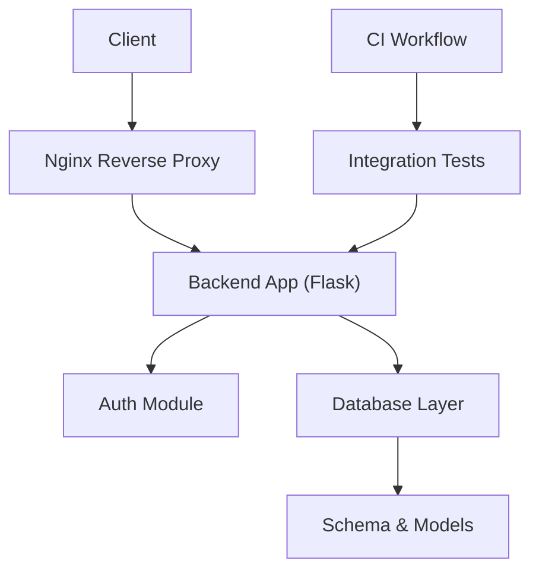
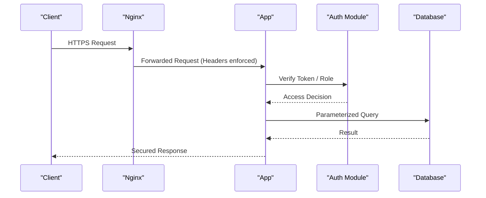
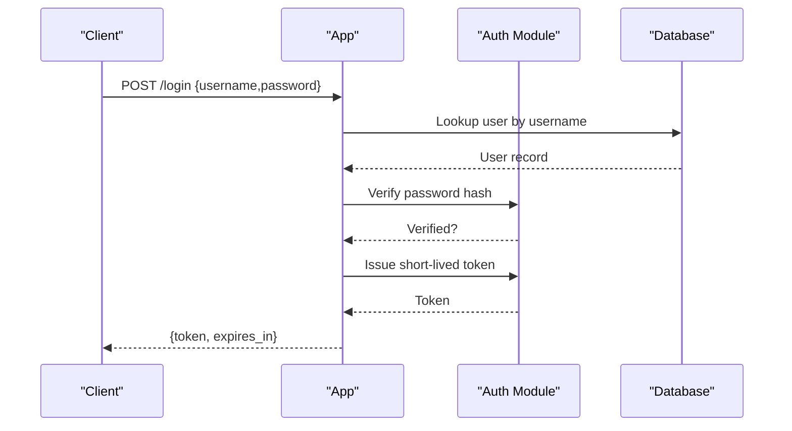
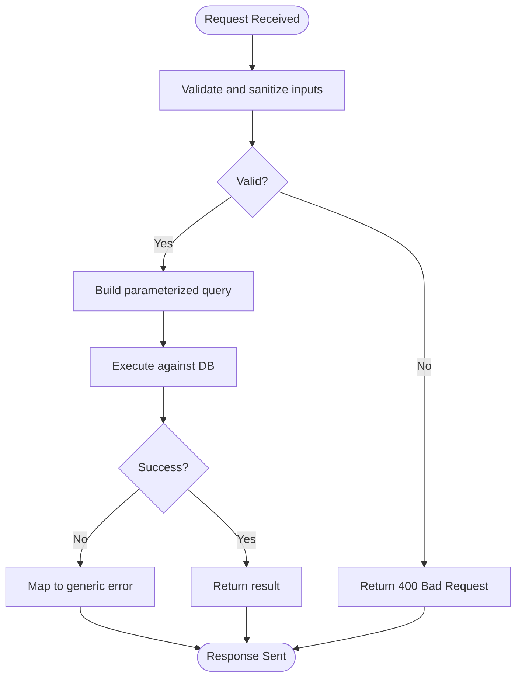
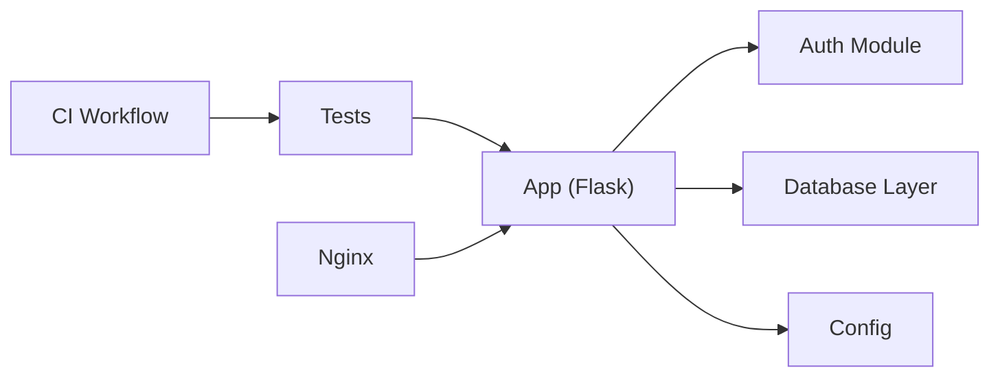

# Security Testing

<cite>
**Referenced Files in This Document**
- [app.py](file://backend/app.py)
- [auth.py](file://backend/auth.py)
- [admin_auth.py](file://backend/admin_auth.py)
- [config.py](file://backend/config.py)
- [database.py](file://backend/database/database.py)
- [models.py](file://backend/database/models.py)
- [schema.sql](file://backend/database/schema.sql)
- [test_api_auth.py](file://backend/tests/integration/test_api_auth.py)
- [test_api_admin.py](file://backend/tests/integration/test_api_admin.py)
- [conftest.py](file://backend/tests/conftest.py)
- [requirements.txt](file://backend/requirements.txt)
- [deploy.yml](file://.github/workflows/deploy.yml)
- [nginx.conf](file://deploy/nginx.conf)
</cite>

## Table of Contents
1. [Introduction](#introduction)
2. [Project Structure](#project-structure)
3. [Core Components](#core-components)
4. [Architecture Overview](#architecture-overview)
5. [Detailed Component Analysis](#detailed-component-analysis)
6. [Dependency Analysis](#dependency-analysis)
7. [Performance Considerations](#performance-considerations)
8. [Troubleshooting Guide](#troubleshooting-guide)
9. [Conclusion](#conclusion)
10. [Appendices](#appendices)

## Introduction
This document defines a comprehensive security testing strategy for the application, covering vulnerability assessment, penetration testing, and compliance validation. It focuses on authentication and authorization testing, input validation, SQL injection prevention verification, JWT token security, CSRF protection, XSS scanning, secure configuration, sensitive data handling, API security, automated security scanning integration, dependency vulnerability checking, best practices validation, test automation, reporting mechanisms, and remediation tracking.

## Project Structure
The backend is a Python web service with:
- Application entrypoint and routing
- Authentication and authorization modules
- Database layer with models and schema
- Integration tests for API endpoints
- Deployment artifacts including CI workflow and reverse proxy configuration

**Diagram sources**
- [app.py:1-200](file://backend/app.py#L1-L200)
- [auth.py:1-200](file://backend/auth.py#L1-L200)
- [database.py:1-200](file://backend/database/database.py#L1-L200)
- [models.py:1-200](file://backend/database/models.py#L1-L200)
- [schema.sql:1-200](file://backend/database/schema.sql#L1-L200)
- [test_api_auth.py:1-200](file://backend/tests/integration/test_api_auth.py#L1-L200)
- [deploy.yml:1-200](file://.github/workflows/deploy.yml#L1-L200)
- [nginx.conf:1-200](file://deploy/nginx.conf#L1-L200)

**Section sources**
- [app.py:1-200](file://backend/app.py#L1-L200)
- [auth.py:1-200](file://backend/auth.py#L1-L200)
- [database.py:1-200](file://backend/database/database.py#L1-L200)
- [models.py:1-200](file://backend/database/models.py#L1-L200)
- [schema.sql:1-200](file://backend/database/schema.sql#L1-L200)
- [test_api_auth.py:1-200](file://backend/tests/integration/test_api_auth.py#L1-L200)
- [deploy.yml:1-200](file://.github/workflows/deploy.yml#L1-L200)
- [nginx.conf:1-200](file://deploy/nginx.conf#L1-L200)

## Core Components
- Authentication and Authorization: Centralized auth module and admin-specific checks.
- API Endpoints: HTTP routes that enforce access control and process inputs.
- Database Layer: Parameterized queries and model definitions to prevent SQL injection.
- Configuration: Secure settings for secrets, tokens, and runtime options.
- Tests: Integration tests validating auth flows and admin access.
- Deployment: Reverse proxy hardening and CI pipeline integration.

Key responsibilities:
- Validate credentials and issue short-lived tokens.
- Enforce role-based access for admin operations.
- Sanitize and validate all user inputs.
- Use parameterized queries exclusively.
- Store secrets via environment variables.
- Harden HTTP headers and TLS termination at the proxy.

**Section sources**
- [auth.py:1-200](file://backend/auth.py#L1-L200)
- [admin_auth.py:1-200](file://backend/admin_auth.py#L1-L200)
- [app.py:1-200](file://backend/app.py#L1-L200)
- [database.py:1-200](file://backend/database/database.py#L1-L200)
- [models.py:1-200](file://backend/database/models.py#L1-L200)
- [config.py:1-200](file://backend/config.py#L1-L200)
- [test_api_auth.py:1-200](file://backend/tests/integration/test_api_auth.py#L1-L200)
- [test_api_admin.py:1-200](file://backend/tests/integration/test_api_admin.py#L1-L200)

## Architecture Overview
Security controls are layered across the stack:
- Transport: TLS termination and strict headers at Nginx.
- Application: Input validation, authentication, authorization, and safe DB access.
- Data: Parameterized queries and least-privilege database accounts.
- CI/CD: Automated security scans and dependency checks.

**Diagram sources**
- [nginx.conf:1-200](file://deploy/nginx.conf#L1-L200)
- [app.py:1-200](file://backend/app.py#L1-L200)
- [auth.py:1-200](file://backend/auth.py#L1-L200)
- [database.py:1-200](file://backend/database/database.py#L1-L200)

## Detailed Component Analysis

### Authentication and Authorization Testing
Objectives:
- Validate login success/failure paths.
- Confirm token issuance and rejection rules.
- Enforce admin-only endpoints.
- Test session/token lifecycle and expiration.

Test scenarios:
- Valid credentials return an access token; invalid credentials return error without revealing details.
- Expired or malformed tokens are rejected.
- Non-admin users cannot access admin endpoints.
- Admin roles are correctly validated per endpoint.

Automation:
- Use existing integration tests as templates to assert status codes and response shapes.
- Add negative cases for missing, expired, tampered, and wrong-signature tokens.

Reporting:
- Record pass/fail per scenario with request/response metadata (sanitized).
- Track regressions over time.

Remediation:
- If auth bypasses occur, add middleware guards and explicit role checks.
- Normalize error messages to avoid information leakage.

**Section sources**
- [auth.py:1-200](file://backend/auth.py#L1-L200)
- [admin_auth.py:1-200](file://backend/admin_auth.py#L1-L200)
- [test_api_auth.py:1-200](file://backend/tests/integration/test_api_auth.py#L1-L200)
- [test_api_admin.py:1-200](file://backend/tests/integration/test_api_admin.py#L1-L200)

#### Sequence: Login and Token Validation

**Diagram sources**
- [app.py:1-200](file://backend/app.py#L1-L200)
- [auth.py:1-200](file://backend/auth.py#L1-L200)
- [database.py:1-200](file://backend/database/database.py#L1-L200)

### Input Validation and SQL Injection Prevention
Objectives:
- Ensure all user inputs are validated and sanitized.
- Prevent SQL injection through parameterized queries only.
- Reject unsafe payloads early.

Validation rules:
- Type, length, format, and range checks for all inputs.
- Whitelist allowed characters where applicable.
- Reject empty or excessively large payloads.

SQL injection prevention:
- Use parameterized queries consistently.
- Avoid string concatenation in SQL.
- Apply least-privilege DB account permissions.

Automated checks:
- Fuzz endpoints with boundary values and common injection patterns.
- Assert no SQL errors leak into responses.

**Section sources**
- [database.py:1-200](file://backend/database/database.py#L1-L200)
- [models.py:1-200](file://backend/database/models.py#L1-L200)
- [schema.sql:1-200](file://backend/database/schema.sql#L1-L200)

#### Flowchart: Input Validation and Safe Query Execution

**Diagram sources**
- [database.py:1-200](file://backend/database/database.py#L1-L200)

### JWT Token Security Testing
Objectives:
- Verify signature integrity and algorithm enforcement.
- Validate expiration and refresh behavior if used.
- Ensure tokens are not logged or exposed.

Test scenarios:
- Accept valid tokens; reject tampered, expired, or unsigned tokens.
- Confirm minimal claims and short TTL.
- Ensure tokens are transmitted only over HTTPS and stored securely on clients.

Remediation:
- Enforce expected algorithms and key management.
- Implement token rotation and revocation lists if needed.

**Section sources**
- [auth.py:1-200](file://backend/auth.py#L1-L200)
- [config.py:1-200](file://backend/config.py#L1-L200)

### CSRF Protection Validation
Objectives:
- Ensure state-changing endpoints require CSRF mitigation.
- Validate SameSite cookie policy and origin checks.

Recommendations:
- Use SameSite=Strict/Lax cookies for session tokens.
- Require custom headers or double-submit tokens for critical mutations.
- Validate Referer/Origin when feasible.

**Section sources**
- [nginx.conf:1-200](file://deploy/nginx.conf#L1-L200)
- [app.py:1-200](file://backend/app.py#L1-L200)

### XSS Vulnerability Scanning
Objectives:
- Detect reflected and stored XSS vectors.
- Validate output encoding and content type policies.

Actions:
- Run DAST scanners against staging.
- Enforce Content-Security-Policy and X-Content-Type-Options via proxy/app.
- Sanitize rich text inputs and render safely.

**Section sources**
- [nginx.conf:1-200](file://deploy/nginx.conf#L1-L200)
- [app.py:1-200](file://backend/app.py#L1-L200)

### Secure Configuration Testing
Objectives:
- Verify secrets are loaded from environment variables.
- Confirm TLS termination and strong cipher suites at the proxy.
- Disable verbose error pages in production.

Checks:
- No hardcoded secrets in code or configs.
- Strict HTTP headers set by Nginx.
- Minimal logging of sensitive data.

**Section sources**
- [config.py:1-200](file://backend/config.py#L1-L200)
- [nginx.conf:1-200](file://deploy/nginx.conf#L1-L200)

### Sensitive Data Handling Validation
Objectives:
- Ensure passwords are hashed and never logged.
- Validate PII minimization and masking in logs.
- Confirm secure storage and transmission.

Actions:
- Audit log statements for sensitive fields.
- Enforce encryption at rest for sensitive files.
- Restrict file permissions and access controls.

**Section sources**
- [auth.py:1-200](file://backend/auth.py#L1-L200)
- [config.py:1-200](file://backend/config.py#L1-L200)

### API Security Testing
Objectives:
- Validate authentication and authorization on all endpoints.
- Test rate limiting and abuse protections.
- Inspect error responses for information disclosure.

Scenarios:
- Unauthenticated access returns 401/403.
- Excessive requests are throttled.
- Errors do not reveal stack traces or internal details.

**Section sources**
- [app.py:1-200](file://backend/app.py#L1-L200)
- [auth.py:1-200](file://backend/auth.py#L1-L200)

### Automated Security Scanning Integration
Objectives:
- Integrate SAST/DAST and dependency checks into CI.
- Gate merges on security findings above thresholds.

Implementation:
- Add steps to scan code and dependencies.
- Publish reports and fail builds on critical issues.

**Section sources**
- [deploy.yml:1-200](file://.github/workflows/deploy.yml#L1-L200)

### Dependency Vulnerability Checking
Objectives:
- Continuously check third-party libraries for known vulnerabilities.
- Update or pin versions based on severity.

Actions:
- Run vulnerability scans in CI and locally.
- Maintain an allowlist and review exceptions.

**Section sources**
- [requirements.txt:1-200](file://backend/requirements.txt#L1-L200)

### Security Best Practices Validation
Objectives:
- Enforce coding standards and security linting.
- Validate secure defaults and configurations.

Checklist:
- Least privilege for services and DB accounts.
- Strong cryptographic choices and key management.
- Comprehensive input validation and output encoding.

**Section sources**
- [config.py:1-200](file://backend/config.py#L1-L200)
- [nginx.conf:1-200](file://deploy/nginx.conf#L1-L200)

### Security Test Automation, Reporting, and Remediation Tracking
Automation:
- Orchestrate unit, integration, and security tests in CI.
- Generate JUnit-style results and security reports.

Reporting:
- Aggregate test outcomes and scanner findings.
- Provide dashboards and trend analysis.

Remediation:
- Create tickets for each finding with severity and owner.
- Track closure and re-test after fixes.

**Section sources**
- [deploy.yml:1-200](file://.github/workflows/deploy.yml#L1-L200)
- [conftest.py:1-200](file://backend/tests/conftest.py#L1-L200)

## Dependency Analysis
Security-relevant dependencies include the web framework, database driver, and utilities. Ensure they are pinned and scanned regularly.

**Diagram sources**
- [app.py:1-200](file://backend/app.py#L1-L200)
- [auth.py:1-200](file://backend/auth.py#L1-L200)
- [database.py:1-200](file://backend/database/database.py#L1-L200)
- [config.py:1-200](file://backend/config.py#L1-L200)
- [test_api_auth.py:1-200](file://backend/tests/integration/test_api_auth.py#L1-L200)
- [deploy.yml:1-200](file://.github/workflows/deploy.yml#L1-L200)
- [nginx.conf:1-200](file://deploy/nginx.conf#L1-L200)

**Section sources**
- [requirements.txt:1-200](file://backend/requirements.txt#L1-L200)
- [deploy.yml:1-200](file://.github/workflows/deploy.yml#L1-L200)

## Performance Considerations
- Keep token lifetimes short to reduce exposure windows.
- Use connection pooling and prepared statements to minimize overhead while maintaining safety.
- Rate-limit sensitive endpoints to mitigate brute-force and DoS risks.
- Cache non-sensitive data judiciously and invalidate securely.

[No sources needed since this section provides general guidance]

## Troubleshooting Guide
Common issues and resolutions:
- Authentication failures due to misconfigured secrets: verify environment variables and key alignment.
- Authorization bypasses: ensure every protected route enforces role checks.
- SQL errors leaking: centralize error mapping and sanitize messages.
- CORS or CSRF mismatches: align client headers with server expectations.
- TLS handshake problems: confirm certificate validity and cipher suites at Nginx.

**Section sources**
- [auth.py:1-200](file://backend/auth.py#L1-L200)
- [admin_auth.py:1-200](file://backend/admin_auth.py#L1-L200)
- [database.py:1-200](file://backend/database/database.py#L1-L200)
- [nginx.conf:1-200](file://deploy/nginx.conf#L1-L200)

## Conclusion
Adopting layered security controls—secure transport, robust authentication and authorization, strict input validation, parameterized queries, hardened configuration, and automated scanning—significantly reduces risk. Integrating these checks into CI ensures continuous assurance and faster remediation.

[No sources needed since this section summarizes without analyzing specific files]

## Appendices

### Security Test Plan Checklist
- Authentication and authorization flows
- JWT token lifecycle and validation
- CSRF mitigations
- XSS scanning and CSP enforcement
- Input validation and SQL injection prevention
- Secure configuration and secrets management
- API security and rate limiting
- Dependency vulnerability scanning
- Logging and monitoring for security events

[No sources needed since this section provides general guidance]