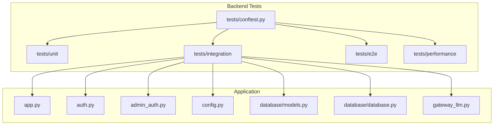
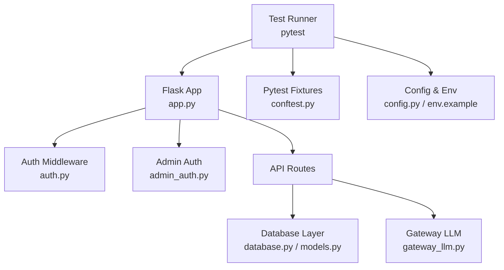
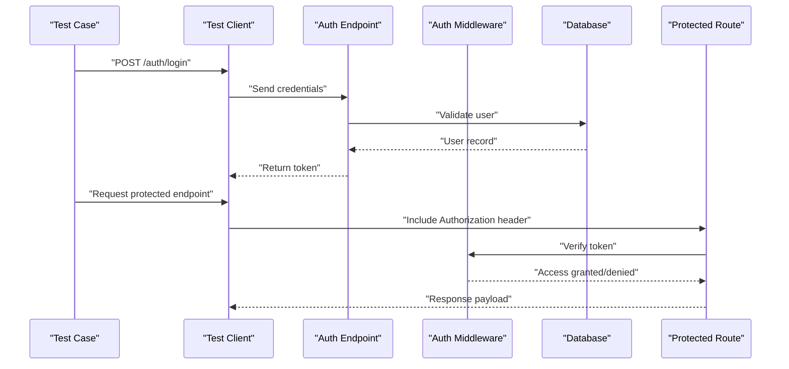
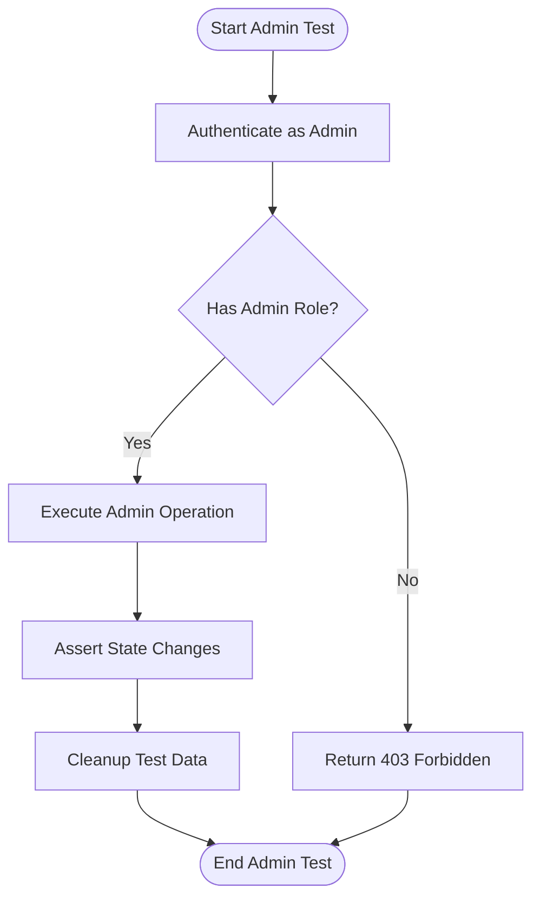
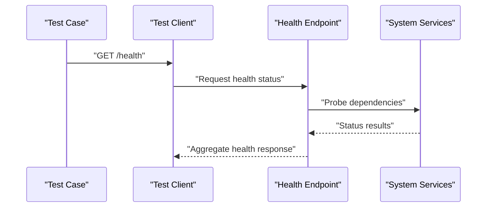
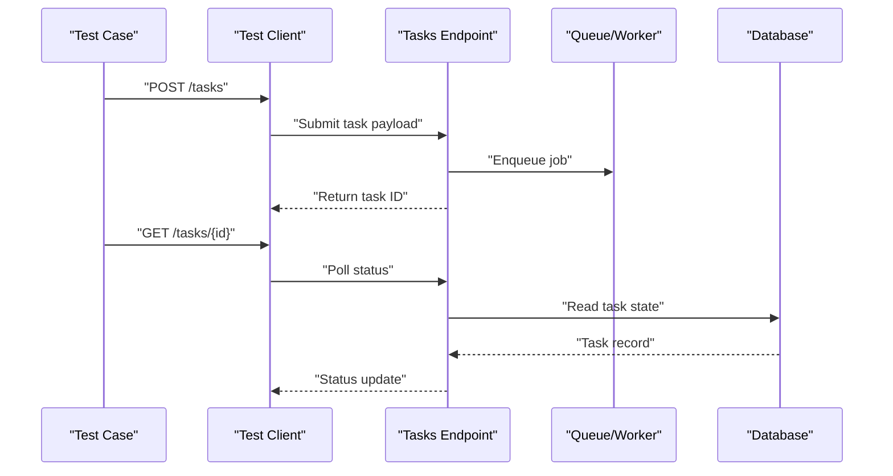
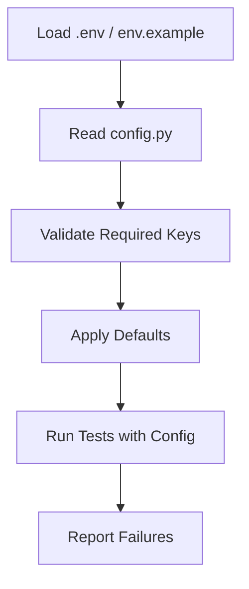
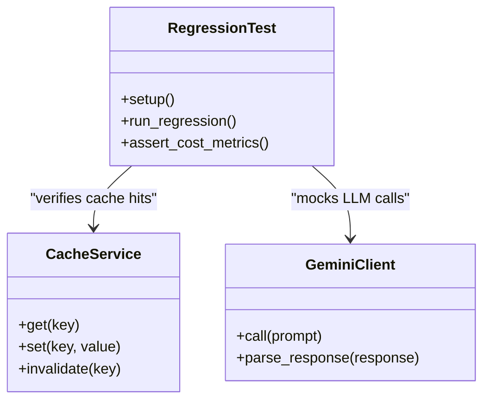
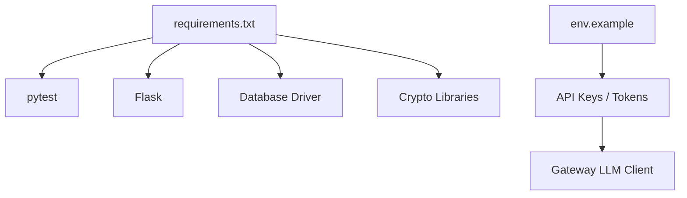
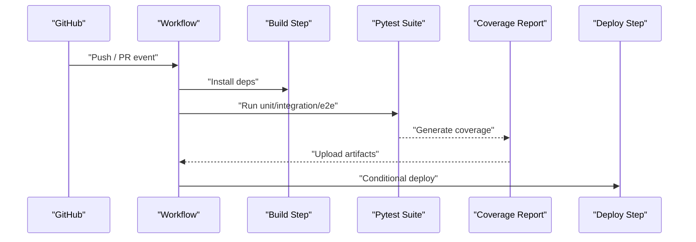

# Testing Strategy

<cite>
**Referenced Files in This Document**
- [backend/tests/conftest.py](file://backend/tests/conftest.py)
- [backend/tests/test_config.py](file://backend/tests/test_config.py)
- [backend/tests/integration/test_api_auth.py](file://backend/tests/integration/test_api_auth.py)
- [backend/tests/integration/test_api_admin.py](file://backend/tests/integration/test_api_admin.py)
- [backend/tests/integration/test_api_health.py](file://backend/tests/integration/test_api_health.py)
- [backend/tests/integration/test_api_tasks.py](file://backend/tests/integration/test_api_tasks.py)
- [backend/app.py](file://backend/app.py)
- [backend/auth.py](file://backend/auth.py)
- [backend/admin_auth.py](file://backend/admin_auth.py)
- [backend/config.py](file://backend/config.py)
- [backend/database/models.py](file://backend/database/models.py)
- [backend/database/database.py](file://backend/database/database.py)
- [backend/gateway_llm.py](file://backend/gateway_llm.py)
- [backend/cost_optimization_demo/regression_test.py](file://backend/cost_optimization_demo/regression_test.py)
- [backend/cost_optimization_demo/test_cache_integration.py](file://backend/cost_optimization_demo/test_cache_integration.py)
- [backend/requirements.txt](file://backend/requirements.txt)
- [backend/start-test.bat](file://backend/start-test.bat)
- [backend/test_all.py](file://backend/test_all.py)
- [backend/test_api.sh](file://backend/test_api.sh)
- [backend/test_api.ps1](file://backend/test_api.ps1)
- [backend/check-env.bat](file://backend/check-env.bat)
- [backend/env.example](file://backend/env.example)
- [.github/workflows/deploy.yml](file://.github/workflows/deploy.yml)
</cite>

## Table of Contents
1. [Introduction](#introduction)
2. [Project Structure](#project-structure)
3. [Core Components](#core-components)
4. [Architecture Overview](#architecture-overview)
5. [Detailed Component Analysis](#detailed-component-analysis)
6. [Dependency Analysis](#dependency-analysis)
7. [Performance Considerations](#performance-considerations)
8. [Troubleshooting Guide](#troubleshooting-guide)
9. [Conclusion](#conclusion)
10. [Appendices](#appendices)

## Introduction
This document defines the comprehensive testing strategy for the XSYY Edu platform. It covers pytest setup, test organization patterns, mocking strategies for external dependencies, unit and integration tests, end-to-end workflows, performance and load testing, security testing, continuous integration, quality gates, best practices, coverage requirements, and test data management. The goal is to ensure reliable, maintainable, and secure software delivery across development, staging, and production environments.

## Project Structure
The backend organizes tests under a dedicated directory with clear separation by scope:
- Unit tests: backend/tests/unit
- Integration tests: backend/tests/integration
- End-to-end tests: backend/tests/e2e
- Performance tests: backend/tests/performance
- Shared fixtures and configuration: backend/tests/conftest.py

Additional scripts support local execution and environment checks:
- Test runners and helpers: backend/test_all.py, backend/start-test.bat, backend/test_api.sh, backend/test_api.ps1
- Environment validation: backend/check-env.bat
- Example environment variables: backend/env.example

**Diagram sources**
- [backend/tests/conftest.py](file://backend/tests/conftest.py)
- [backend/app.py](file://backend/app.py)
- [backend/auth.py](file://backend/auth.py)
- [backend/admin_auth.py](file://backend/admin_auth.py)
- [backend/config.py](file://backend/config.py)
- [backend/database/models.py](file://backend/database/models.py)
- [backend/database/database.py](file://backend/database/database.py)
- [backend/gateway_llm.py](file://backend/gateway_llm.py)

**Section sources**
- [backend/tests/conftest.py](file://backend/tests/conftest.py)
- [backend/tests/integration/test_api_auth.py](file://backend/tests/integration/test_api_auth.py)
- [backend/tests/integration/test_api_admin.py](file://backend/tests/integration/test_api_admin.py)
- [backend/tests/integration/test_api_health.py](file://backend/tests/integration/test_api_health.py)
- [backend/tests/integration/test_api_tasks.py](file://backend/tests/integration/test_api_tasks.py)
- [backend/test_all.py](file://backend/test_all.py)
- [backend/start-test.bat](file://backend/start-test.bat)
- [backend/test_api.sh](file://backend/test_api.sh)
- [backend/test_api.ps1](file://backend/test_api.ps1)
- [backend/check-env.bat](file://backend/check-env.bat)
- [backend/env.example](file://backend/env.example)

## Core Components
- Pytest configuration and shared fixtures are centralized in conftest.py to provide consistent application context, database connections, and client instances across tests.
- Configuration-driven tests rely on config.py and env.example to manage settings such as database URLs, API keys, and feature flags.
- Integration tests exercise real endpoints via the Flask app instance, validating authentication flows, admin operations, health checks, and task APIs.
- Database models and ORM interactions are validated through integration tests that use the configured database layer.
- External service calls (e.g., gateway LLM) are isolated using mocks or stubs to avoid flakiness and reduce cost.

Key responsibilities:
- Conftest: Provide app factory, test client, DB session, and fixture utilities.
- Config: Supply deterministic settings for tests and CI.
- Auth/AdminAuth: Validate token-based access control and role enforcement.
- Database: Ensure schema migrations and model behavior are correct.
- GatewayLLM: Mock responses for AI services during tests.

**Section sources**
- [backend/tests/conftest.py](file://backend/tests/conftest.py)
- [backend/config.py](file://backend/config.py)
- [backend/auth.py](file://backend/auth.py)
- [backend/admin_auth.py](file://backend/admin_auth.py)
- [backend/database/models.py](file://backend/database/models.py)
- [backend/database/database.py](file://backend/database/database.py)
- [backend/gateway_llm.py](file://backend/gateway_llm.py)

## Architecture Overview
The testing architecture integrates unit, integration, and e2e layers around the Flask application. Integration tests interact with the live app and database, while unit tests isolate business logic and external dependencies. Performance and regression tests validate stability and resource usage.

**Diagram sources**
- [backend/app.py](file://backend/app.py)
- [backend/auth.py](file://backend/auth.py)
- [backend/admin_auth.py](file://backend/admin_auth.py)
- [backend/database/database.py](file://backend/database/database.py)
- [backend/database/models.py](file://backend/database/models.py)
- [backend/gateway_llm.py](file://backend/gateway_llm.py)
- [backend/tests/conftest.py](file://backend/tests/conftest.py)
- [backend/config.py](file://backend/config.py)
- [backend/env.example](file://backend/env.example)

## Detailed Component Analysis

### Authentication Flow Testing
Integration tests verify login, token issuance, protected route access, and admin-only endpoints.

**Diagram sources**
- [backend/tests/integration/test_api_auth.py](file://backend/tests/integration/test_api_auth.py)
- [backend/auth.py](file://backend/auth.py)
- [backend/app.py](file://backend/app.py)
- [backend/database/database.py](file://backend/database/database.py)
- [backend/database/models.py](file://backend/database/models.py)

**Section sources**
- [backend/tests/integration/test_api_auth.py](file://backend/tests/integration/test_api_auth.py)
- [backend/auth.py](file://backend/auth.py)
- [backend/app.py](file://backend/app.py)
- [backend/database/database.py](file://backend/database/database.py)
- [backend/database/models.py](file://backend/database/models.py)

### Admin Operations Testing
Admin endpoints require elevated privileges. Tests assert authorization checks and side effects on resources.

**Diagram sources**
- [backend/tests/integration/test_api_admin.py](file://backend/tests/integration/test_api_admin.py)
- [backend/admin_auth.py](file://backend/admin_auth.py)
- [backend/app.py](file://backend/app.py)

**Section sources**
- [backend/tests/integration/test_api_admin.py](file://backend/tests/integration/test_api_admin.py)
- [backend/admin_auth.py](file://backend/admin_auth.py)
- [backend/app.py](file://backend/app.py)

### Health Check Testing
Health endpoints validate system readiness and dependency status.

**Diagram sources**
- [backend/tests/integration/test_api_health.py](file://backend/tests/integration/test_api_health.py)
- [backend/app.py](file://backend/app.py)

**Section sources**
- [backend/tests/integration/test_api_health.py](file://backend/tests/integration/test_api_health.py)
- [backend/app.py](file://backend/app.py)

### Task API Testing
Task endpoints orchestrate background jobs and state transitions. Tests cover creation, polling, completion, and error handling.

**Diagram sources**
- [backend/tests/integration/test_api_tasks.py](file://backend/tests/integration/test_api_tasks.py)
- [backend/app.py](file://backend/app.py)
- [backend/database/database.py](file://backend/database/database.py)
- [backend/database/models.py](file://backend/database/models.py)

**Section sources**
- [backend/tests/integration/test_api_tasks.py](file://backend/tests/integration/test_api_tasks.py)
- [backend/app.py](file://backend/app.py)
- [backend/database/database.py](file://backend/database/database.py)
- [backend/database/models.py](file://backend/database/models.py)

### Configuration Testing
Configuration-driven behavior ensures deterministic test runs. Tests validate defaults, overrides, and required environment variables.

**Diagram sources**
- [backend/tests/test_config.py](file://backend/tests/test_config.py)
- [backend/config.py](file://backend/config.py)
- [backend/env.example](file://backend/env.example)

**Section sources**
- [backend/tests/test_config.py](file://backend/tests/test_config.py)
- [backend/config.py](file://backend/config.py)
- [backend/env.example](file://backend/env.example)

### Cost Optimization Regression Tests
Regression tests guard against unintended changes in cost-sensitive components like caching and LLM client behavior.

**Diagram sources**
- [backend/cost_optimization_demo/regression_test.py](file://backend/cost_optimization_demo/regression_test.py)
- [backend/cost_optimization_demo/test_cache_integration.py](file://backend/cost_optimization_demo/test_cache_integration.py)

**Section sources**
- [backend/cost_optimization_demo/regression_test.py](file://backend/cost_optimization_demo/regression_test.py)
- [backend/cost_optimization_demo/test_cache_integration.py](file://backend/cost_optimization_demo/test_cache_integration.py)

## Dependency Analysis
External dependencies relevant to testing include pytest, Flask test client, database drivers, and optional LLM clients. Requirements are declared in requirements.txt; environment variables are documented in env.example.

**Diagram sources**
- [backend/requirements.txt](file://backend/requirements.txt)
- [backend/env.example](file://backend/env.example)

**Section sources**
- [backend/requirements.txt](file://backend/requirements.txt)
- [backend/env.example](file://backend/env.example)

## Performance Considerations
- Use lightweight fixtures and minimal payloads to keep unit tests fast.
- For integration tests, limit database size and use transactional rollback where possible.
- Isolate LLM calls with deterministic mocks to avoid network variability and cost spikes.
- Implement performance benchmarks for critical paths (e.g., auth verification, query latency).
- Track metrics such as CPU, memory, and request duration; set thresholds in CI.

[No sources needed since this section provides general guidance]

## Troubleshooting Guide
Common issues and resolutions:
- Missing environment variables: Ensure env.example values are present in the test environment; use check-env.bat to validate.
- Database connection failures: Confirm database URL and credentials; reset schema if necessary.
- Flaky LLM tests: Replace real calls with mocked responses; assert structure rather than exact content.
- Permission errors: Verify admin roles and tokens in integration tests.
- Slow tests: Reduce dataset size, parallelize non-shared fixtures, and avoid heavy I/O.

Operational helpers:
- Local test runner: backend/start-test.bat
- Cross-platform API tests: backend/test_api.sh, backend/test_api.ps1
- Full suite entrypoint: backend/test_all.py

**Section sources**
- [backend/check-env.bat](file://backend/check-env.bat)
- [backend/start-test.bat](file://backend/start-test.bat)
- [backend/test_api.sh](file://backend/test_api.sh)
- [backend/test_api.ps1](file://backend/test_api.ps1)
- [backend/test_all.py](file://backend/test_all.py)

## Conclusion
The XSYY Edu testing strategy combines pytest-based unit, integration, and e2e tests with robust configuration, mocking, and CI automation. By isolating external dependencies, enforcing quality gates, and maintaining clear test organization, the platform achieves reliability, security, and performance assurance across all environments.

[No sources needed since this section summarizes without analyzing specific files]

## Appendices

### Continuous Integration Setup
GitHub Actions workflow orchestrates build, test, and deployment steps. Integrate pytest runs, coverage reporting, and artifact uploads into the pipeline.

**Diagram sources**
- [.github/workflows/deploy.yml](file://.github/workflows/deploy.yml)

**Section sources**
- [.github/workflows/deploy.yml](file://.github/workflows/deploy.yml)

### Security Testing
- Penetration testing: Simulate common attack vectors (injection, broken auth) against API endpoints.
- Vulnerability scanning: Use static analysis and dependency scanners; enforce fail-on-severity thresholds.
- Compliance validation: Verify secrets handling, logging sanitization, and data retention policies.

[No sources needed since this section provides general guidance]

### Best Practices
- Keep tests deterministic and independent; avoid shared mutable state.
- Prefer explicit assertions over implicit behavior.
- Use descriptive test names and organize by feature or component.
- Maintain small, focused fixtures; reuse via conftest.py.
- Version test data alongside code when necessary.

[No sources needed since this section provides general guidance]

### Code Coverage Requirements
- Set minimum coverage thresholds per module.
- Exclude generated or third-party code from coverage.
- Publish coverage reports in CI and block merges below thresholds.

[No sources needed since this section provides general guidance]

### Test Data Management
- Seed minimal datasets for each test scenario.
- Use transactions or in-memory databases for isolation.
- Clean up after tests to prevent cross-test contamination.

[No sources needed since this section provides general guidance]

### Examples of Effective Tests
- Unit tests: Validate pure functions and business rules with edge cases.
- Integration tests: Assert HTTP status codes, headers, and payload schemas.
- E2E tests: Drive key user journeys across UI and backend.

[No sources needed since this section provides general guidance]

### Debugging Test Failures
- Enable verbose output and capture logs.
- Reproduce failures locally with the same environment variables.
- Isolate failing tests using markers or selective runs.

[No sources needed since this section provides general guidance]

### Maintaining Test Suites
- Regularly refactor tests to match evolving APIs.
- Remove obsolete tests and mark deprecated features.
- Monitor flakiness and stabilize unstable tests.

[No sources needed since this section provides general guidance]