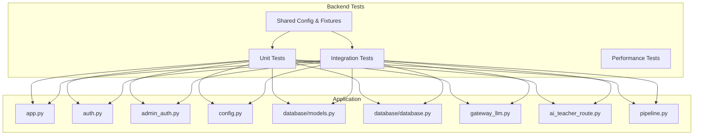
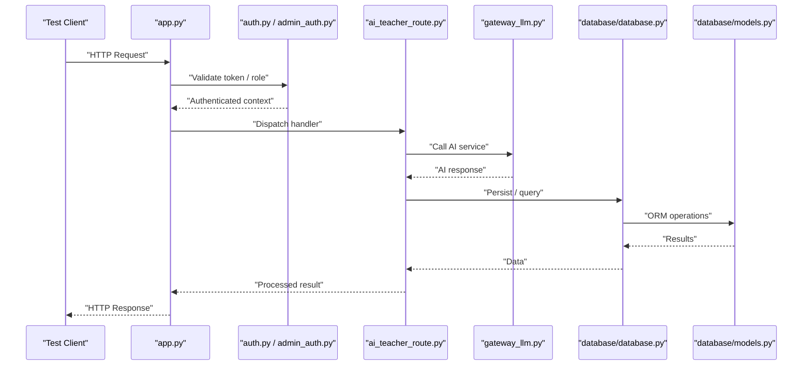
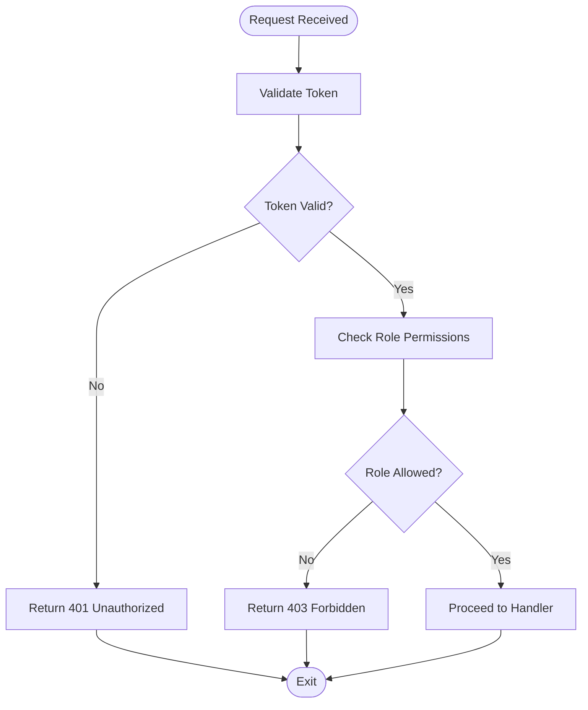
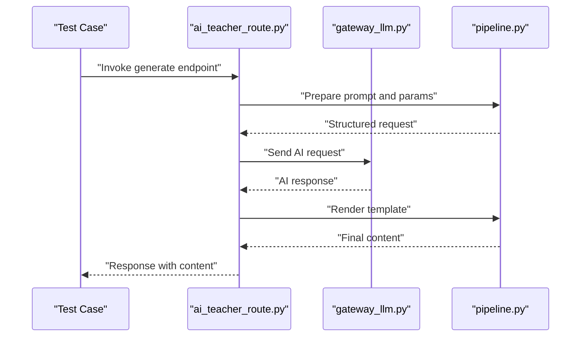
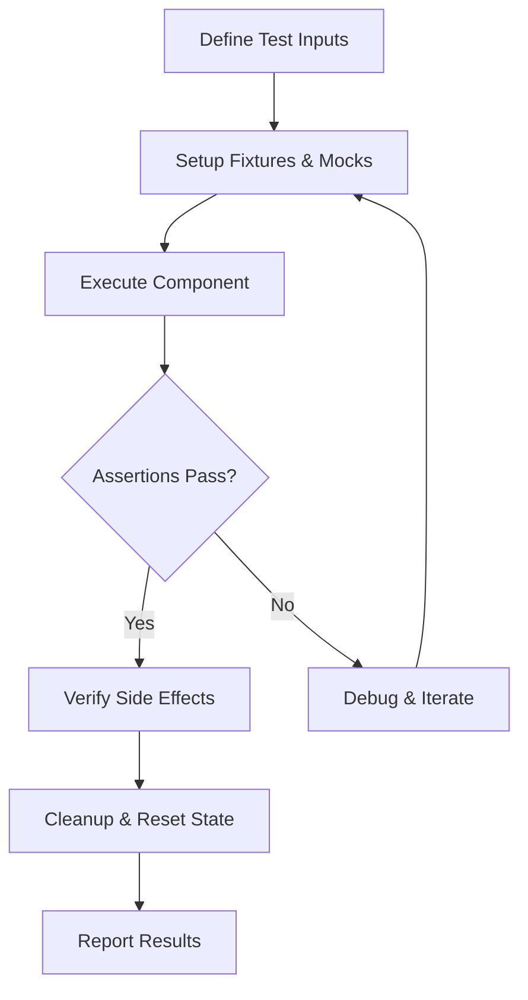
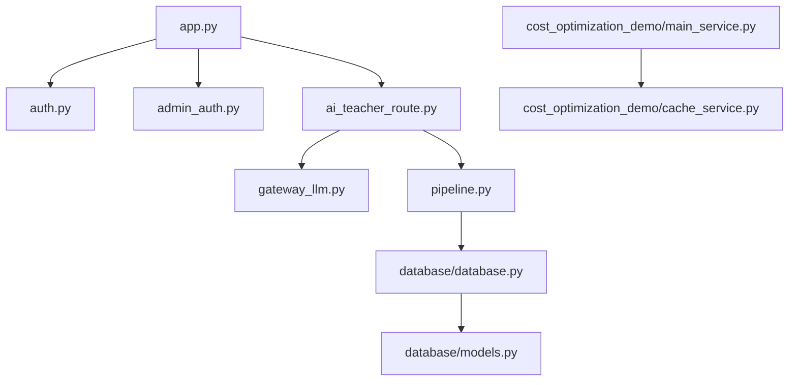

# Unit Testing

<cite>
**Referenced Files in This Document**
- [backend/tests/conftest.py](file://backend/tests/conftest.py)
- [backend/tests/test_config.py](file://backend/tests/test_config.py)
- [backend/tests/integration/test_api_auth.py](file://backend/tests/integration/test_api_auth.py)
- [backend/tests/integration/test_api_admin.py](file://backend/tests/integration/test_api_admin.py)
- [backend/tests/integration/test_api_health.py](file://backend/tests/integration/test_api_health.py)
- [backend/tests/integration/test_api_tasks.py](file://backend/tests/integration/test_api_tasks.py)
- [backend/app.py](file://backend/app.py)
- [backend/auth.py](file://backend/auth.py)
- [backend/admin_auth.py](file://backend/admin_auth.py)
- [backend/config.py](file://backend/config.py)
- [backend/database/models.py](file://backend/database/models.py)
- [backend/database/database.py](file://backend/database/database.py)
- [backend/gateway_llm.py](file://backend/gateway_llm.py)
- [backend/cost_optimization_demo/main_service.py](file://backend/cost_optimization_demo/main_service.py)
- [backend/cost_optimization_demo/cache_service.py](file://backend/cost_optimization_demo/cache_service.py)
- [backend/cost_optimization_demo/test_cache_integration.py](file://backend/cost_optimization_demo/test_cache_integration.py)
- [backend/ai_teacher_route.py](file://backend/ai_teacher_route.py)
- [backend/pipeline.py](file://backend/pipeline.py)
</cite>

## Table of Contents
1. [Introduction](#introduction)
2. [Project Structure](#project-structure)
3. [Core Components](#core-components)
4. [Architecture Overview](#architecture-overview)
5. [Detailed Component Analysis](#detailed-component-analysis)
6. [Dependency Analysis](#dependency-analysis)
7. [Performance Considerations](#performance-considerations)
8. [Troubleshooting Guide](#troubleshooting-guide)
9. [Conclusion](#conclusion)
10. [Appendices](#appendices)

## Introduction
This document provides comprehensive unit testing guidance for the XSYY Edu platform backend. It explains how pytest is set up, how tests are organized, and how to mock external dependencies such as AI services and database connections. It also covers writing effective unit tests for authentication modules, content generation functions, and utility classes; managing test data with fixtures; using parameterized tests; validating error handling and edge cases; and establishing code coverage requirements, naming conventions, and debugging techniques.

## Project Structure
The backend test suite follows a layered structure:
- Unit tests: isolated logic verification without network or DB calls
- Integration tests: API endpoints and cross-component flows
- Performance tests: optional benchmarks and load scenarios
- Shared configuration and fixtures: centralized setup via pytest plugins and conftest

**Diagram sources**
- [backend/tests/conftest.py](file://backend/tests/conftest.py)
- [backend/tests/test_config.py](file://backend/tests/test_config.py)
- [backend/tests/integration/test_api_auth.py](file://backend/tests/integration/test_api_auth.py)
- [backend/app.py](file://backend/app.py)
- [backend/auth.py](file://backend/auth.py)
- [backend/admin_auth.py](file://backend/admin_auth.py)
- [backend/config.py](file://backend/config.py)
- [backend/database/models.py](file://backend/database/models.py)
- [backend/database/database.py](file://backend/database/database.py)
- [backend/gateway_llm.py](file://backend/gateway_llm.py)
- [backend/ai_teacher_route.py](file://backend/ai_teacher_route.py)
- [backend/pipeline.py](file://backend/pipeline.py)

**Section sources**
- [backend/tests/conftest.py](file://backend/tests/conftest.py)
- [backend/tests/test_config.py](file://backend/tests/test_config.py)
- [backend/tests/integration/test_api_auth.py](file://backend/tests/integration/test_api_auth.py)
- [backend/tests/integration/test_api_admin.py](file://backend/tests/integration/test_api_admin.py)
- [backend/tests/integration/test_api_health.py](file://backend/tests/integration/test_api_health.py)
- [backend/tests/integration/test_api_tasks.py](file://backend/tests/integration/test_api_tasks.py)

## Core Components
Key components that require robust unit testing include:
- Authentication and authorization (user and admin auth)
- Configuration management
- Database models and access layer
- AI gateway and teacher route handlers
- Pipeline orchestration for content generation
- Cost optimization demo services (cache and main service)

Testing priorities:
- Isolate business logic from external systems using mocks and fixtures
- Validate input validation, error paths, and edge cases
- Ensure deterministic behavior by controlling time, randomness, and environment variables

**Section sources**
- [backend/auth.py](file://backend/auth.py)
- [backend/admin_auth.py](file://backend/admin_auth.py)
- [backend/config.py](file://backend/config.py)
- [backend/database/models.py](file://backend/database/models.py)
- [backend/database/database.py](file://backend/database/database.py)
- [backend/gateway_llm.py](file://backend/gateway_llm.py)
- [backend/ai_teacher_route.py](file://backend/ai_teacher_route.py)
- [backend/pipeline.py](file://backend/pipeline.py)
- [backend/cost_optimization_demo/main_service.py](file://backend/cost_optimization_demo/main_service.py)
- [backend/cost_optimization_demo/cache_service.py](file://backend/cost_optimization_demo/cache_service.py)

## Architecture Overview
The backend exposes HTTP endpoints through a central application module. Authentication layers protect routes, while AI and pipeline modules handle content generation. The database layer abstracts persistence. Tests interact with these layers either directly (unit) or via the application interface (integration).

**Diagram sources**
- [backend/app.py](file://backend/app.py)
- [backend/auth.py](file://backend/auth.py)
- [backend/admin_auth.py](file://backend/admin_auth.py)
- [backend/ai_teacher_route.py](file://backend/ai_teacher_route.py)
- [backend/gateway_llm.py](file://backend/gateway_llm.py)
- [backend/database/database.py](file://backend/database/database.py)
- [backend/database/models.py](file://backend/database/models.py)

## Detailed Component Analysis

### Pytest Framework Setup and Test Organization
- Use a shared conftest.py for fixtures, global configurations, and plugin settings
- Organize tests into directories:
  - unit: pure function and class tests
  - integration: endpoint and cross-module flows
  - performance: optional benchmarks
- Naming conventions:
  - Files: test_<module>.py
  - Functions: test_<behavior>_<scenario>_<expected>
  - Classes: Test<Module><Scenario>

Recommended fixture patterns:
- app_client: create an isolated test client for the application
- db_session: provide a transactional or in-memory database session
- ai_gateway_mock: replace AI calls with deterministic responses
- config_override: inject environment variables for controlled configuration

Coverage configuration:
- Set minimum thresholds for overall and per-file coverage
- Exclude non-test files and generated artifacts
- Report failures when thresholds are not met

**Section sources**
- [backend/tests/conftest.py](file://backend/tests/conftest.py)
- [backend/tests/test_config.py](file://backend/tests/test_config.py)

### Mocking Strategies for External Dependencies
- AI Services (gateway_llm.py):
  - Replace network calls with local stubs returning predefined payloads
  - Simulate latency and errors to validate retry and fallback logic
- Database Layer (database/database.py, database/models.py):
  - Use in-memory databases or transaction rollbacks to isolate state
  - Seed minimal datasets via fixtures
- File Storage and Templates:
  - Mount temporary directories for file I/O operations
  - Provide template strings instead of reading from disk

Best practices:
- Keep mocks close to their usage sites (per-test or per-class fixtures)
- Assert on interactions (calls, arguments) and outputs
- Avoid over-mocking core logic; only externalize side effects

**Section sources**
- [backend/gateway_llm.py](file://backend/gateway_llm.py)
- [backend/database/database.py](file://backend/database/database.py)
- [backend/database/models.py](file://backend/database/models.py)

### Authentication Modules Testing
Focus areas:
- Token validation and expiration handling
- Role-based authorization checks
- Error responses for invalid credentials and malformed tokens

Test patterns:
- Parameterized tests for multiple token formats and roles
- Negative tests for expired, revoked, and missing tokens
- Assertions on status codes and payload structures

**Diagram sources**
- [backend/auth.py](file://backend/auth.py)
- [backend/admin_auth.py](file://backend/admin_auth.py)

**Section sources**
- [backend/auth.py](file://backend/auth.py)
- [backend/admin_auth.py](file://backend/admin_auth.py)
- [backend/tests/integration/test_api_auth.py](file://backend/tests/integration/test_api_auth.py)

### Content Generation and AI Teacher Route
Focus areas:
- Input validation for prompts and parameters
- Handling AI service responses and errors
- Template rendering and output formatting

Test patterns:
- Stub AI responses to cover success, partial, and failure cases
- Validate template placeholders and output schema
- Assert error propagation and user-friendly messages

**Diagram sources**
- [backend/ai_teacher_route.py](file://backend/ai_teacher_route.py)
- [backend/gateway_llm.py](file://backend/gateway_llm.py)
- [backend/pipeline.py](file://backend/pipeline.py)

**Section sources**
- [backend/ai_teacher_route.py](file://backend/ai_teacher_route.py)
- [backend/gateway_llm.py](file://backend/gateway_llm.py)
- [backend/pipeline.py](file://backend/pipeline.py)

### Configuration Management Testing
Focus areas:
- Environment variable loading and defaults
- Validation of required settings
- Safe overrides during tests

Test patterns:
- Parameterized tests for different configuration sets
- Assertions on parsed values and type conversions
- Verify behavior under missing or invalid configs

**Section sources**
- [backend/config.py](file://backend/config.py)
- [backend/tests/test_config.py](file://backend/tests/test_config.py)

### Database Models and Access Layer Testing
Focus areas:
- ORM model definitions and constraints
- Query correctness and performance
- Transaction isolation and rollback behavior

Test patterns:
- In-memory database sessions for fast iteration
- Seed fixtures for consistent test data
- Assertions on query results and side effects

**Section sources**
- [backend/database/models.py](file://backend/database/models.py)
- [backend/database/database.py](file://backend/database/database.py)

### Cost Optimization Demo Services
Focus areas:
- Cache hit/miss behavior
- Main service orchestration and caching decisions
- Deterministic outcomes under varied inputs

Test patterns:
- Stub cache implementations
- Assert cache population and retrieval
- Validate service responses under cache-enabled and disabled modes

**Section sources**
- [backend/cost_optimization_demo/main_service.py](file://backend/cost_optimization_demo/main_service.py)
- [backend/cost_optimization_demo/cache_service.py](file://backend/cost_optimization_demo/cache_service.py)
- [backend/cost_optimization_demo/test_cache_integration.py](file://backend/cost_optimization_demo/test_cache_integration.py)

### Conceptual Overview
Conceptual workflow for unit testing any component:
- Define inputs and expected outputs
- Prepare fixtures and mocks
- Execute the component under test
- Assert behavior and side effects
- Clean up resources and verify isolation

[No sources needed since this diagram shows conceptual workflow, not actual code structure]

## Dependency Analysis
Dependencies between core modules and their test implications:
- app.py depends on auth, routes, and middleware
- ai_teacher_route.py depends on gateway_llm and pipeline
- database layer depends on models and connection configuration
- cost optimization demo depends on cache and main service

**Diagram sources**
- [backend/app.py](file://backend/app.py)
- [backend/auth.py](file://backend/auth.py)
- [backend/admin_auth.py](file://backend/admin_auth.py)
- [backend/ai_teacher_route.py](file://backend/ai_teacher_route.py)
- [backend/gateway_llm.py](file://backend/gateway_llm.py)
- [backend/pipeline.py](file://backend/pipeline.py)
- [backend/database/database.py](file://backend/database/database.py)
- [backend/database/models.py](file://backend/database/models.py)
- [backend/cost_optimization_demo/main_service.py](file://backend/cost_optimization_demo/main_service.py)
- [backend/cost_optimization_demo/cache_service.py](file://backend/cost_optimization_demo/cache_service.py)

**Section sources**
- [backend/app.py](file://backend/app.py)
- [backend/auth.py](file://backend/auth.py)
- [backend/admin_auth.py](file://backend/admin_auth.py)
- [backend/ai_teacher_route.py](file://backend/ai_teacher_route.py)
- [backend/gateway_llm.py](file://backend/gateway_llm.py)
- [backend/pipeline.py](file://backend/pipeline.py)
- [backend/database/database.py](file://backend/database/database.py)
- [backend/database/models.py](file://backend/database/models.py)
- [backend/cost_optimization_demo/main_service.py](file://backend/cost_optimization_demo/main_service.py)
- [backend/cost_optimization_demo/cache_service.py](file://backend/cost_optimization_demo/cache_service.py)

## Performance Considerations
- Prefer in-memory databases and lightweight mocks for unit tests
- Avoid heavy initialization in fixtures; use lazy setup where possible
- Separate slow integration tests from fast unit tests
- Use parameterized tests to reduce duplication and improve coverage
- Monitor test execution time and optimize bottlenecks

[No sources needed since this section provides general guidance]

## Troubleshooting Guide
Common issues and resolutions:
- Flaky tests due to shared state:
  - Ensure each test runs in isolation with fresh fixtures
  - Roll back transactions or reset caches after tests
- Network timeouts in AI calls:
  - Stub all external requests and assert behavior deterministically
- Configuration mismatches:
  - Override environment variables in fixtures and assert defaults
- Coverage gaps:
  - Identify untested branches and add targeted tests
  - Exclude non-test artifacts from coverage reports

Debugging techniques:
- Use verbose logging and print statements sparingly
- Leverage pytest’s -v and -s flags for detailed output
- Inspect fixture scopes and lifetimes
- Reproduce failures locally with minimal test cases

**Section sources**
- [backend/tests/conftest.py](file://backend/tests/conftest.py)
- [backend/tests/test_config.py](file://backend/tests/test_config.py)

## Conclusion
A robust unit testing strategy for XSYY Edu ensures reliability, maintainability, and confidence in changes. By isolating external dependencies, organizing tests effectively, and enforcing coverage standards, the team can deliver high-quality features while minimizing regressions. Adopt the patterns outlined here to build a resilient test suite aligned with the platform’s architecture and goals.

[No sources needed since this section summarizes without analyzing specific files]

## Appendices
- Test naming conventions:
  - test_<function>_<scenario>_<expected_result>
  - Example: test_validate_token_expired_returns_401
- Fixture best practices:
  - Keep fixtures small and focused
  - Use autouse sparingly; prefer explicit injection
- Parameterized testing:
  - Use @pytest.mark.parametrize for input/output pairs
  - Group related scenarios to improve readability
- Code coverage thresholds:
  - Set minimums for overall and critical modules
  - Fail CI builds when thresholds are not met

[No sources needed since this section provides general guidance]