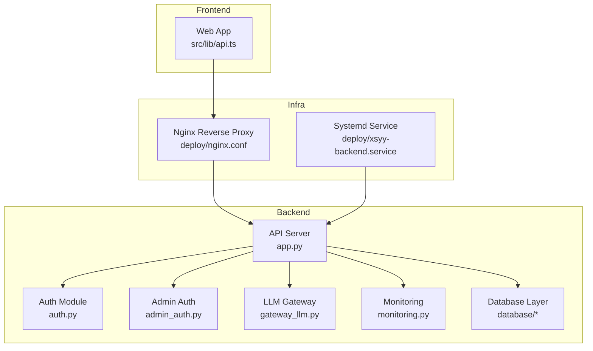
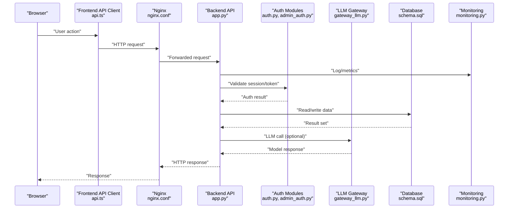
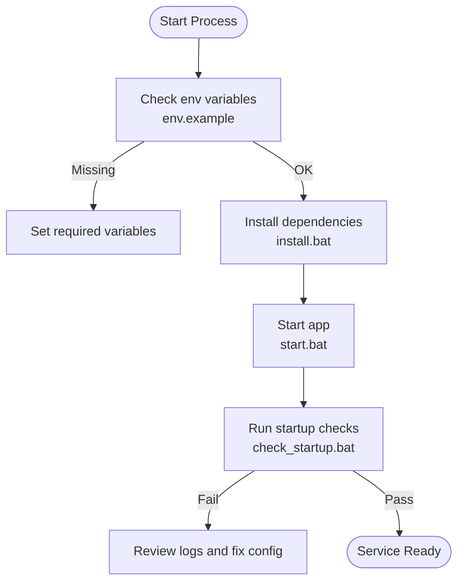
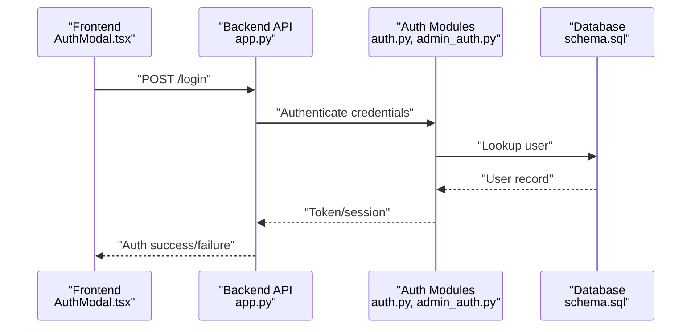
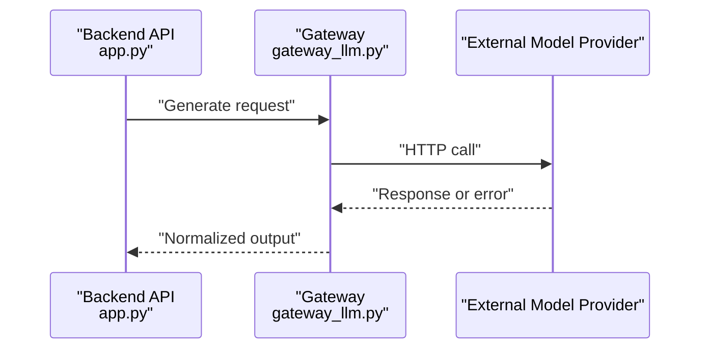
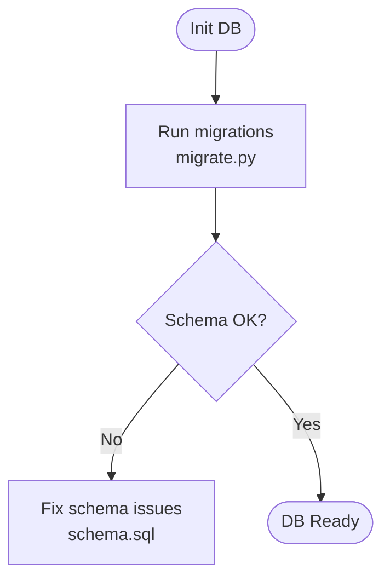
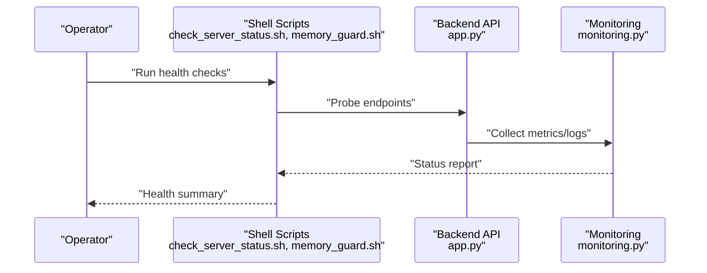
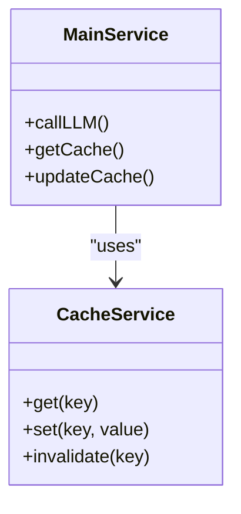
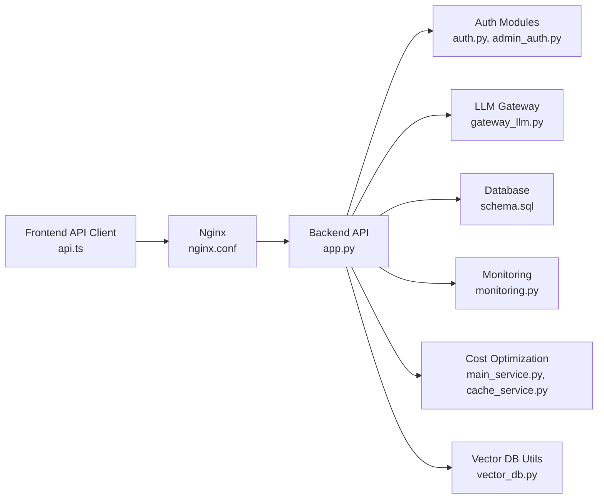

# Troubleshooting & FAQ

<cite>
**Referenced Files in This Document**
- [backend/app.py](file://backend/app.py)
- [backend/config.py](file://backend/config.py)
- [backend/monitoring.py](file://backend/monitoring.py)
- [backend/check_server_status.sh](file://backend/check_server_status.sh)
- [backend/memory_guard.sh](file://backend/memory_guard.sh)
- [backend/start.bat](file://backend/start.bat)
- [backend/install.bat](file://backend/install.bat)
- [backend/check_startup.bat](file://backend/check_startup.bat)
- [backend/env.example](file://backend/env.example)
- [backend/PERFORMANCE_OPTIMIZATION.md](file://backend/PERFORMANCE_OPTIMIZATION.md)
- [backend/database/schema.sql](file://backend/database/schema.sql)
- [backend/database/migrate.py](file://backend/database/migrate.py)
- [backend/gateway_llm.py](file://backend/gateway_llm.py)
- [backend/auth.py](file://backend/auth.py)
- [backend/admin_auth.py](file://backend/admin_auth.py)
- [backend/cost_optimization_demo/main_service.py](file://backend/cost_optimization_demo/main_service.py)
- [backend/cost_optimization_demo/cache_service.py](file://backend/cost_optimization_demo/cache_service.py)
- [backend/utils/vector_db.py](file://backend/utils/vector_db.py)
- [web/src/lib/api.ts](file://web/src/lib/api.ts)
- [web/src/components/AuthModal.tsx](file://web/src/components/AuthModal.tsx)
- [deploy/nginx.conf](file://deploy/nginx.conf)
- [deploy/xsyy-backend.service](file://deploy/xsyy-backend.service)
</cite>

## Table of Contents
1. Introduction
2. Project Structure
3. Core Components
4. Architecture Overview
5. Detailed Component Analysis
6. Dependency Analysis
7. Performance Considerations
8. Troubleshooting Guide
9. Conclusion
10. Appendices

## Introduction
This document provides comprehensive troubleshooting and frequently asked questions for the XSYY Edu platform. It covers startup problems, configuration errors, runtime exceptions, diagnostic tools, performance monitoring, log analysis, optimization techniques, memory management, resource tuning, known limitations, workarounds, compatibility issues, installation/configuration FAQs, usage patterns, feature limitations, step-by-step procedures for complex issues, escalation paths, community resources, platform-specific issues, browser compatibility, and mobile considerations.

## Project Structure
The project is a full-stack application with:
- Backend (Python): API server, authentication, database migrations, LLM gateway integration, monitoring utilities, and deployment scripts.
- Frontend (TypeScript/React): Admin and user interfaces, API client, auth flows, and build configuration.
- Deployment: Nginx reverse proxy, systemd service, and CI/CD workflows.

**Diagram sources**
- [backend/app.py](file://backend/app.py)
- [backend/auth.py](file://backend/auth.py)
- [backend/admin_auth.py](file://backend/admin_auth.py)
- [backend/gateway_llm.py](file://backend/gateway_llm.py)
- [backend/monitoring.py](file://backend/monitoring.py)
- [backend/database/schema.sql](file://backend/database/schema.sql)
- [web/src/lib/api.ts](file://web/src/lib/api.ts)
- [deploy/nginx.conf](file://deploy/nginx.conf)
- [deploy/xsyy-backend.service](file://deploy/xsyy-backend.service)

**Section sources**
- [backend/app.py](file://backend/app.py)
- [web/src/lib/api.ts](file://web/src/lib/api.ts)
- [deploy/nginx.conf](file://deploy/nginx.conf)
- [deploy/xsyy-backend.service](file://deploy/xsyy-backend.service)

## Core Components
- API Server: Central HTTP entry point, routes, middleware, and health endpoints.
- Authentication: User and admin authentication modules.
- LLM Gateway: External model provider integration and request routing.
- Monitoring: Health checks, metrics, and logging helpers.
- Database: Schema, migrations, and data access utilities.
- Cost Optimization Demo: Caching and cost-aware services.
- Vector DB Utilities: Embedding and vector operations.
- Frontend API Client: Typed API calls and error handling.

Key responsibilities and interactions are mapped in the architecture diagram above.

**Section sources**
- [backend/app.py](file://backend/app.py)
- [backend/auth.py](file://backend/auth.py)
- [backend/admin_auth.py](file://backend/admin_auth.py)
- [backend/gateway_llm.py](file://backend/gateway_llm.py)
- [backend/monitoring.py](file://backend/monitoring.py)
- [backend/database/schema.sql](file://backend/database/schema.sql)
- [backend/cost_optimization_demo/main_service.py](file://backend/cost_optimization_demo/main_service.py)
- [backend/cost_optimization_demo/cache_service.py](file://backend/cost_optimization_demo/cache_service.py)
- [backend/utils/vector_db.py](file://backend/utils/vector_db.py)
- [web/src/lib/api.ts](file://web/src/lib/api.ts)

## Architecture Overview
End-to-end flow from frontend to backend and external services:

**Diagram sources**
- [web/src/lib/api.ts](file://web/src/lib/api.ts)
- [deploy/nginx.conf](file://deploy/nginx.conf)
- [backend/app.py](file://backend/app.py)
- [backend/auth.py](file://backend/auth.py)
- [backend/admin_auth.py](file://backend/admin_auth.py)
- [backend/gateway_llm.py](file://backend/gateway_llm.py)
- [backend/database/schema.sql](file://backend/database/schema.sql)
- [backend/monitoring.py](file://backend/monitoring.py)

## Detailed Component Analysis

### Startup and Environment Configuration
Common startup failures often stem from environment variables, missing dependencies, or incorrect ports. Use provided scripts to validate setup and start services.

- Verify environment variables against the example file.
- Install dependencies using the installer script.
- Start the backend using the Windows batch script.
- Run startup checks to confirm readiness.

**Diagram sources**
- [backend/env.example](file://backend/env.example)
- [backend/install.bat](file://backend/install.bat)
- [backend/start.bat](file://backend/start.bat)
- [backend/check_startup.bat](file://backend/check_startup.bat)

**Section sources**
- [backend/env.example](file://backend/env.example)
- [backend/install.bat](file://backend/install.bat)
- [backend/start.bat](file://backend/start.bat)
- [backend/check_startup.bat](file://backend/check_startup.bat)

### Authentication and Authorization Issues
Symptoms include login failures, token validation errors, and admin access denials.

- Ensure correct secret keys and cookie/session settings.
- Validate CORS and CSRF configurations if applicable.
- Confirm admin roles and permissions are properly configured.

**Diagram sources**
- [web/src/components/AuthModal.tsx](file://web/src/components/AuthModal.tsx)
- [backend/app.py](file://backend/app.py)
- [backend/auth.py](file://backend/auth.py)
- [backend/admin_auth.py](file://backend/admin_auth.py)
- [backend/database/schema.sql](file://backend/database/schema.sql)

**Section sources**
- [backend/auth.py](file://backend/auth.py)
- [backend/admin_auth.py](file://backend/admin_auth.py)
- [web/src/components/AuthModal.tsx](file://web/src/components/AuthModal.tsx)

### LLM Gateway Integration Problems
Symptoms include timeouts, rate limits, invalid responses, and model listing failures.

- Check gateway configuration and credentials.
- Inspect network connectivity and proxy settings.
- Review retry policies and timeout thresholds.

**Diagram sources**
- [backend/gateway_llm.py](file://backend/gateway_llm.py)
- [backend/app.py](file://backend/app.py)

**Section sources**
- [backend/gateway_llm.py](file://backend/gateway_llm.py)

### Database Migration and Schema Errors
Symptoms include missing tables, schema mismatch, and migration failures.

- Apply migrations using the migration utility.
- Validate schema integrity.
- Re-run failed migrations after fixing prerequisites.

**Diagram sources**
- [backend/database/migrate.py](file://backend/database/migrate.py)
- [backend/database/schema.sql](file://backend/database/schema.sql)

**Section sources**
- [backend/database/migrate.py](file://backend/database/migrate.py)
- [backend/database/schema.sql](file://backend/database/schema.sql)

### Monitoring and Health Checks
Use built-in monitoring and shell utilities to check system health and resource usage.

- Health endpoint and metrics via monitoring module.
- Shell scripts to verify server status and memory guard behavior.

**Diagram sources**
- [backend/monitoring.py](file://backend/monitoring.py)
- [backend/check_server_status.sh](file://backend/check_server_status.sh)
- [backend/memory_guard.sh](file://backend/memory_guard.sh)
- [backend/app.py](file://backend/app.py)

**Section sources**
- [backend/monitoring.py](file://backend/monitoring.py)
- [backend/check_server_status.sh](file://backend/check_server_status.sh)
- [backend/memory_guard.sh](file://backend/memory_guard.sh)

### Cost Optimization and Caching
Symptoms include high costs or slow responses due to repeated LLM calls.

- Enable caching layer to reduce redundant requests.
- Review cost-aware service logic and cache hit rates.

**Diagram sources**
- [backend/cost_optimization_demo/main_service.py](file://backend/cost_optimization_demo/main_service.py)
- [backend/cost_optimization_demo/cache_service.py](file://backend/cost_optimization_demo/cache_service.py)

**Section sources**
- [backend/cost_optimization_demo/main_service.py](file://backend/cost_optimization_demo/main_service.py)
- [backend/cost_optimization_demo/cache_service.py](file://backend/cost_optimization_demo/cache_service.py)

### Vector DB and Embeddings
Symptoms include embedding failures or vector search errors.

- Validate vector DB connection and indexes.
- Check embedding pipeline outputs and formats.

**Section sources**
- [backend/utils/vector_db.py](file://backend/utils/vector_db.py)

## Dependency Analysis
High-level dependency relationships among core components:

**Diagram sources**
- [web/src/lib/api.ts](file://web/src/lib/api.ts)
- [deploy/nginx.conf](file://deploy/nginx.conf)
- [backend/app.py](file://backend/app.py)
- [backend/auth.py](file://backend/auth.py)
- [backend/admin_auth.py](file://backend/admin_auth.py)
- [backend/gateway_llm.py](file://backend/gateway_llm.py)
- [backend/database/schema.sql](file://backend/database/schema.sql)
- [backend/monitoring.py](file://backend/monitoring.py)
- [backend/cost_optimization_demo/main_service.py](file://backend/cost_optimization_demo/main_service.py)
- [backend/cost_optimization_demo/cache_service.py](file://backend/cost_optimization_demo/cache_service.py)
- [backend/utils/vector_db.py](file://backend/utils/vector_db.py)

**Section sources**
- [backend/app.py](file://backend/app.py)
- [web/src/lib/api.ts](file://web/src/lib/api.ts)
- [deploy/nginx.conf](file://deploy/nginx.conf)

## Performance Considerations
- Connection pooling and timeouts for database and external APIs.
- Caching strategies to reduce LLM calls and improve latency.
- Memory guard and process supervision to prevent OOM conditions.
- Indexing and query optimization in the database.
- Frontend request batching and retries.

For detailed guidance, refer to the performance optimization documentation.

**Section sources**
- [backend/PERFORMANCE_OPTIMIZATION.md](file://backend/PERFORMANCE_OPTIMIZATION.md)
- [backend/memory_guard.sh](file://backend/memory_guard.sh)
- [backend/monitoring.py](file://backend/monitoring.py)

## Troubleshooting Guide

### Startup Problems
- Symptoms: Application fails to start, port conflicts, missing dependencies.
- Actions:
  - Verify environment variables match the example file.
  - Run the installer to ensure dependencies are present.
  - Start the app using the provided script.
  - Execute startup checks to validate readiness.
  - Inspect logs for stack traces and configuration errors.

**Section sources**
- [backend/env.example](file://backend/env.example)
- [backend/install.bat](file://backend/install.bat)
- [backend/start.bat](file://backend/start.bat)
- [backend/check_startup.bat](file://backend/check_startup.bat)

### Configuration Errors
- Symptoms: Runtime exceptions due to misconfiguration, missing secrets, wrong URLs.
- Actions:
  - Cross-check all required variables in the environment file.
  - Validate database connection strings and credentials.
  - Confirm LLM gateway endpoints and API keys.
  - Restart the service after changes and re-run health checks.

**Section sources**
- [backend/env.example](file://backend/env.example)
- [backend/gateway_llm.py](file://backend/gateway_llm.py)
- [backend/database/schema.sql](file://backend/database/schema.sql)

### Runtime Exceptions
- Symptoms: Unhandled exceptions, 500 errors, intermittent failures.
- Actions:
  - Enable detailed logging via monitoring module.
  - Capture request IDs and trace through API layers.
  - Isolate failing components (auth, gateway, database).
  - Reproduce with minimal payloads and review stack traces.

**Section sources**
- [backend/monitoring.py](file://backend/monitoring.py)
- [backend/app.py](file://backend/app.py)

### Health Checking and Diagnostics
- Commands:
  - Run server status checks using the shell script.
  - Monitor memory guard behavior and restarts.
  - Probe health endpoints exposed by the API.
- Logs:
  - Collect recent logs around failure timestamps.
  - Filter by component tags (auth, gateway, db).

**Section sources**
- [backend/check_server_status.sh](file://backend/check_server_status.sh)
- [backend/memory_guard.sh](file://backend/memory_guard.sh)
- [backend/monitoring.py](file://backend/monitoring.py)

### Performance Monitoring
- Metrics:
  - Request latency, throughput, error rates.
  - Memory usage trends and GC pauses.
  - Database query times and connection pool saturation.
- Tools:
  - Built-in monitoring module for metrics collection.
  - System-level monitoring (CPU, memory, disk I/O).

**Section sources**
- [backend/monitoring.py](file://backend/monitoring.py)
- [backend/PERFORMANCE_OPTIMIZATION.md](file://backend/PERFORMANCE_OPTIMIZATION.md)

### Log Analysis
- Steps:
  - Identify time windows of incidents.
  - Search for error keywords and stack traces.
  - Correlate frontend errors with backend logs using request IDs.
  - Review gateway logs for external provider errors.

**Section sources**
- [backend/monitoring.py](file://backend/monitoring.py)
- [backend/gateway_llm.py](file://backend/gateway_llm.py)

### Known Limitations and Workarounds
- Rate limits on external LLM providers: implement backoff and queueing.
- Large payload handling: enable streaming or chunking where supported.
- Vector DB constraints: ensure index rebuilds during schema updates.

**Section sources**
- [backend/gateway_llm.py](file://backend/gateway_llm.py)
- [backend/utils/vector_db.py](file://backend/utils/vector_db.py)

### Compatibility Issues
- Environments:
  - Python version requirements and virtual environments.
  - OS-specific behaviors (Windows vs Linux).
- Browsers:
  - CORS and secure cookie flags.
  - Mobile viewport and touch events.
- Mobile:
  - Network reliability and retry strategies.
  - Local storage limits and fallbacks.

**Section sources**
- [web/src/lib/api.ts](file://web/src/lib/api.ts)
- [web/src/components/AuthModal.tsx](file://web/src/components/AuthModal.tsx)

### Installation FAQs
- Q: How do I install dependencies?
  - A: Use the installer script and ensure the environment matches requirements.
- Q: How do I start the backend?
  - A: Use the provided start script and verify with startup checks.
- Q: Where are environment variables defined?
  - A: Refer to the example environment file and set values accordingly.

**Section sources**
- [backend/install.bat](file://backend/install.bat)
- [backend/start.bat](file://backend/start.bat)
- [backend/check_startup.bat](file://backend/check_startup.bat)
- [backend/env.example](file://backend/env.example)

### Configuration FAQs
- Q: What must be configured for the LLM gateway?
  - A: Endpoint URL, API keys, and optional proxy settings.
- Q: How do I configure database connections?
  - A: Set connection strings and credentials; run migrations.
- Q: How do I enable monitoring?
  - A: Configure monitoring module and expose health endpoints.

**Section sources**
- [backend/gateway_llm.py](file://backend/gateway_llm.py)
- [backend/database/schema.sql](file://backend/database/schema.sql)
- [backend/monitoring.py](file://backend/monitoring.py)

### Usage Patterns FAQs
- Q: How should the frontend handle auth failures?
  - A: Redirect to login, clear local state, and retry after refresh.
- Q: How to optimize repeated LLM calls?
  - A: Use caching and deduplicate identical requests.
- Q: How to handle large responses?
  - A: Stream responses and paginate when possible.

**Section sources**
- [web/src/components/AuthModal.tsx](file://web/src/components/AuthModal.tsx)
- [backend/cost_optimization_demo/cache_service.py](file://backend/cost_optimization_demo/cache_service.py)

### Feature Limitations FAQs
- Q: Are there request size limits?
  - A: Yes, enforced by gateway and reverse proxy; adjust as needed.
- Q: Can I use custom models?
  - A: Supported via gateway abstraction; ensure compatibility.
- Q: Is offline mode available?
  - A: Limited; some features require external services.

**Section sources**
- [backend/gateway_llm.py](file://backend/gateway_llm.py)
- [deploy/nginx.conf](file://deploy/nginx.conf)

### Step-by-Step Troubleshooting for Complex Issues
- Procedure:
  1. Reproduce the issue and capture timestamps.
  2. Collect logs from API, gateway, and database layers.
  3. Run health checks and memory guard diagnostics.
  4. Isolate components by disabling non-essential features.
  5. Validate configuration and environment variables.
  6. Test with minimal payloads and simplified flows.
  7. Escalate with collected artifacts if unresolved.

**Section sources**
- [backend/monitoring.py](file://backend/monitoring.py)
- [backend/check_server_status.sh](file://backend/check_server_status.sh)
- [backend/memory_guard.sh](file://backend/memory_guard.sh)

### Escalation Paths and Community Resources
- Internal escalation:
  - Provide logs, metrics, and reproduction steps.
  - Include environment details and versions.
- Community:
  - Report issues with clear titles and steps.
  - Share configuration snippets (redacted) and error messages.

[No sources needed since this section provides general guidance]

### Platform-Specific Issues
- Windows:
  - Use provided batch scripts for installation and startup.
  - Ensure PATH and environment variables are set correctly.
- Linux:
  - Use systemd service for process supervision.
  - Configure Nginx reverse proxy and SSL termination.

**Section sources**
- [backend/start.bat](file://backend/start.bat)
- [deploy/xsyy-backend.service](file://deploy/xsyy-backend.service)
- [deploy/nginx.conf](file://deploy/nginx.conf)

### Browser Compatibility Problems
- Symptoms: CORS errors, insecure cookies, mixed content.
- Actions:
  - Verify CORS headers and allowed origins.
  - Ensure HTTPS and secure cookie flags.
  - Clear caches and test in incognito mode.

**Section sources**
- [web/src/lib/api.ts](file://web/src/lib/api.ts)
- [deploy/nginx.conf](file://deploy/nginx.conf)

### Mobile Device Considerations
- Network reliability: Implement retries and exponential backoff.
- Storage limits: Use server-side persistence for large assets.
- UX: Optimize layouts and minimize heavy payloads.

**Section sources**
- [web/src/lib/api.ts](file://web/src/lib/api.ts)

## Conclusion
This guide consolidates common issues, diagnostic tools, and best practices for operating and maintaining the XSYY Edu platform. By following the structured troubleshooting procedures and leveraging monitoring and optimization resources, operators can quickly identify root causes, stabilize services, and improve performance.

[No sources needed since this section summarizes without analyzing specific files]

## Appendices

### Quick Reference: Diagnostic Commands
- Health checks:
  - Run server status script.
  - Probe health endpoints.
- Memory guard:
  - Monitor and auto-restart on threshold breaches.
- Logs:
  - Collect recent logs around incident windows.
  - Filter by component tags.

**Section sources**
- [backend/check_server_status.sh](file://backend/check_server_status.sh)
- [backend/memory_guard.sh](file://backend/memory_guard.sh)
- [backend/monitoring.py](file://backend/monitoring.py)