# Authentication System

<cite>
**Referenced Files in This Document**
- [auth.py](file://backend/auth.py)
- [admin_auth.py](file://backend/admin_auth.py)
- [app.py](file://backend/app.py)
- [users.json](file://backend/users/users.json)
- [verification_codes.json](file://backend/users/verification_codes.json)
- [config.py](file://backend/config.py)
</cite>

## Table of Contents
1. [Introduction](#introduction)
2. [Project Structure](#project-structure)
3. [Core Components](#core-components)
4. [Architecture Overview](#architecture-overview)
5. [Detailed Component Analysis](#detailed-component-analysis)
6. [Dependency Analysis](#dependency-analysis)
7. [Performance Considerations](#performance-considerations)
8. [Troubleshooting Guide](#troubleshooting-guide)
9. [Conclusion](#conclusion)

## Introduction
This document describes the XSYY Edu platform’s authentication system. It covers JWT-based token generation and validation, password hashing, user registration with email verification codes, login/logout flows, session management, token expiration handling, security measures (rate limiting and brute-force protection), secure token storage, custom middleware patterns, extending login methods, error handling, and the user data schema stored in users.json.

## Project Structure
The authentication-related components are primarily located under backend:
- auth.py: Core authentication logic (JWT, password hashing, helpers)
- admin_auth.py: Admin-specific authorization utilities
- app.py: Application entry point where routes and middleware are registered
- users/users.json: User accounts store
- users/verification_codes.json: Email verification code store
- config.py: Configuration for secrets, tokens, and feature flags

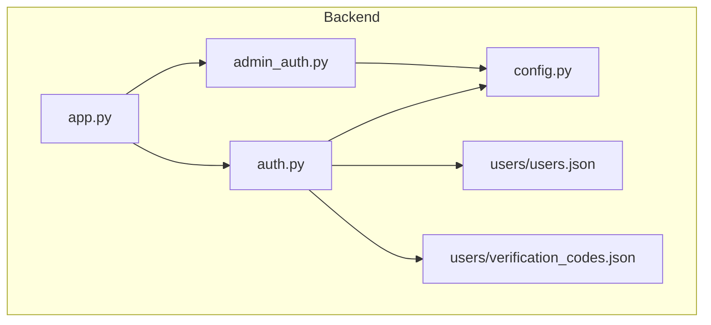

**Diagram sources**
- [app.py](file://backend/app.py)
- [auth.py](file://backend/auth.py)
- [admin_auth.py](file://backend/admin_auth.py)
- [config.py](file://backend/config.py)
- [users.json](file://backend/users/users.json)
- [verification_codes.json](file://backend/users/verification_codes.json)

**Section sources**
- [app.py](file://backend/app.py)
- [auth.py](file://backend/auth.py)
- [admin_auth.py](file://backend/admin_auth.py)
- [config.py](file://backend/config.py)
- [users.json](file://backend/users/users.json)
- [verification_codes.json](file://backend/users/verification_codes.json)

## Core Components
- JWT Token Service: Issues access tokens, validates signatures, checks expiration, and supports refresh flows.
- Password Hashing: Uses a strong algorithm (e.g., bcrypt) to hash and verify passwords securely.
- User Store: JSON-backed user records in users.json with fields such as id, username, email, hashed_password, roles, timestamps, and optional profile attributes.
- Verification Code Store: In-memory or file-backed store in verification_codes.json for temporary email verification codes with TTLs.
- Middleware: Request decorators/factories that enforce authentication, role checks, and rate limits.
- Admin Authorization: Additional checks for admin-only endpoints.

Security highlights:
- Tokens signed with a secret configured via environment variables.
- Passwords hashed per-user with salt; never stored in plaintext.
- Rate limiting and lockout counters to mitigate brute force.
- Secure token storage guidance for clients (httpOnly cookies or memory-scoped storage).

**Section sources**
- [auth.py](file://backend/auth.py)
- [admin_auth.py](file://backend/admin_auth.py)
- [users.json](file://backend/users/users.json)
- [verification_codes.json](file://backend/users/verification_codes.json)
- [config.py](file://backend/config.py)

## Architecture Overview
High-level flow:
- Client sends credentials to login endpoint.
- Server verifies password against stored hash.
- On success, server issues an access token (and optionally a refresh token).
- Protected endpoints validate the token via middleware.
- Registration requires email verification code stored temporarily.

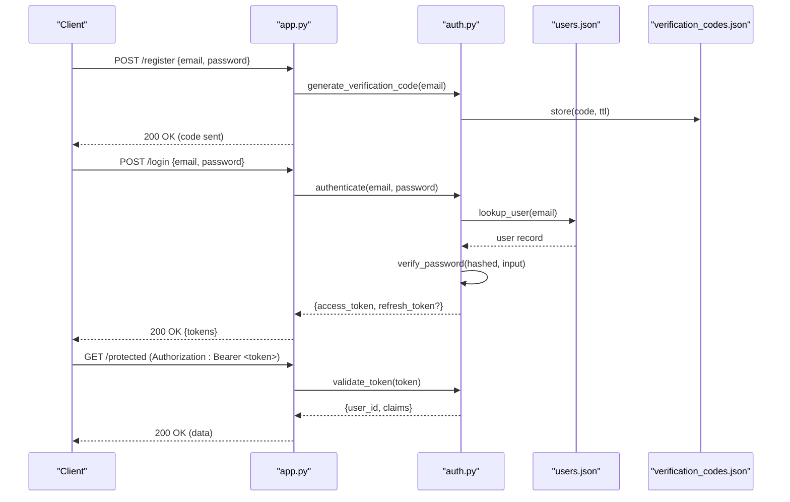

**Diagram sources**
- [app.py](file://backend/app.py)
- [auth.py](file://backend/auth.py)
- [users.json](file://backend/users/users.json)
- [verification_codes.json](file://backend/users/verification_codes.json)

## Detailed Component Analysis

### JWT Token Lifecycle
- Generation: Create payload with user identity and roles; sign with secret; set short-lived expiration.
- Validation: Verify signature, check expiration, extract claims, attach user context to request.
- Refresh: If supported, issue new access tokens using a refresh token with longer lifetime and rotation.

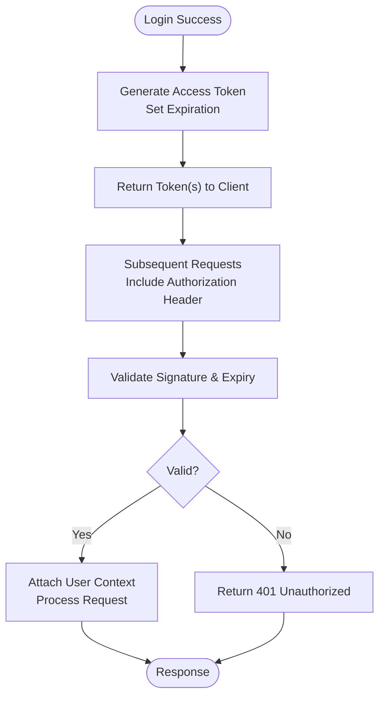

**Diagram sources**
- [auth.py](file://backend/auth.py)
- [app.py](file://backend/app.py)

**Section sources**
- [auth.py](file://backend/auth.py)
- [app.py](file://backend/app.py)

### Password Hashing and Verification
- Hashing: Use a strong, adaptive algorithm (e.g., bcrypt) with per-user salt.
- Verification: Compare input password against stored hash.
- Storage: Only store hashes; never log or expose them.

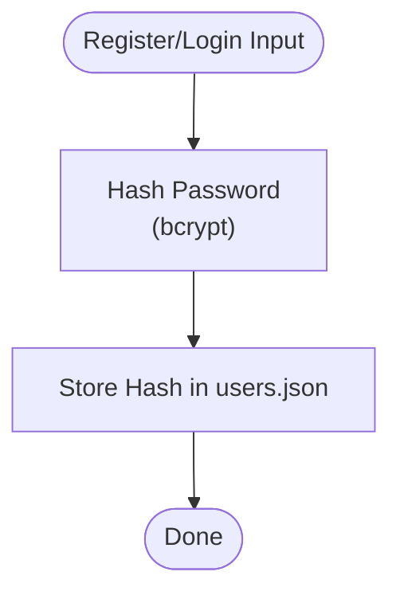

**Diagram sources**
- [auth.py](file://backend/auth.py)
- [users.json](file://backend/users/users.json)

**Section sources**
- [auth.py](file://backend/auth.py)
- [users.json](file://backend/users/users.json)

### User Registration and Email Verification
- Steps:
  - Receive email and password.
  - Generate a time-limited verification code.
  - Store code in verification_codes.json with TTL.
  - Send code via email channel (external service).
  - On verify, confirm code and create user account.
- Security:
  - Limit attempts per email/IP.
  - Invalidate code after use or expiry.

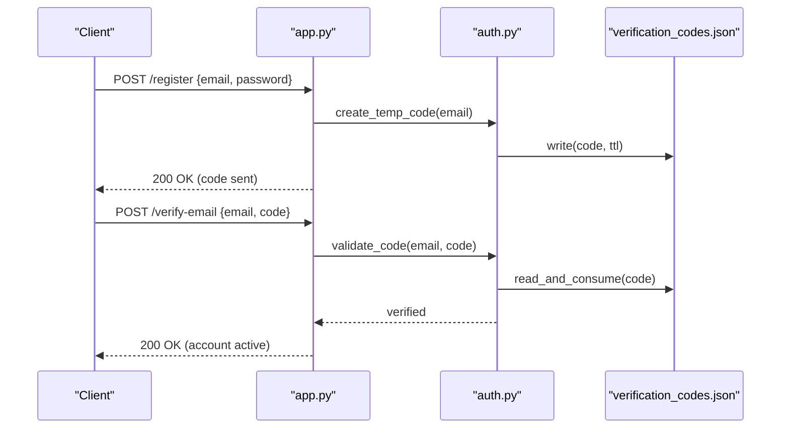

**Diagram sources**
- [app.py](file://backend/app.py)
- [auth.py](file://backend/auth.py)
- [verification_codes.json](file://backend/users/verification_codes.json)

**Section sources**
- [auth.py](file://backend/auth.py)
- [verification_codes.json](file://backend/users/verification_codes.json)
- [app.py](file://backend/app.py)

### Login and Logout Procedures
- Login:
  - Validate credentials.
  - Issue tokens.
  - Optionally track last login timestamp.
- Logout:
  - For stateless JWT, client discards tokens.
  - Optional server-side blacklist for immediate invalidation if required.

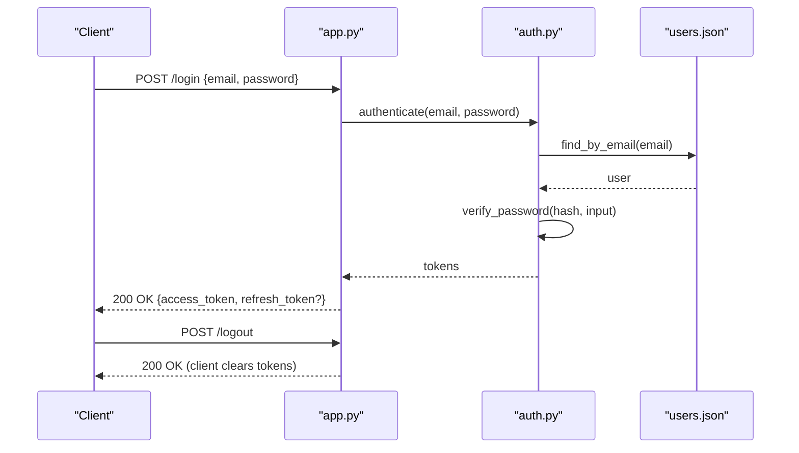

**Diagram sources**
- [app.py](file://backend/app.py)
- [auth.py](file://backend/auth.py)
- [users.json](file://backend/users/users.json)

**Section sources**
- [auth.py](file://backend/auth.py)
- [users.json](file://backend/users/users.json)
- [app.py](file://backend/app.py)

### Session Management and Token Expiration Handling
- Stateless sessions via JWT; no server-side session store required.
- Short-lived access tokens reduce risk window.
- Refresh tokens (if used) should be rotated and bound to user/device.
- Clients must handle 401 responses by refreshing or prompting re-login.

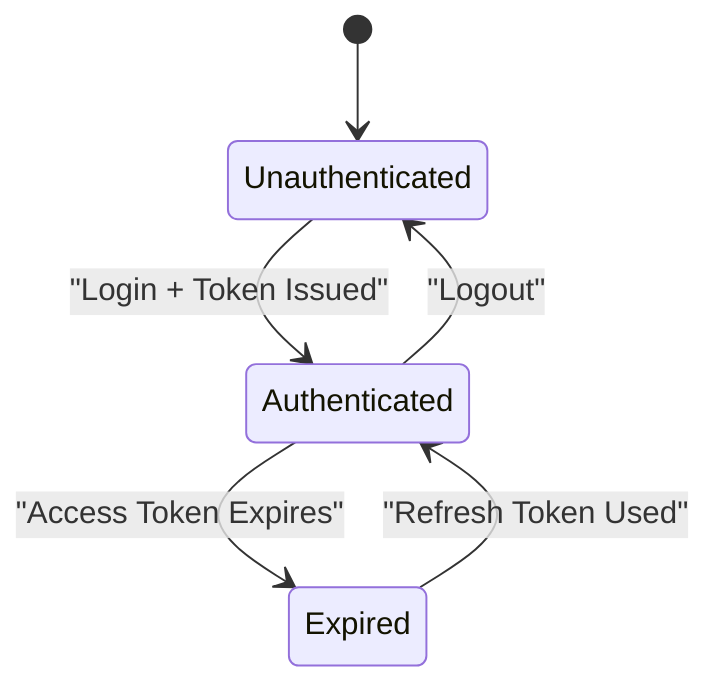

**Diagram sources**
- [auth.py](file://backend/auth.py)
- [app.py](file://backend/app.py)

**Section sources**
- [auth.py](file://backend/auth.py)
- [app.py](file://backend/app.py)

### Security Measures
- Rate Limiting:
  - Apply per-endpoint and per-IP limits for login/register/verify endpoints.
  - Return 429 when exceeded.
- Brute Force Protection:
  - Track failed attempts per email/IP.
  - Temporarily lock out after threshold.
- Secure Token Storage:
  - Prefer httpOnly cookies for web apps or in-memory storage for SPAs.
  - Avoid localStorage for sensitive tokens if possible.
- Secrets Management:
  - Load signing secret and other secrets from environment variables.

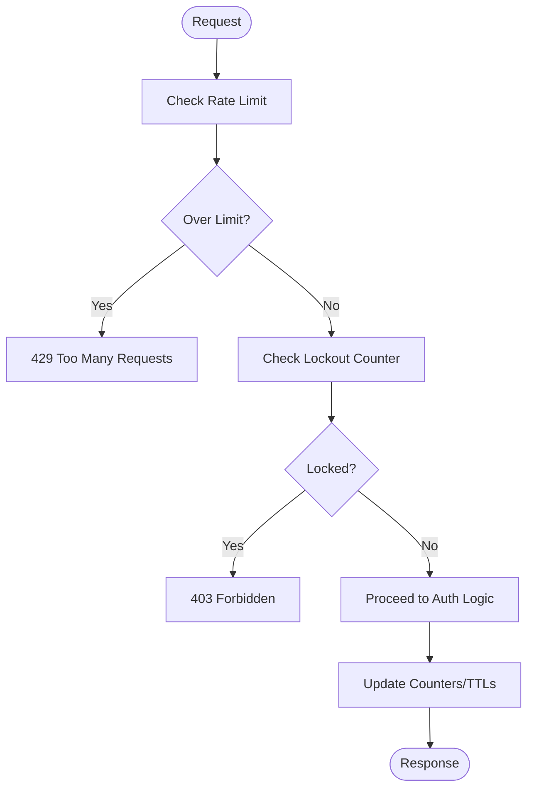

**Diagram sources**
- [auth.py](file://backend/auth.py)
- [app.py](file://backend/app.py)

**Section sources**
- [auth.py](file://backend/auth.py)
- [app.py](file://backend/app.py)

### Custom Authentication Middleware
- Pattern:
  - Decorator or factory that extracts Authorization header.
  - Validates token and attaches user info to request context.
  - Rejects invalid/expired tokens with 401.
- Extensibility:
  - Add role-based checks.
  - Integrate audit logging.

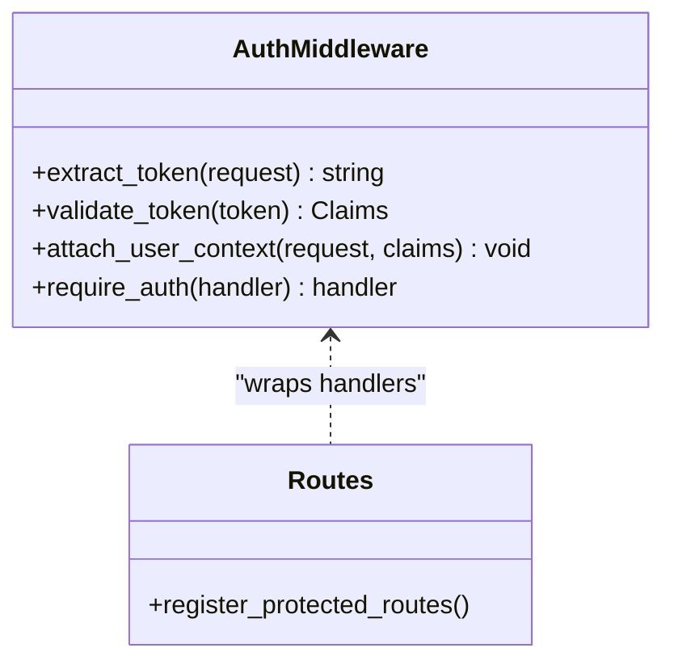

**Diagram sources**
- [auth.py](file://backend/auth.py)
- [app.py](file://backend/app.py)

**Section sources**
- [auth.py](file://backend/auth.py)
- [app.py](file://backend/app.py)

### Extending Login Methods
- Multi-factor:
  - After password check, require OTP or TOTP.
- Social/SSO:
  - Exchange provider tokens for internal JWT.
- Device binding:
  - Bind refresh tokens to device fingerprint.

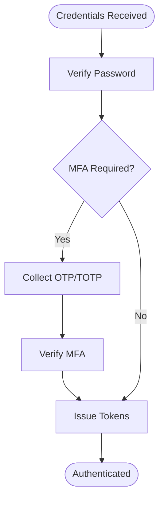

**Diagram sources**
- [auth.py](file://backend/auth.py)
- [app.py](file://backend/app.py)

**Section sources**
- [auth.py](file://backend/auth.py)
- [app.py](file://backend/app.py)

### Authentication Errors
Common errors and handling:
- 401 Unauthorized: Invalid or missing token.
- 403 Forbidden: Insufficient permissions or locked account.
- 429 Too Many Requests: Rate limit exceeded.
- 400 Bad Request: Malformed input or invalid verification code.

Best practices:
- Do not reveal whether an email exists during login failures.
- Log security events without sensitive payloads.
- Provide consistent error shapes for clients.

**Section sources**
- [auth.py](file://backend/auth.py)
- [app.py](file://backend/app.py)

### User Data Schema (users.json)
Typical fields:
- id: unique identifier
- username: display name
- email: primary email address
- hashed_password: bcrypt hash
- roles: array of roles (e.g., ["user"], ["admin"])
- is_active: boolean flag
- created_at, updated_at: timestamps
- optional profile fields (avatar_url, phone, etc.)

Validation rules:
- Unique email and username.
- Strong password policy enforced at registration.
- Timestamps auto-managed.

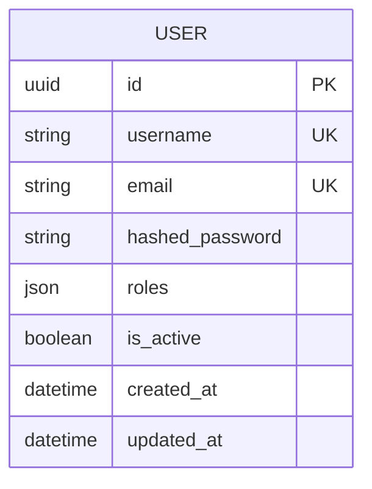

**Diagram sources**
- [users.json](file://backend/users/users.json)

**Section sources**
- [users.json](file://backend/users/users.json)

### Admin Authorization
- Admin-only endpoints protected by additional role checks.
- Separate middleware or decorator to enforce admin privileges.

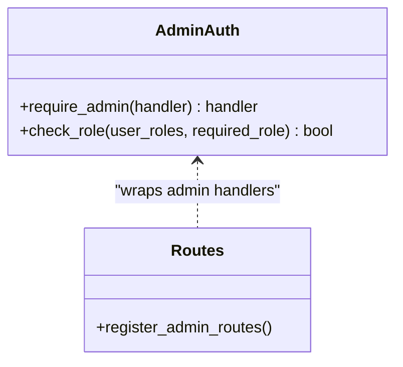

**Diagram sources**
- [admin_auth.py](file://backend/admin_auth.py)
- [app.py](file://backend/app.py)

**Section sources**
- [admin_auth.py](file://backend/admin_auth.py)
- [app.py](file://backend/app.py)

## Dependency Analysis
Key relationships:
- app.py registers routes and applies middleware from auth.py and admin_auth.py.
- auth.py depends on configuration (secrets, token settings) and data stores (users.json, verification_codes.json).
- admin_auth.py extends auth.py with role enforcement.

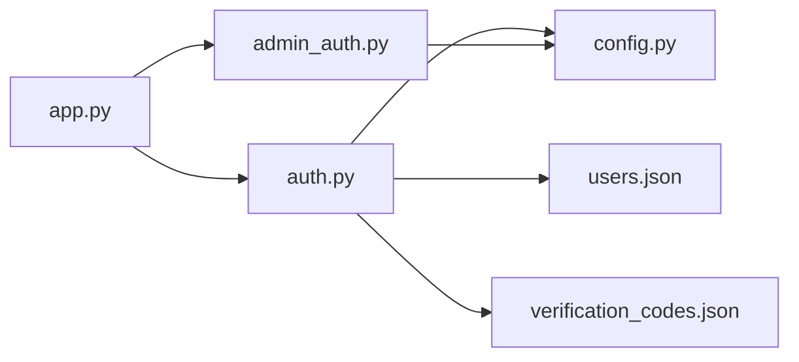

**Diagram sources**
- [app.py](file://backend/app.py)
- [auth.py](file://backend/auth.py)
- [admin_auth.py](file://backend/admin_auth.py)
- [config.py](file://backend/config.py)
- [users.json](file://backend/users/users.json)
- [verification_codes.json](file://backend/users/verification_codes.json)

**Section sources**
- [app.py](file://backend/app.py)
- [auth.py](file://backend/auth.py)
- [admin_auth.py](file://backend/admin_auth.py)
- [config.py](file://backend/config.py)
- [users.json](file://backend/users/users.json)
- [verification_codes.json](file://backend/users/verification_codes.json)

## Performance Considerations
- Keep JWT payloads minimal to reduce overhead.
- Cache frequent lookups if migrating to databases later.
- Use efficient hashing parameters (bcrypt cost factor) tuned for your hardware.
- Implement token refresh batching on the client to avoid thundering herds.

[No sources needed since this section provides general guidance]

## Troubleshooting Guide
- Token rejected:
  - Verify secret alignment between issuer and validator.
  - Ensure clock skew is handled or NTP is synchronized.
- Login fails repeatedly:
  - Check lockout counters and rate limit windows.
  - Confirm password hashing parameters match stored hashes.
- Verification code expired:
  - Re-issue code and ensure TTL is appropriate.
- Admin access denied:
  - Confirm user roles include admin and route uses admin middleware.

**Section sources**
- [auth.py](file://backend/auth.py)
- [admin_auth.py](file://backend/admin_auth.py)
- [app.py](file://backend/app.py)

## Conclusion
The XSYY Edu authentication system combines JWT-based stateless sessions, strong password hashing, and a simple JSON-backed user store with email verification codes. It emphasizes security through rate limiting, brute-force protections, and clear separation of concerns via middleware. The documented flows and patterns enable safe extension for multi-factor authentication, social login, and enhanced admin controls while maintaining a straightforward operational model.