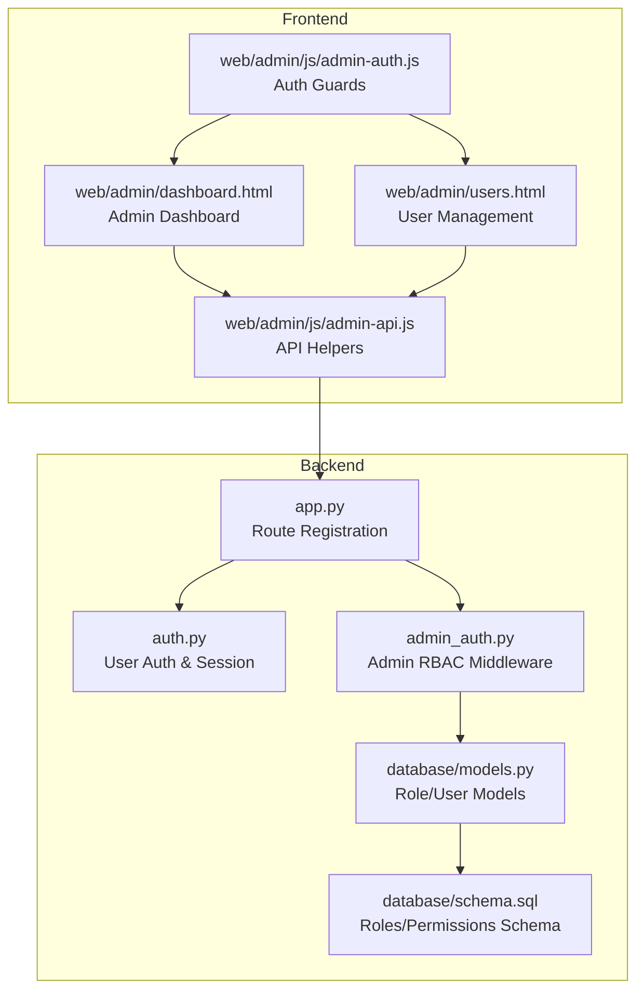
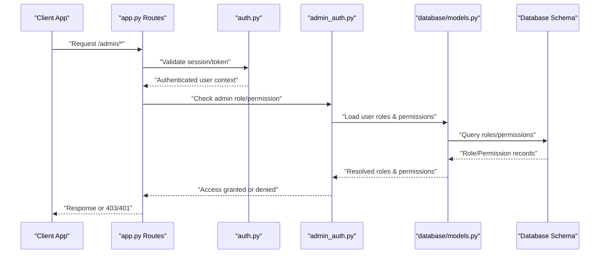
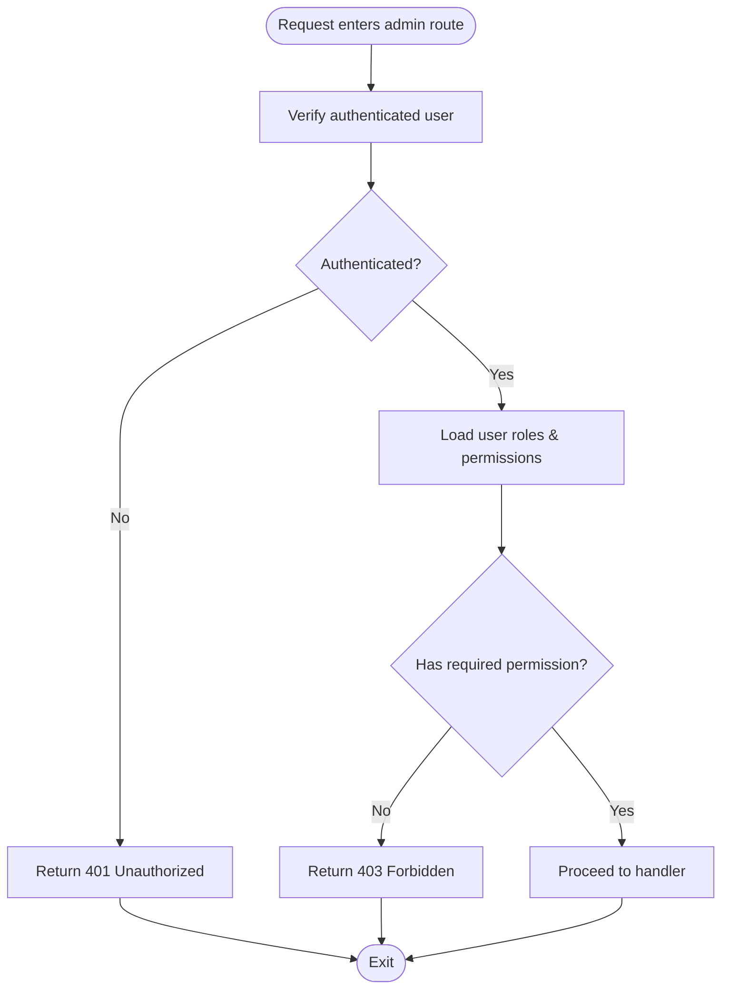
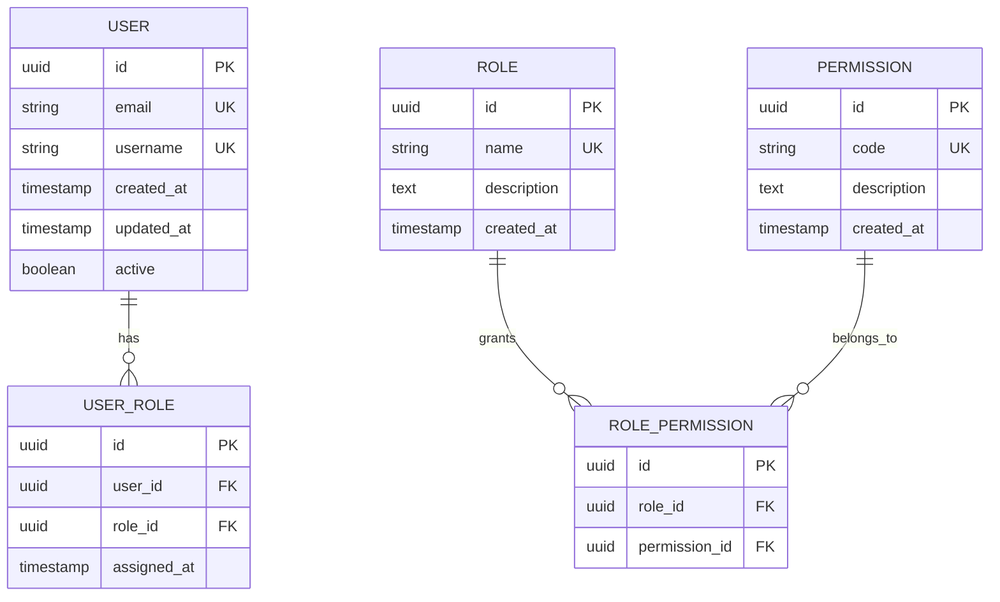
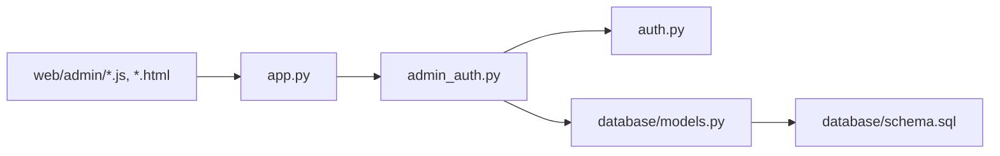

# Authorization & Access Control

<cite>
**Referenced Files in This Document**
- [admin_auth.py](file://backend/admin_auth.py)
- [auth.py](file://backend/auth.py)
- [app.py](file://backend/app.py)
- [models.py](file://backend/database/models.py)
- [schema.sql](file://backend/database/schema.sql)
- [admin-api.js](file://web/admin/js/admin-api.js)
- [admin-auth.js](file://web/admin/js/admin-auth.js)
- [dashboard.html](file://web/admin/dashboard.html)
- [users.html](file://web/admin/users.html)
</cite>

## Table of Contents
1. [Introduction](#introduction)
2. [Project Structure](#project-structure)
3. [Core Components](#core-components)
4. [Architecture Overview](#architecture-overview)
5. [Detailed Component Analysis](#detailed-component-analysis)
6. [Dependency Analysis](#dependency-analysis)
7. [Performance Considerations](#performance-considerations)
8. [Troubleshooting Guide](#troubleshooting-guide)
9. [Conclusion](#conclusion)
10. [Appendices](#appendices)

## Introduction
This document explains the authorization and access control system for the XSYY Edu platform, focusing on role-based access control (RBAC), route protection, and middleware implementation. It covers how regular users and administrators are distinguished, permission levels, endpoint security, privilege escalation prevention, permission inheritance, dynamic role assignment, and admin dashboard controls. Practical guidance is provided for adding new roles, implementing custom permission checks, and securing API endpoints.

## Project Structure
The authorization system spans backend authentication/authorization modules, database models and schema, and frontend admin utilities:
- Backend:
  - Authentication and session handling
  - Admin authorization middleware
  - Route registration and protection
  - Data models and schema for roles and permissions
- Frontend:
  - Admin API client helpers
  - Admin auth utilities
  - Admin pages that enforce client-side guards

**Diagram sources**
- [app.py](file://backend/app.py)
- [auth.py](file://backend/auth.py)
- [admin_auth.py](file://backend/admin_auth.py)
- [models.py](file://backend/database/models.py)
- [schema.sql](file://backend/database/schema.sql)
- [admin-api.js](file://web/admin/js/admin-api.js)
- [admin-auth.js](file://web/admin/js/admin-auth.js)
- [dashboard.html](file://web/admin/dashboard.html)
- [users.html](file://web/admin/users.html)

**Section sources**
- [app.py](file://backend/app.py)
- [auth.py](file://backend/auth.py)
- [admin_auth.py](file://backend/admin_auth.py)
- [models.py](file://backend/database/models.py)
- [schema.sql](file://backend/database/schema.sql)
- [admin-api.js](file://web/admin/js/admin-api.js)
- [admin-auth.js](file://web/admin/js/admin-auth.js)
- [dashboard.html](file://web/admin/dashboard.html)
- [users.html](file://web/admin/users.html)

## Core Components
- User authentication and session management:
  - Handles login, token/session issuance, and user identity resolution.
- Admin authorization middleware:
  - Enforces RBAC for administrative routes, checking roles and permissions before allowing access.
- Role and permission data model:
  - Defines roles, permissions, and their relationships to users.
- Route protection:
  - Decorators or wrappers applied to admin endpoints to ensure only authorized users can access them.
- Frontend admin guards:
  - Client-side checks to prevent unauthorized UI interactions and API calls.

Key responsibilities:
- Validate user identity and session validity.
- Resolve user roles and permissions from the data store.
- Enforce fine-grained permissions at route level.
- Provide consistent error responses for unauthorized access.
- Support dynamic role updates without service restarts.

**Section sources**
- [auth.py](file://backend/auth.py)
- [admin_auth.py](file://backend/admin_auth.py)
- [models.py](file://backend/database/models.py)
- [schema.sql](file://backend/database/schema.sql)

## Architecture Overview
The authorization flow integrates authentication, role resolution, and middleware enforcement across backend routes and frontend guards.

**Diagram sources**
- [app.py](file://backend/app.py)
- [auth.py](file://backend/auth.py)
- [admin_auth.py](file://backend/admin_auth.py)
- [models.py](file://backend/database/models.py)
- [schema.sql](file://backend/database/schema.sql)

## Detailed Component Analysis

### Admin Authorization Middleware (admin_auth.py)
Responsibilities:
- Enforce admin-only access for protected routes.
- Check specific permissions required by each endpoint.
- Return standardized error responses when access is denied.
- Integrate with user context established by authentication layer.

Implementation patterns:
- Decorator-style wrapper around admin endpoints.
- Permission matrix mapping endpoints to required roles/permissions.
- Centralized deny logic with consistent HTTP status codes.

**Diagram sources**
- [admin_auth.py](file://backend/admin_auth.py)
- [auth.py](file://backend/auth.py)
- [models.py](file://backend/database/models.py)

**Section sources**
- [admin_auth.py](file://backend/admin_auth.py)
- [auth.py](file://backend/auth.py)
- [models.py](file://backend/database/models.py)

### Authentication Layer (auth.py)
Responsibilities:
- Authenticate users via credentials or tokens.
- Establish session context for subsequent requests.
- Provide helper functions to resolve current user identity.

Security considerations:
- Secure session storage and validation.
- Prevent token leakage and replay attacks.
- Ensure minimal exposure of user attributes in context.

**Section sources**
- [auth.py](file://backend/auth.py)

### Route Protection and Registration (app.py)
Responsibilities:
- Register admin routes and apply authorization decorators.
- Group public vs. protected endpoints.
- Centralize error handling for authorization failures.

Best practices:
- Explicitly annotate each admin route with required permissions.
- Avoid broad open routes; prefer least privilege.
- Keep permission checks close to route definitions.

**Section sources**
- [app.py](file://backend/app.py)

### Data Models and Schema (models.py, schema.sql)
Responsibilities:
- Define roles, permissions, and user-role associations.
- Enforce referential integrity and constraints.
- Support dynamic role assignment and permission inheritance.

Design highlights:
- Roles map to sets of permissions.
- Users inherit permissions through assigned roles.
- Schema supports auditability and versioning of role changes.

**Diagram sources**
- [models.py](file://backend/database/models.py)
- [schema.sql](file://backend/database/schema.sql)

**Section sources**
- [models.py](file://backend/database/models.py)
- [schema.sql](file://backend/database/schema.sql)

### Frontend Admin Guards (admin-api.js, admin-auth.js, dashboard.html, users.html)
Responsibilities:
- Guard admin pages from unauthorized access.
- Intercept API calls and handle 401/403 responses gracefully.
- Render UI elements based on user permissions.

Behavior:
- Redirect unauthenticated users to login.
- Hide/disable features not permitted by current role.
- Display meaningful errors and fallback states.

**Section sources**
- [admin-api.js](file://web/admin/js/admin-api.js)
- [admin-auth.js](file://web/admin/js/admin-auth.js)
- [dashboard.html](file://web/admin/dashboard.html)
- [users.html](file://web/admin/users.html)

## Dependency Analysis
Authorization dependencies form a clear chain from request entry to data retrieval and response:
- app.py registers routes and applies admin_auth.py decorators.
- admin_auth.py depends on auth.py for user context and models.py for role/permission resolution.
- models.py interacts with schema.sql-defined tables.
- Frontend admin scripts depend on backend APIs and enforce client-side guards.

**Diagram sources**
- [app.py](file://backend/app.py)
- [admin_auth.py](file://backend/admin_auth.py)
- [auth.py](file://backend/auth.py)
- [models.py](file://backend/database/models.py)
- [schema.sql](file://backend/database/schema.sql)
- [admin-api.js](file://web/admin/js/admin-api.js)
- [admin-auth.js](file://web/admin/js/admin-auth.js)
- [dashboard.html](file://web/admin/dashboard.html)
- [users.html](file://web/admin/users.html)

**Section sources**
- [app.py](file://backend/app.py)
- [admin_auth.py](file://backend/admin_auth.py)
- [auth.py](file://backend/auth.py)
- [models.py](file://backend/database/models.py)
- [schema.sql](file://backend/database/schema.sql)
- [admin-api.js](file://web/admin/js/admin-api.js)
- [admin-auth.js](file://web/admin/js/admin-auth.js)
- [dashboard.html](file://web/admin/dashboard.html)
- [users.html](file://web/admin/users.html)

## Performance Considerations
- Cache resolved roles and permissions per session to reduce database queries.
- Use efficient indexes on role and permission lookup keys.
- Minimize payload size in user context to avoid overhead.
- Implement short-circuit checks in middleware to fail fast on missing tokens.
- Batch permission checks where possible to reduce round trips.

[No sources needed since this section provides general guidance]

## Troubleshooting Guide
Common issues and resolutions:
- 401 Unauthorized:
  - Missing or invalid session/token.
  - Expired credentials.
  - Verify authentication headers and session cookies.
- 403 Forbidden:
  - Insufficient permissions for the requested operation.
  - Check role assignments and permission mappings.
  - Review admin_auth.py permission matrix for the endpoint.
- Inconsistent UI behavior:
  - Frontend guards may not match backend permissions.
  - Synchronize client-side permission checks with server-side rules.
- Dynamic role changes not reflected:
  - Ensure cache invalidation or re-fetch of user context after role updates.

**Section sources**
- [admin_auth.py](file://backend/admin_auth.py)
- [auth.py](file://backend/auth.py)
- [admin-api.js](file://web/admin/js/admin-api.js)
- [admin-auth.js](file://web/admin/js/admin-auth.js)

## Conclusion
The XSYY Edu platform implements a robust RBAC system with clear separation between authentication and authorization layers. The admin_auth.py middleware enforces strict access control for administrative operations, while the data models and schema support flexible role and permission management. Frontend guards complement backend enforcement to provide a cohesive user experience. Following the guidelines in this document will help maintain secure, scalable, and maintainable access controls.

[No sources needed since this section summarizes without analyzing specific files]

## Appendices

### Adding New Roles
Steps:
- Define a new role in the schema and models.
- Assign permissions to the role via the role-permission mapping table.
- Update admin_auth.py permission matrix if necessary.
- Test with sample users and verify access behavior.

**Section sources**
- [schema.sql](file://backend/database/schema.sql)
- [models.py](file://backend/database/models.py)
- [admin_auth.py](file://backend/admin_auth.py)

### Implementing Custom Permission Checks
Approach:
- Create a decorator or helper function in admin_auth.py.
- Map custom permissions to endpoints requiring elevated privileges.
- Ensure consistent error responses and logging.

**Section sources**
- [admin_auth.py](file://backend/admin_auth.py)

### Securing API Endpoints
Guidelines:
- Apply admin authorization decorators to all sensitive routes.
- Validate input and enforce least privilege.
- Log authorization decisions for auditability.

**Section sources**
- [app.py](file://backend/app.py)
- [admin_auth.py](file://backend/admin_auth.py)

### Admin Dashboard Access Controls
Controls:
- Restrict dashboard access to users with admin roles.
- Hide or disable non-permitted actions in the UI.
- Enforce backend permission checks for all operations.

**Section sources**
- [dashboard.html](file://web/admin/dashboard.html)
- [admin-auth.js](file://web/admin/js/admin-auth.js)
- [admin-api.js](file://web/admin/js/admin-api.js)

### Administrative Operations Requiring Elevated Privileges
Examples:
- User management (create, update, delete).
- System settings modifications.
- Content moderation and approvals.
- Audit log access and export.

Ensure these operations are protected by admin middleware and require explicit permissions.

**Section sources**
- [users.html](file://web/admin/users.html)
- [admin_auth.py](file://backend/admin_auth.py)