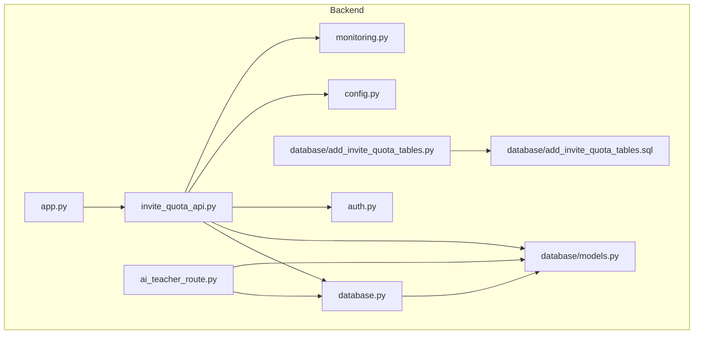
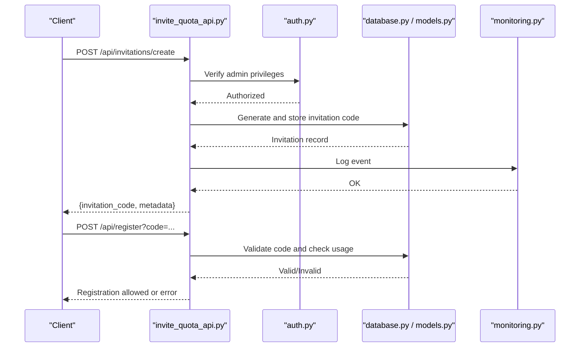
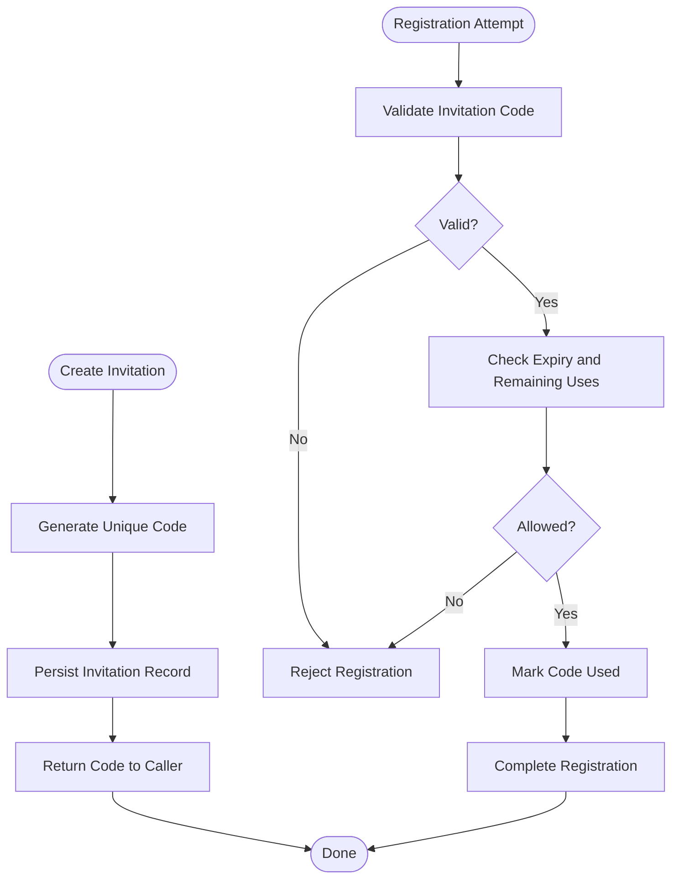
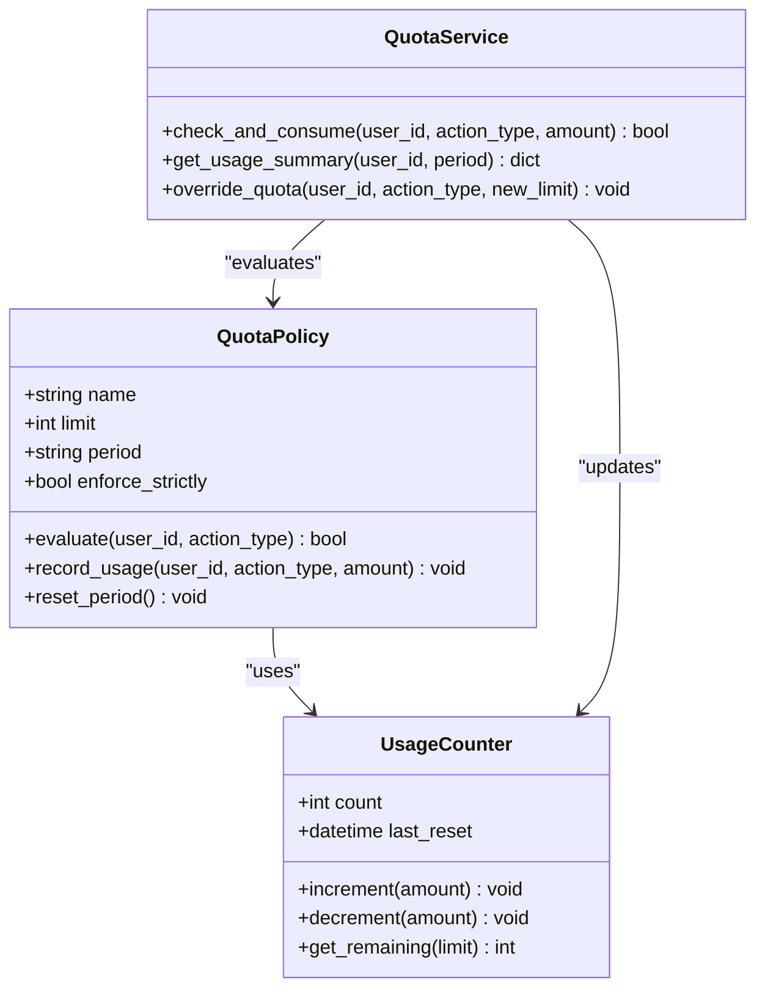
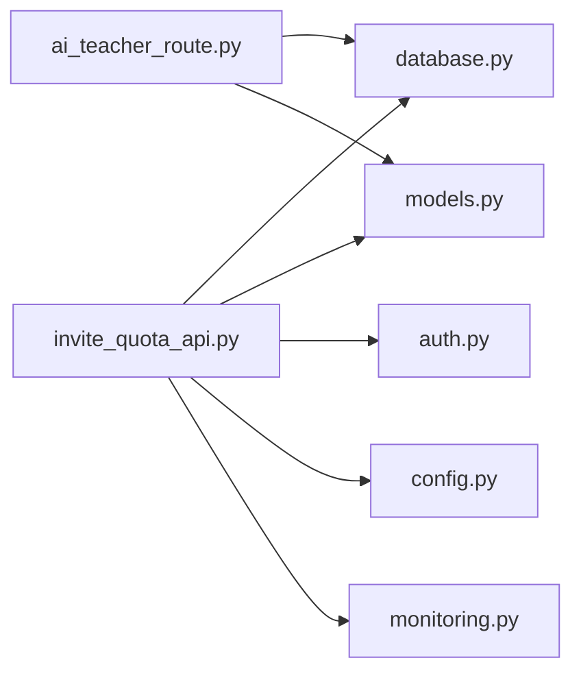

# Invitation & Quota Management

<cite>
**Referenced Files in This Document**
- [invite_quota_api.py](file://backend/invite_quota_api.py)
- [add_invite_quota_tables.py](file://backend/database/add_invite_quota_tables.py)
- [add_invite_quota_tables.sql](file://backend/database/add_invite_quota_tables.sql)
- [models.py](file://backend/database/models.py)
- [database.py](file://backend/database/database.py)
- [app.py](file://backend/app.py)
- [auth.py](file://backend/auth.py)
- [ai_teacher_route.py](file://backend/ai_teacher_route.py)
- [config.py](file://backend/config.py)
- [monitoring.py](file://backend/monitoring.py)
</cite>

## Table of Contents
1. [Introduction](#introduction)
2. [Project Structure](#project-structure)
3. [Core Components](#core-components)
4. [Architecture Overview](#architecture-overview)
5. [Detailed Component Analysis](#detailed-component-analysis)
6. [Dependency Analysis](#dependency-analysis)
7. [Performance Considerations](#performance-considerations)
8. [Troubleshooting Guide](#troubleshooting-guide)
9. [Conclusion](#conclusion)
10. [Appendices](#appendices)

## Introduction
This document explains the invitation and quota management system for the XSYY Edu platform. It covers how controlled user registration is enforced via invitation codes, how quotas limit user actions and resource consumption (including content generation requests), and how administrators manage invitations and monitor usage through dedicated API endpoints. It also provides guidance on implementing custom quota rules, extending invitation workflows, handling quota violations, and integrating with user registration and content generation systems.

## Project Structure
The invitation and quota features are implemented primarily in the backend module invite_quota_api.py, backed by database schema and models related to invitations and quotas. The application registers these routes in the main app entry point and integrates with authentication and AI teaching routes where appropriate.

**Diagram sources**
- [app.py](file://backend/app.py)
- [invite_quota_api.py](file://backend/invite_quota_api.py)
- [auth.py](file://backend/auth.py)
- [ai_teacher_route.py](file://backend/ai_teacher_route.py)
- [database.py](file://backend/database/database.py)
- [models.py](file://backend/database/models.py)
- [add_invite_quota_tables.sql](file://backend/database/add_invite_quota_tables.sql)
- [add_invite_quota_tables.py](file://backend/database/add_invite_quota_tables.py)
- [config.py](file://backend/config.py)
- [monitoring.py](file://backend/monitoring.py)

**Section sources**
- [app.py](file://backend/app.py)
- [invite_quota_api.py](file://backend/invite_quota_api.py)
- [add_invite_quota_tables.py](file://backend/database/add_invite_quota_tables.py)
- [add_invite_quota_tables.sql](file://backend/database/add_invite_quota_tables.sql)
- [models.py](file://backend/database/models.py)
- [database.py](file://backend/database/database.py)
- [auth.py](file://backend/auth.py)
- [ai_teacher_route.py](file://backend/ai_teacher_route.py)
- [config.py](file://backend/config.py)
- [monitoring.py](file://backend/monitoring.py)

## Core Components
- Invitation Code System: Generates secure codes, validates them during registration, tracks usage, and supports administrative controls such as revocation or extension.
- Quota System: Enforces limits per user or tenant across actions like content generation requests and resource consumption; supports reset policies and analytics.
- Invite Quota API: Provides endpoints for creating, validating, and managing invitations; querying and adjusting quotas; and reporting usage metrics.
- Database Layer: Stores invitation records, usage logs, and quota configurations; includes migrations and models for persistence.
- Integration Points: Authentication middleware ensures only authorized users can perform sensitive operations; AI teaching route enforces quotas when generating content.

Key responsibilities:
- Invitation lifecycle: creation, validation, assignment, expiration, and audit.
- Quota policy evaluation: checking remaining allowances before allowing an action.
- Usage tracking: recording successful and failed attempts for analytics and compliance.
- Administrative controls: listing, filtering, resetting, and auditing invitations and quotas.

**Section sources**
- [invite_quota_api.py](file://backend/invite_quota_api.py)
- [add_invite_quota_tables.py](file://backend/database/add_invite_quota_tables.py)
- [add_invite_quota_tables.sql](file://backend/database/add_invite_quota_tables.sql)
- [models.py](file://backend/database/models.py)
- [database.py](file://backend/database/database.py)
- [auth.py](file://backend/auth.py)
- [ai_teacher_route.py](file://backend/ai_teacher_route.py)

## Architecture Overview
The system follows a layered architecture:
- API layer: Flask/FastAPI-style endpoints in invite_quota_api.py expose invitation and quota operations.
- Service layer: Business logic for code generation/validation, quota checks, and usage logging.
- Data layer: Models and SQL migrations define schemas for invitations, quotas, and usage logs.
- Integration layer: Auth middleware protects endpoints; AI teaching route enforces quotas during content generation.

**Diagram sources**
- [invite_quota_api.py](file://backend/invite_quota_api.py)
- [auth.py](file://backend/auth.py)
- [database.py](file://backend/database/database.py)
- [models.py](file://backend/database/models.py)
- [monitoring.py](file://backend/monitoring.py)

## Detailed Component Analysis

### Invitation Code System
Purpose:
- Controlled user registration via unique, expiring invitation codes.
- Prevents open sign-ups and enables targeted onboarding campaigns.

Key behaviors:
- Generation: Secure random codes with optional attributes (expiry, max uses, scope).
- Validation: Checks existence, expiry, remaining uses, and association constraints.
- Usage tracking: Records each attempt (success/failure) for audit and analytics.
- Administration: Create, list, filter, revoke, extend, and export invitation data.

Data model highlights:
- Invitation entity with fields for code, status, expiry, max_uses, used_count, created_by, and timestamps.
- Usage log entries capturing user context, timestamp, and outcome.

Integration points:
- Registration flow validates the code before completing account creation.
- Admin UI calls invitation endpoints to manage campaigns.

**Diagram sources**
- [invite_quota_api.py](file://backend/invite_quota_api.py)
- [models.py](file://backend/database/models.py)
- [database.py](file://backend/database/database.py)

**Section sources**
- [invite_quota_api.py](file://backend/invite_quota_api.py)
- [add_invite_quota_tables.py](file://backend/database/add_invite_quota_tables.py)
- [add_invite_quota_tables.sql](file://backend/database/add_invite_quota_tables.sql)
- [models.py](file://backend/database/models.py)
- [database.py](file://backend/database/database.py)

### Quota System
Purpose:
- Limit user actions, content generation requests, and resource consumption to ensure fairness and cost control.

Key behaviors:
- Policy evaluation: Determine if a request is allowed based on current usage vs. configured limits.
- Incremental accounting: Atomically increment counters upon successful operations.
- Reset policies: Support daily, weekly, monthly resets or manual overrides.
- Analytics: Aggregate usage metrics for dashboards and alerts.

Common quota types:
- Per-user request limits (e.g., number of AI-generated teachings per day).
- Global or department-level caps.
- Resource-specific limits (e.g., storage or compute units).

Administrative controls:
- Adjust quotas dynamically without downtime.
- Override or grant temporary boosts.
- Audit changes and view historical usage.

**Diagram sources**
- [invite_quota_api.py](file://backend/invite_quota_api.py)
- [models.py](file://backend/database/models.py)
- [database.py](file://backend/database/database.py)

**Section sources**
- [invite_quota_api.py](file://backend/invite_quota_api.py)
- [models.py](file://backend/database/models.py)
- [database.py](file://backend/database/database.py)

### Invite Quota API Endpoints
Responsibilities:
- Invitation management: create, validate, list, revoke, extend, export.
- Quota management: query limits, adjust quotas, reset periods, report usage.
- Monitoring: provide metrics and logs for audits and dashboards.

Typical endpoint categories:
- Invitations:
  - Create invitation codes with attributes (expiry, max uses).
  - Validate invitation code during registration.
  - List/filter invitations by status, creator, date range.
  - Revoke or extend existing invitations.
- Quotas:
  - Get current usage and remaining allowance for a user/action.
  - Update quota limits or apply temporary overrides.
  - Reset quotas according to policy (daily/weekly/monthly).
  - Export usage reports for analytics.

Security:
- Admin-only endpoints protected by auth middleware.
- Rate limiting and input validation to prevent abuse.

Integration:
- Registration flow consumes invitation validation endpoint.
- Content generation route checks quotas before processing requests.

**Section sources**
- [invite_quota_api.py](file://backend/invite_quota_api.py)
- [auth.py](file://backend/auth.py)
- [ai_teacher_route.py](file://backend/ai_teacher_route.py)

### Database Schema and Migrations
Schema components:
- Invitation table: stores code, status, expiry, max_uses, used_count, created_by, timestamps.
- Quota configuration table: defines limits, periods, and enforcement flags.
- Usage log table: records user actions, amounts, timestamps, and outcomes.

Migrations:
- Python migration script applies SQL DDL statements to create/update tables.
- Ensures idempotent updates and safe rollbacks.

Best practices:
- Index frequently queried fields (user_id, action_type, timestamp).
- Partition large usage logs by time for performance.
- Use transactions for atomic updates to counters and logs.

**Section sources**
- [add_invite_quota_tables.py](file://backend/database/add_invite_quota_tables.py)
- [add_invite_quota_tables.sql](file://backend/database/add_invite_quota_tables.sql)
- [models.py](file://backend/database/models.py)
- [database.py](file://backend/database/database.py)

### Integration with User Registration and Content Generation
User registration:
- Before account creation, validate invitation code via API.
- On success, mark code as used and proceed with registration.
- On failure, return clear error messages (expired, invalid, exhausted).

Content generation:
- AI teaching route checks quota before invoking LLM services.
- If allowed, increment usage counter and proceed; otherwise, return quota exceeded response.
- Provide graceful fallbacks (queue, retry, or upgrade prompt).

Error handling:
- Distinguish between transient errors (network timeouts) and policy violations (quota exceeded).
- Log detailed context for debugging and analytics.

**Section sources**
- [invite_quota_api.py](file://backend/invite_quota_api.py)
- [ai_teacher_route.py](file://backend/ai_teacher_route.py)
- [auth.py](file://backend/auth.py)

## Dependency Analysis
Component relationships:
- invite_quota_api.py depends on database.py and models.py for persistence.
- auth.py provides authorization checks for admin endpoints.
- ai_teacher_route.py enforces quotas during content generation.
- config.py centralizes settings for quotas, invitation policies, and feature flags.
- monitoring.py captures events and metrics for observability.

Potential coupling:
- Tight coupling between API and models requires careful interface design to avoid churn.
- Shared quota service should be abstracted to allow swapping implementations.

Circular dependencies:
- Ensure no circular imports between modules; use dependency injection where needed.

External integrations:
- LLM providers invoked by AI teaching route; quotas must guard external calls.
- Storage services for generated content; quotas may include storage limits.

**Diagram sources**
- [invite_quota_api.py](file://backend/invite_quota_api.py)
- [database.py](file://backend/database/database.py)
- [models.py](file://backend/database/models.py)
- [auth.py](file://backend/auth.py)
- [ai_teacher_route.py](file://backend/ai_teacher_route.py)
- [config.py](file://backend/config.py)
- [monitoring.py](file://backend/monitoring.py)

**Section sources**
- [invite_quota_api.py](file://backend/invite_quota_api.py)
- [database.py](file://backend/database/database.py)
- [models.py](file://backend/database/models.py)
- [auth.py](file://backend/auth.py)
- [ai_teacher_route.py](file://backend/ai_teacher_route.py)
- [config.py](file://backend/config.py)
- [monitoring.py](file://backend/monitoring.py)

## Performance Considerations
- Use efficient queries with proper indexes on user_id, action_type, and timestamps.
- Batch usage updates to reduce write contention.
- Cache frequent quota checks with short TTLs to minimize database load.
- Partition usage logs by time ranges for faster aggregation.
- Implement rate limiting at the API layer to protect against spikes.

[No sources needed since this section provides general guidance]

## Troubleshooting Guide
Common issues:
- Invitation code invalid/expired: verify code existence, expiry, and remaining uses.
- Quota exceeded: check current usage vs. configured limits; consider temporary overrides.
- Registration failures: inspect logs for validation errors and database transaction failures.
- Content generation blocked: confirm quota policy and LLM provider availability.

Debugging steps:
- Review monitoring logs for failed validations and quota checks.
- Inspect database records for invitation and usage states.
- Validate configuration settings for quotas and invitation policies.
- Reproduce with minimal inputs to isolate the issue.

Recovery actions:
- Reset quotas according to policy or manually override for affected users.
- Extend invitation expiry or regenerate codes for campaigns.
- Retry failed operations after transient errors resolve.

**Section sources**
- [monitoring.py](file://backend/monitoring.py)
- [invite_quota_api.py](file://backend/invite_quota_api.py)
- [ai_teacher_route.py](file://backend/ai_teacher_route.py)

## Conclusion
The XSYY Edu platform’s invitation and quota management system provides robust controls for user registration and resource consumption. By combining secure invitation codes, flexible quota policies, and comprehensive APIs, administrators can manage access and usage effectively. Integrating with authentication and content generation ensures consistent enforcement across the platform. Following best practices for performance, security, and observability will help maintain reliability and scalability.

[No sources needed since this section summarizes without analyzing specific files]

## Appendices

### Examples and Best Practices
- Implementing custom quota rules:
  - Define new action types and associated limits in configuration.
  - Extend the quota service to evaluate custom conditions (e.g., time-of-day restrictions).
  - Add corresponding API endpoints for querying and updating custom quotas.
- Extending invitation workflows:
  - Add campaign metadata (source, channel, target audience) to invitation records.
  - Integrate with marketing tools to automate code generation and distribution.
  - Track conversion rates from invitation to registration.
- Handling quota violations:
  - Return standardized error responses with actionable hints (upgrade, wait, or contact support).
  - Provide user-facing messaging explaining limits and options.
  - Log violations for compliance and analytics.

[No sources needed since this section provides general guidance]