# Security Best Practices

<cite>
**Referenced Files in This Document**
- [app.py](file://backend/app.py)
- [auth.py](file://backend/auth.py)
- [admin_auth.py](file://backend/admin_auth.py)
- [config.py](file://backend/config.py)
- [database.py](file://backend/database/database.py)
- [models.py](file://backend/database/models.py)
- [schema.sql](file://backend/database/schema.sql)
- [nginx.conf](file://deploy/nginx.conf)
- [monitoring.py](file://backend/monitoring.py)
- [requirements.txt](file://backend/requirements.txt)
- [test_api_auth.py](file://backend/tests/integration/test_api_auth.py)
- [test_api_admin.py](file://backend/tests/integration/test_api_admin.py)
- [test_api_health.py](file://backend/tests/integration/test_api_health.py)
- [test_api_tasks.py](file://backend/tests/integration/test_api_tasks.py)
</cite>

## Table of Contents
1. [Introduction](#introduction)
2. [Project Structure](#project-structure)
3. [Core Components](#core-components)
4. [Architecture Overview](#architecture-overview)
5. [Detailed Component Analysis](#detailed-component-analysis)
6. [Dependency Analysis](#dependency-analysis)
7. [Performance Considerations](#performance-considerations)
8. [Troubleshooting Guide](#troubleshooting-guide)
9. [Conclusion](#conclusion)
10. [Appendices](#appendices)

## Introduction
This document provides comprehensive security best practices for the XSYY Edu platform, focusing on input validation and sanitization, CSRF protection, secure cookie handling, HTTPS enforcement, secure communication protocols, certificate management, API security, encryption at rest and in transit, secure file uploads, vulnerability scanning, security headers, CORS policy, rate limiting, security testing, penetration testing guidelines, audit procedures, custom security middleware, and security monitoring. The guidance is grounded in the repository’s backend application, database layer, deployment configuration, and tests.

## Project Structure
The XSYY Edu platform consists of:
- Backend application (Flask-based) with authentication, admin authorization, configuration, database access, and monitoring modules.
- Database schema and models under a dedicated directory.
- Deployment artifacts including Nginx configuration.
- Integration tests covering authentication, admin routes, health checks, and tasks.

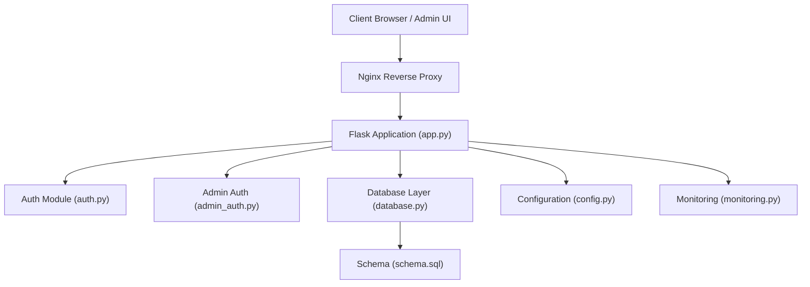

**Diagram sources**
- [app.py](file://backend/app.py)
- [auth.py](file://backend/auth.py)
- [admin_auth.py](file://backend/admin_auth.py)
- [database.py](file://backend/database/database.py)
- [schema.sql](file://backend/database/schema.sql)
- [config.py](file://backend/config.py)
- [monitoring.py](file://backend/monitoring.py)
- [nginx.conf](file://deploy/nginx.conf)

**Section sources**
- [app.py](file://backend/app.py)
- [auth.py](file://backend/auth.py)
- [admin_auth.py](file://backend/admin_auth.py)
- [database.py](file://backend/database/database.py)
- [models.py](file://backend/database/models.py)
- [schema.sql](file://backend/database/schema.sql)
- [config.py](file://backend/config.py)
- [monitoring.py](file://backend/monitoring.py)
- [nginx.conf](file://deploy/nginx.conf)

## Core Components
- Authentication and session management are implemented in the auth module and referenced by the main application.
- Admin authorization is handled separately to enforce stricter controls for administrative operations.
- Database interactions use parameterized queries and model definitions to reduce injection risks.
- Configuration centralizes sensitive settings such as secrets and feature flags.
- Monitoring captures operational metrics and logs for security observability.

Key responsibilities:
- Input validation and sanitization at API boundaries.
- Secure session cookies with appropriate flags.
- CSRF protection for state-changing endpoints.
- HTTPS termination at the reverse proxy.
- Rate limiting and request throttling.
- Security headers and CORS policies.

**Section sources**
- [auth.py](file://backend/auth.py)
- [admin_auth.py](file://backend/admin_auth.py)
- [database.py](file://backend/database/database.py)
- [models.py](file://backend/database/models.py)
- [config.py](file://backend/config.py)
- [monitoring.py](file://backend/monitoring.py)

## Architecture Overview
The system follows a layered architecture:
- Client requests are terminated at Nginx, which enforces HTTPS and forwards traffic to the Flask app.
- The Flask app applies authentication and authorization middleware before routing to handlers.
- Handlers validate inputs, interact with the database via parameterized queries, and return responses.
- Monitoring collects logs and metrics for security analysis.

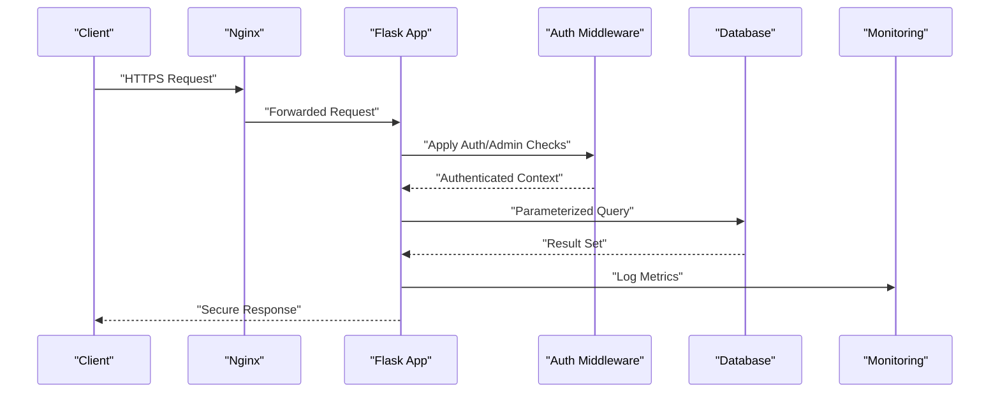

**Diagram sources**
- [nginx.conf](file://deploy/nginx.conf)
- [app.py](file://backend/app.py)
- [auth.py](file://backend/auth.py)
- [admin_auth.py](file://backend/admin_auth.py)
- [database.py](file://backend/database/database.py)
- [monitoring.py](file://backend/monitoring.py)

## Detailed Component Analysis

### Authentication and Session Security
- Enforce strong password hashing and secure token generation.
- Use HttpOnly, Secure, SameSite attributes for session cookies.
- Implement short-lived sessions and rotation upon privilege changes.
- Centralize secret management via configuration.

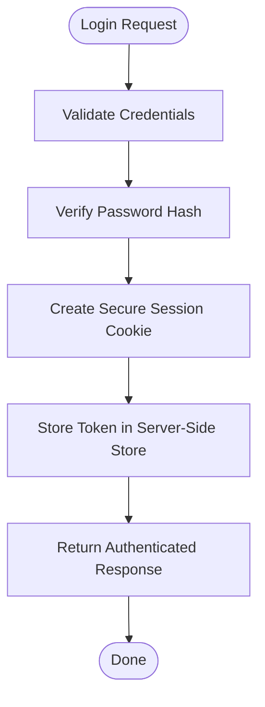

**Diagram sources**
- [auth.py](file://backend/auth.py)
- [config.py](file://backend/config.py)

**Section sources**
- [auth.py](file://backend/auth.py)
- [config.py](file://backend/config.py)

### Admin Authorization Controls
- Separate admin routes require elevated privileges.
- Apply strict role checks and audit logging for administrative actions.
- Restrict admin endpoints to trusted networks or additional verification.

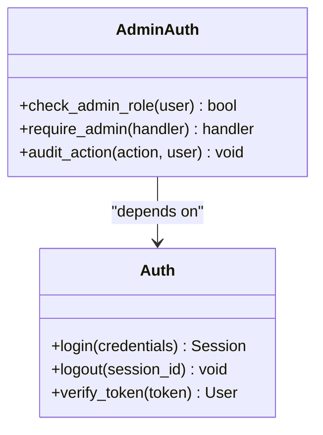

**Diagram sources**
- [admin_auth.py](file://backend/admin_auth.py)
- [auth.py](file://backend/auth.py)

**Section sources**
- [admin_auth.py](file://backend/admin_auth.py)
- [auth.py](file://backend/auth.py)

### Database Access and SQL Injection Prevention
- Use parameterized queries exclusively; avoid string concatenation for SQL.
- Define clear data models and constraints to enforce integrity.
- Limit database user permissions to least privilege.

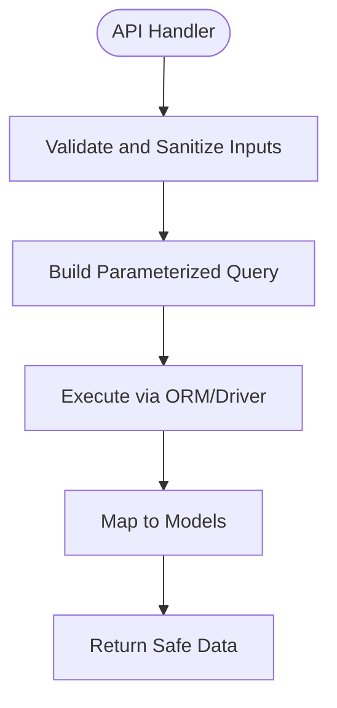

**Diagram sources**
- [database.py](file://backend/database/database.py)
- [models.py](file://backend/database/models.py)
- [schema.sql](file://backend/database/schema.sql)

**Section sources**
- [database.py](file://backend/database/database.py)
- [models.py](file://backend/database/models.py)
- [schema.sql](file://backend/database/schema.sql)

### HTTPS Enforcement and TLS Termination
- Terminate TLS at Nginx using valid certificates.
- Redirect HTTP to HTTPS and enforce HSTS.
- Configure modern cipher suites and protocol versions.

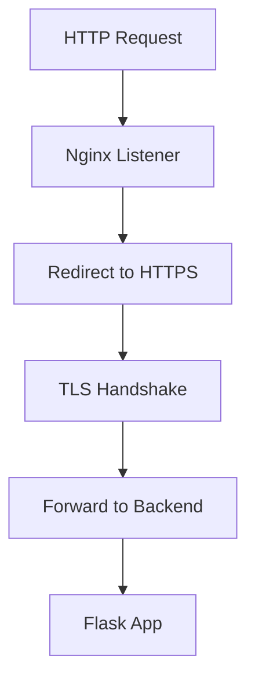

**Diagram sources**
- [nginx.conf](file://deploy/nginx.conf)

**Section sources**
- [nginx.conf](file://deploy/nginx.conf)

### Security Headers and CORS Policy
- Set Content-Security-Policy, X-Frame-Options, X-Content-Type-Options, Referrer-Policy, Permissions-Policy.
- Configure CORS to allow only trusted origins and methods.
- Ensure no sensitive information in error responses.

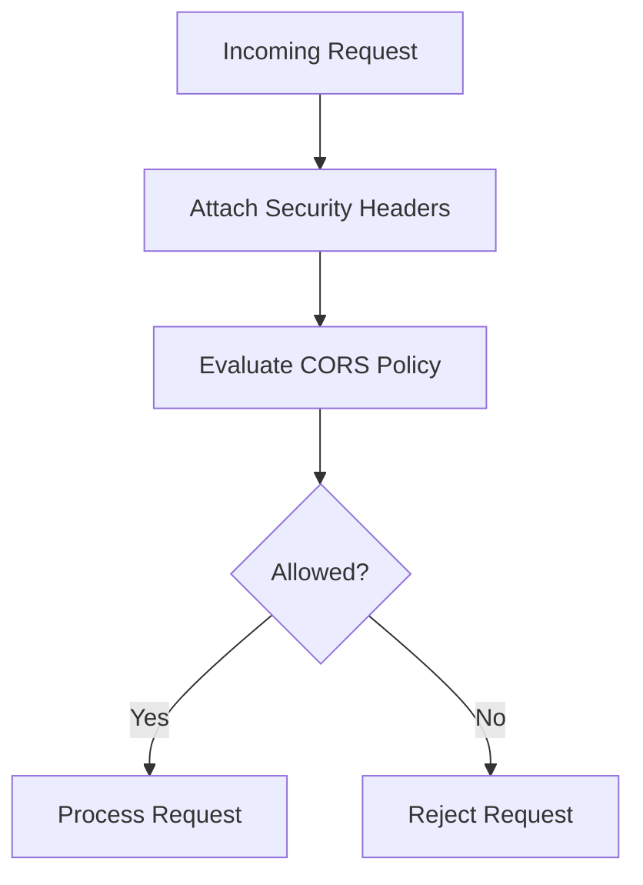

[No sources needed since this diagram shows conceptual workflow, not actual code structure]

### Rate Limiting and Abuse Mitigation
- Apply per-IP and per-user rate limits on authentication and sensitive endpoints.
- Use sliding window counters or token buckets.
- Return standardized error codes and throttle messages.

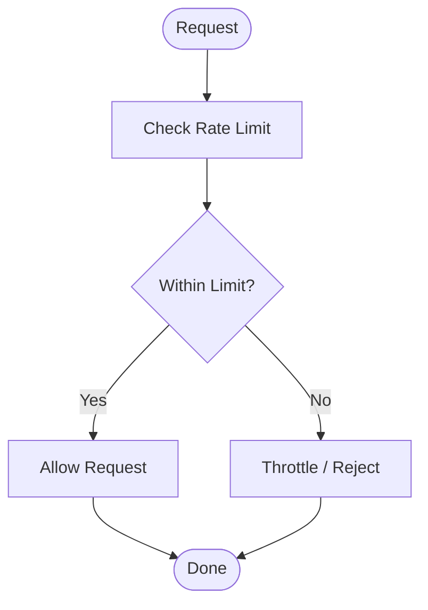

[No sources needed since this diagram shows conceptual workflow, not actual code structure]

### Secure File Uploads
- Validate file types via MIME and magic bytes.
- Enforce size limits and scan for malware.
- Store files outside web root with randomized names and metadata.
- Serve files through authenticated endpoints or signed URLs.

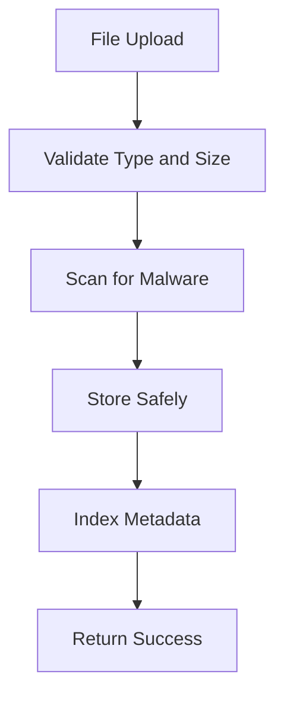

[No sources needed since this diagram shows conceptual workflow, not actual code structure]

### Encryption at Rest and In Transit
- Encrypt sensitive fields at the application layer where required.
- Use TLS for all external communications.
- Manage keys securely via environment variables or secret managers.

```mermaid
flowchart TD
Data["Sensitive Data"] --> EncryptInTransit["Encrypt in Transit (TLS)")
EncryptInTransit --> EncryptAtRest["Encrypt at Rest (Fields/DB)"]
EncryptAtRest --> Store["Persist Securely"]
```

[No sources needed since this diagram shows conceptual workflow, not actual code structure]

### API Security Measures
- Require authentication tokens for protected endpoints.
- Validate and sanitize all inputs; reject malformed payloads.
- Implement consistent error handling without leaking internals.
- Log security-relevant events for auditing.

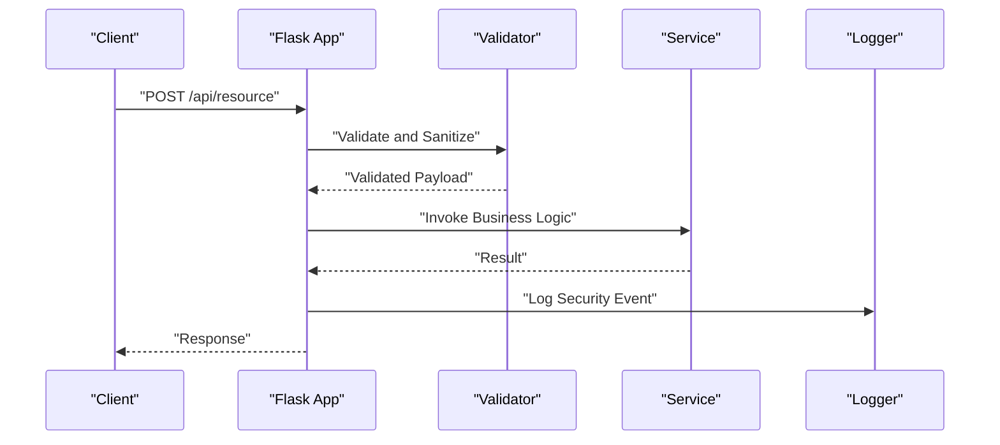

[No sources needed since this diagram shows conceptual workflow, not actual code structure]

### Custom Security Middleware
- Implement middleware for CSRF validation, request signing, and IP allowlisting.
- Attach security headers globally.
- Integrate with monitoring for anomaly detection.

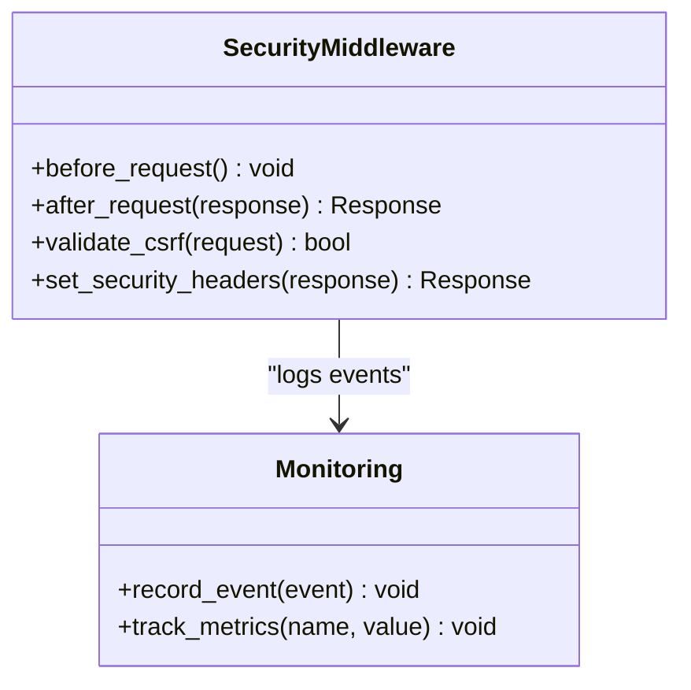

[No sources needed since this diagram shows conceptual workflow, not actual code structure]

### Security Testing and Penetration Testing Guidelines
- Unit and integration tests cover authentication flows, admin access, health checks, and task APIs.
- Perform regular vulnerability scans and dependency audits.
- Conduct periodic penetration tests focusing on injection, XSS, CSRF, and insecure configurations.

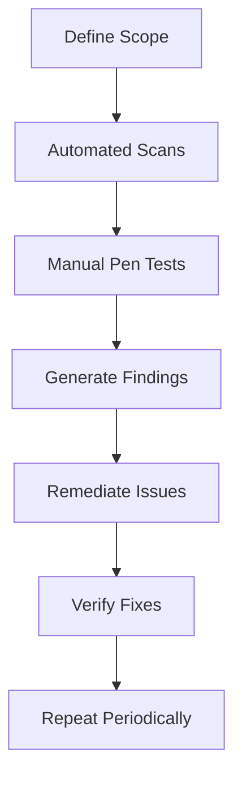

[No sources needed since this diagram shows conceptual workflow, not actual code structure]

**Section sources**
- [test_api_auth.py](file://backend/tests/integration/test_api_auth.py)
- [test_api_admin.py](file://backend/tests/integration/test_api_admin.py)
- [test_api_health.py](file://backend/tests/integration/test_api_health.py)
- [test_api_tasks.py](file://backend/tests/integration/test_api_tasks.py)

## Dependency Analysis
External dependencies relevant to security include libraries for authentication, database access, and monitoring. Review requirements to ensure up-to-date and vetted packages.

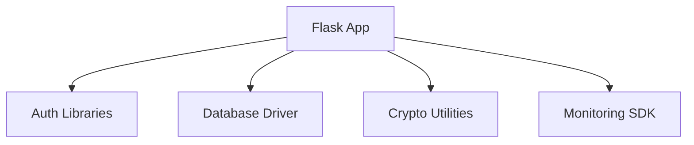

**Diagram sources**
- [requirements.txt](file://backend/requirements.txt)

**Section sources**
- [requirements.txt](file://backend/requirements.txt)

## Performance Considerations
- Minimize overhead of security checks by caching validated contexts where safe.
- Use efficient rate limiting algorithms and backends.
- Avoid heavy cryptographic operations on hot paths; precompute when possible.
- Monitor latency and resource usage to detect anomalies.

[No sources needed since this section provides general guidance]

## Troubleshooting Guide
Common issues and mitigations:
- Authentication failures due to misconfigured secrets or expired tokens: verify configuration and rotate secrets securely.
- CORS errors: ensure allowed origins match client domains exactly.
- Rate limit rejections: adjust thresholds based on legitimate traffic patterns.
- TLS handshake failures: check certificate validity and cipher suite compatibility.
- Database connection errors: confirm credentials and network access.

Operational steps:
- Inspect application logs and monitoring dashboards for security events.
- Reproduce issues with sanitized test cases.
- Validate configuration against deployment manifests.

**Section sources**
- [monitoring.py](file://backend/monitoring.py)
- [config.py](file://backend/config.py)

## Conclusion
Adopting these security best practices strengthens the XSYY Edu platform against common threats. Focus on robust input validation, secure session management, strict authorization, encrypted communications, hardened server configuration, continuous testing, and vigilant monitoring. Regular audits and updates will maintain a resilient security posture.

[No sources needed since this section summarizes without analyzing specific files]

## Appendices

### Security Headers Checklist
- Content-Security-Policy
- X-Frame-Options
- X-Content-Type-Options
- Referrer-Policy
- Permissions-Policy
- Strict-Transport-Security

[No sources needed since this section provides general guidance]

### CORS Policy Setup
- Specify exact allowed origins, methods, and headers.
- Avoid wildcard origins for production.
- Enable preflight caching judiciously.

[No sources needed since this section provides general guidance]

### Certificate Management
- Use automated issuance and renewal.
- Store private keys securely.
- Monitor expiration dates and alert early.

[No sources needed since this section provides general guidance]

### Vulnerability Scanning Practices
- Run static analysis and dependency audits in CI.
- Schedule regular dynamic scans.
- Track and remediate findings promptly.

[No sources needed since this section provides general guidance]