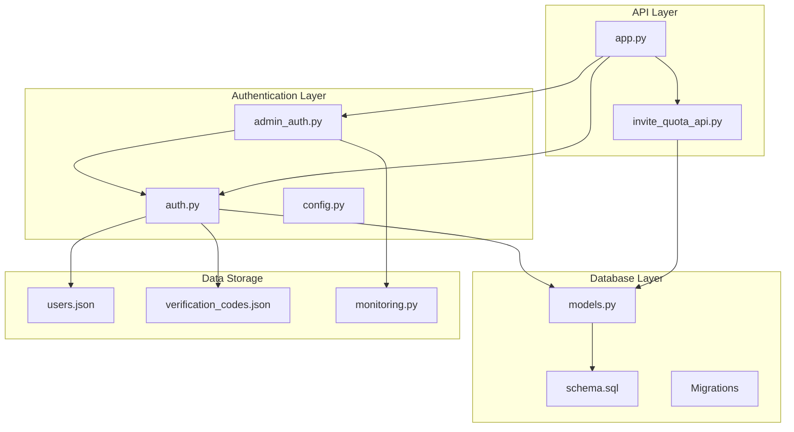
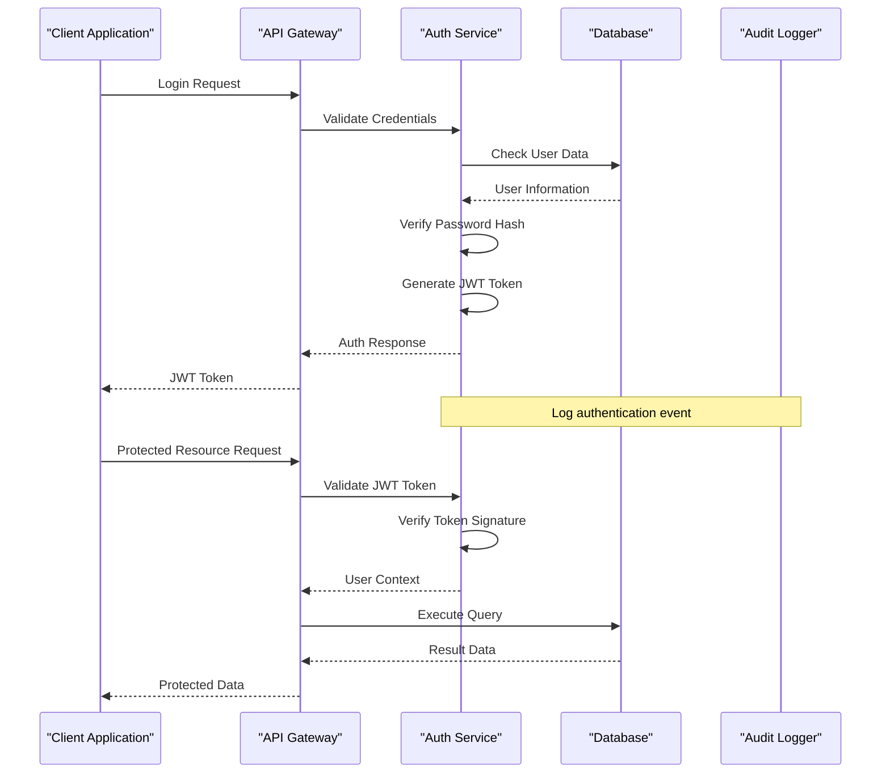
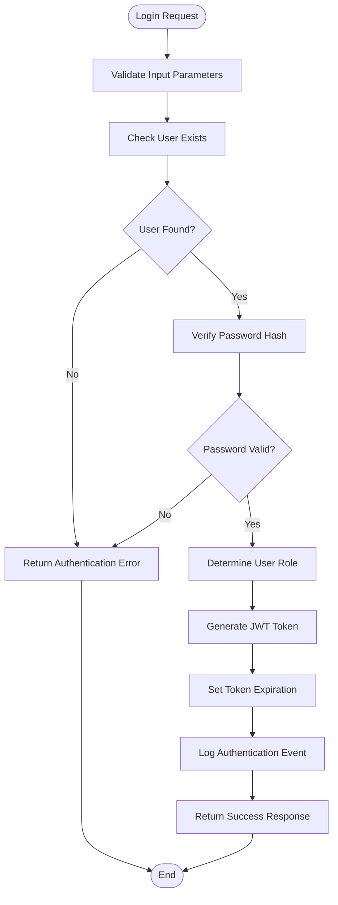
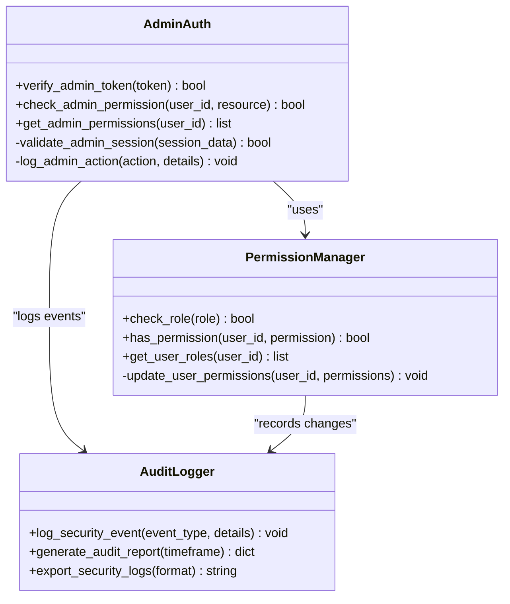
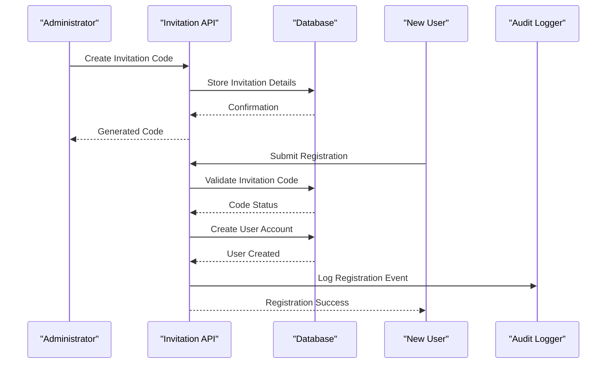
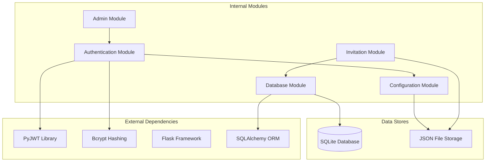

# User Management & Security

<cite>
**Referenced Files in This Document**
- [auth.py](file://backend/auth.py)
- [admin_auth.py](file://backend/admin_auth.py)
- [invite_quota_api.py](file://backend/invite_quota_api.py)
- [config.py](file://backend/config.py)
- [models.py](file://backend/database/models.py)
- [schema.sql](file://backend/database/schema.sql)
- [add_invite_quota_tables.py](file://backend/database/add_invite_quota_tables.py)
- [add_user_profile_fields.py](file://backend/database/add_user_profile_fields.py)
- [users.json](file://backend/users/users.json)
- [verification_codes.json](file://backend/users/verification_codes.json)
- [app.py](file://backend/app.py)
- [monitoring.py](file://backend/monitoring.py)
</cite>

## Table of Contents
1. [Introduction](#introduction)
2. [Project Structure](#project-structure)
3. [Core Components](#core-components)
4. [Architecture Overview](#architecture-overview)
5. [Detailed Component Analysis](#detailed-component-analysis)
6. [Dependency Analysis](#dependency-analysis)
7. [Performance Considerations](#performance-considerations)
8. [Troubleshooting Guide](#troubleshooting-guide)
9. [Conclusion](#conclusion)
10. [Appendices](#appendices)

## Introduction

The XSYY Edu platform implements a comprehensive user management and security system designed to provide secure authentication, role-based access control, invitation-based registration, and quota management for an educational AI teaching platform. The system supports both regular users and administrators with granular permission levels, ensuring that sensitive administrative functions are properly protected while providing a seamless experience for end users.

This documentation covers the complete security architecture including JWT token-based authentication, password hashing mechanisms, session management, invitation and quota systems, audit logging, and security best practices implemented throughout the platform.

## Project Structure

The user management and security functionality is distributed across several key modules:



**Diagram sources**
- [auth.py](file://backend/auth.py)
- [admin_auth.py](file://backend/admin_auth.py)
- [invite_quota_api.py](file://backend/invite_quota_api.py)
- [models.py](file://backend/database/models.py)
- [schema.sql](file://backend/database/schema.sql)

**Section sources**
- [auth.py](file://backend/auth.py)
- [admin_auth.py](file://backend/admin_auth.py)
- [invite_quota_api.py](file://backend/invite_quota_api.py)
- [config.py](file://backend/config.py)
- [models.py](file://backend/database/models.py)

## Core Components

### Authentication System

The authentication system provides JWT token-based authentication with secure password hashing and session management. Key features include:

- **JWT Token Management**: Stateless authentication using JSON Web Tokens for API access
- **Password Hashing**: Secure password storage using industry-standard hashing algorithms
- **Session Handling**: Token expiration and refresh mechanisms
- **Multi-role Support**: Different authentication flows for regular users and administrators

### Role-Based Access Control (RBAC)

The platform implements a comprehensive RBAC system with distinct permission levels:

- **Regular Users**: Basic platform access with limited functionality
- **Administrators**: Full system access with user management capabilities
- **Granular Permissions**: Fine-grained control over specific operations and resources

### Invitation and Quota System

A sophisticated invitation-based registration system controls user access and usage limits:

- **Invitation Codes**: Secure codes for new user registration
- **Quota Management**: Usage tracking and limit enforcement
- **Registration Workflow**: Controlled user onboarding process

**Section sources**
- [auth.py](file://backend/auth.py)
- [admin_auth.py](file://backend/admin_auth.py)
- [invite_quota_api.py](file://backend/invite_quota_api.py)

## Architecture Overview

The security architecture follows a layered approach with clear separation of concerns:



**Diagram sources**
- [auth.py](file://backend/auth.py)
- [app.py](file://backend/app.py)
- [monitoring.py](file://backend/monitoring.py)

## Detailed Component Analysis

### Authentication Module Analysis

The core authentication module handles user login, logout, and token management:

#### Authentication Flow



**Diagram sources**
- [auth.py](file://backend/auth.py)
- [monitoring.py](file://backend/monitoring.py)

#### Security Features

The authentication system implements multiple security layers:

- **Input Validation**: Comprehensive parameter sanitization
- **Rate Limiting**: Protection against brute force attacks
- **Secure Token Generation**: Cryptographically secure JWT tokens
- **Password Security**: Industry-standard hashing with salt
- **Session Management**: Automatic token expiration and refresh

**Section sources**
- [auth.py](file://backend/auth.py)

### Administrative Authentication

Administrative authentication provides enhanced security for admin operations:

#### Admin Access Control



**Diagram sources**
- [admin_auth.py](file://backend/admin_auth.py)
- [monitoring.py](file://backend/monitoring.py)

**Section sources**
- [admin_auth.py](file://backend/admin_auth.py)

### Invitation and Quota System

The invitation system manages user registration through controlled invitation codes:

#### Invitation Workflow



**Diagram sources**
- [invite_quota_api.py](file://backend/invite_quota_api.py)
- [monitoring.py](file://backend/monitoring.py)

#### Quota Management

The system tracks and enforces usage quotas for different user types:

- **Daily Call Limits**: Restriction on AI service usage per day
- **Total Usage Tracking**: Cumulative usage monitoring
- **Quota Reset Logic**: Automated quota renewal
- **Overage Handling**: Graceful degradation when limits exceeded

**Section sources**
- [invite_quota_api.py](file://backend/invite_quota_api.py)

### Database Schema and Data Models

The database layer provides secure data storage and retrieval:

#### User Data Model

```mermaid
erDiagram
USER {
uuid id PK
string username UK
string email UK
string password_hash
enum role
boolean is_active
timestamp created_at
timestamp updated_at
int daily_call_limit
int total_calls
int invite_quota
int used_invites
}
INVITATION_CODE {
uuid id PK
string code UK
uuid created_by FK
int max_uses
int current_uses
boolean is_active
timestamp expires_at
timestamp created_at
}
AUDIT_LOG {
uuid id PK
string event_type
string user_id
string action
text details
ip_address
timestamp created_at
}
VERIFICATION_CODE {
uuid id PK
string code UK
string purpose
string target_email
boolean is_used
timestamp expires_at
timestamp created_at
}
USER ||--o{ AUDIT_LOG : generates
USER ||--o{ INVITATION_CODE : creates
```

**Diagram sources**
- [models.py](file://backend/database/models.py)
- [schema.sql](file://backend/database/schema.sql)

**Section sources**
- [models.py](file://backend/database/models.py)
- [schema.sql](file://backend/database/schema.sql)

### Configuration and Environment Management

Security configuration is centralized and environment-aware:

#### Security Configuration

Key security settings include:

- **JWT Secret Management**: Secure token signing keys
- **Password Policy**: Complexity requirements and rotation policies
- **Session Configuration**: Timeout and security settings
- **Logging Levels**: Granular audit log configuration
- **CORS Settings**: Cross-origin request policies

**Section sources**
- [config.py](file://backend/config.py)

## Dependency Analysis

The security components have well-defined dependencies:



**Diagram sources**
- [auth.py](file://backend/auth.py)
- [admin_auth.py](file://backend/admin_auth.py)
- [invite_quota_api.py](file://backend/invite_quota_api.py)
- [models.py](file://backend/database/models.py)

**Section sources**
- [auth.py](file://backend/auth.py)
- [admin_auth.py](file://backend/admin_auth.py)
- [invite_quota_api.py](file://backend/invite_quota_api.py)
- [models.py](file://backend/database/models.py)

## Performance Considerations

### Authentication Performance

- **Token Caching**: Implement client-side token caching to reduce validation overhead
- **Database Optimization**: Proper indexing on frequently queried user fields
- **Connection Pooling**: Efficient database connection management
- **Memory Management**: Proper cleanup of authentication contexts

### Security Performance

- **Hashing Algorithm Selection**: Balance between security strength and performance
- **Rate Limiting Implementation**: Efficient request throttling without blocking legitimate traffic
- **Audit Log Rotation**: Prevent disk space exhaustion from excessive logging
- **Query Optimization**: Minimize database queries during authentication flows

## Troubleshooting Guide

### Common Authentication Issues

#### JWT Token Problems
- **Token Expiration**: Ensure proper token refresh logic
- **Signature Validation**: Verify secret key configuration
- **Token Format**: Check token encoding and decoding processes

#### Password Authentication Failures
- **Hash Comparison**: Verify password hashing consistency
- **Input Encoding**: Ensure proper character encoding handling
- **Case Sensitivity**: Confirm case-insensitive username/email matching

#### Permission Denied Errors
- **Role Assignment**: Verify user role configuration
- **Permission Checks**: Review permission evaluation logic
- **Resource Access**: Check resource-specific permission rules

### Security Event Monitoring

The audit logging system captures critical security events:

- **Failed Login Attempts**: Track potential brute force attacks
- **Permission Changes**: Monitor privilege escalation attempts
- **Administrative Actions**: Log all admin operations
- **System Configuration Changes**: Track security setting modifications

**Section sources**
- [monitoring.py](file://backend/monitoring.py)
- [auth.py](file://backend/auth.py)
- [admin_auth.py](file://backend/admin_auth.py)

## Conclusion

The XSYY Edu platform implements a robust and comprehensive security architecture that addresses modern web application security requirements. The system provides secure authentication through JWT tokens, implements role-based access control with granular permissions, and includes sophisticated invitation and quota management for controlled user access.

Key security strengths include:

- **Defense in Depth**: Multiple security layers protect against various attack vectors
- **Audit Trail**: Comprehensive logging enables security monitoring and compliance reporting
- **Scalable Design**: Modular architecture supports future security enhancements
- **Industry Standards**: Adherence to established security best practices

The system is designed to be extensible, allowing for custom authentication providers, additional permission models, and enhanced security measures as requirements evolve.

## Appendices

### Security Best Practices Checklist

#### Authentication Security
- [ ] Use HTTPS for all authentication endpoints
- [ ] Implement rate limiting on login attempts
- [ ] Enforce strong password policies
- [ ] Use secure token storage mechanisms
- [ ] Implement proper session timeout handling

#### Authorization Security
- [ ] Apply principle of least privilege
- [ ] Validate permissions on every request
- [ ] Implement CSRF protection for state-changing operations
- [ ] Use parameterized queries to prevent SQL injection
- [ ] Sanitize all user inputs

#### Data Protection
- [ ] Encrypt sensitive data at rest
- [ ] Use secure communication protocols
- [ ] Implement proper error handling to avoid information leakage
- [ ] Regular security audits and penetration testing
- [ ] Keep dependencies updated with security patches

### Custom Authentication Provider Implementation

To extend the authentication system with custom providers:

1. **Implement Authentication Interface**: Create a class implementing the required authentication methods
2. **Register Provider**: Add provider configuration to the authentication manager
3. **Handle Token Generation**: Implement custom token creation logic
4. **Configure Security Settings**: Set appropriate security parameters for the provider
5. **Test Integration**: Verify provider works correctly with existing authorization system

### Permission System Extension

For extending the permission system:

1. **Define New Permission Types**: Create permission categories for new functionality
2. **Update Permission Matrix**: Define role-permission mappings
3. **Implement Permission Checks**: Add permission validation in relevant endpoints
4. **Update UI Components**: Modify interface to reflect new permissions
5. **Add Audit Logging**: Track permission-related events